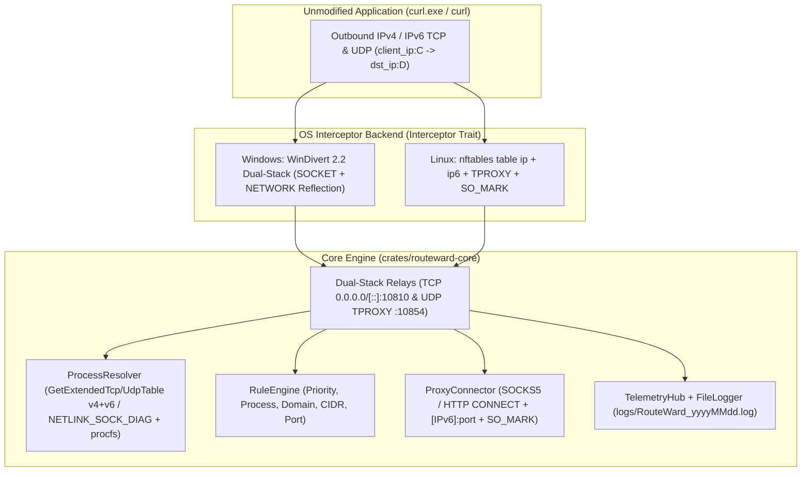

[Français](fr/architecture.md) | English

# RouteWard Architecture

## Overview and Current Status

RouteWard is structured as a Rust workspace with three crates (`routeward-core`, `routeward-cli`, and `routeward-desktop` under `apps/desktop`) and a React + TypeScript frontend (`ui/`).

### Milestone 1 Status (Windows IPv4 TCP Interception)
- **Pluggable `Interceptor` Trait (`routeward-core::interceptor::backend`)**: Abstracts OS packet capture behind the `Interceptor` trait so OS backends (`WinDivertInterceptor` on Windows, `NftablesInterceptor` on Linux) share the same rule engine and proxy connector.
- **WinDivert 2.2 Backend (`routeward-core::interceptor::windivert`)**: Dynamically loads `WinDivert.dll` at runtime via `LoadLibraryExW` and `GetProcAddress` (LGPLv3 dynamic linking compliance; no WinDivert binaries are committed to the repository). The DLL is only loaded from under the executable directory (relative `windivertDllPaths` entries are resolved against it); the `ROUTEWARD_WINDIVERT_DLL_PATH` override is honoured by debug builds only.
- **SOCKET / NETWORK Race Resolution (`routeward-core::interceptor::nat`)**: Opens both `WINDIVERT_LAYER_SOCKET` (sniff/read-only) and `WINDIVERT_LAYER_NETWORK`. If a `SYN` arrives before its `SOCKET` event is cached, RouteWard enqueues the `SYN` in a non-blocking `PendingSynQueue` and resolves the owning PID via `GetExtendedTcpTable` (`tcp_table_fallback`), logging which path resolved the PID (`resolvedVia=socket_layer` or `resolvedVia=tcp_table_fallback`).
- **Loopback Redirection via `streamdump` Reflection**: Redirected IPv4 TCP packets use the reflection technique from the official WinDivert `streamdump` example (`reflect_outbound_to_local_relay` and `reflect_relay_reply_to_client` in `nat.rs`).

### Milestone 2 Status (Linux IPv4 TCP Interception)
- **`nftables` Backend (`routeward-core::interceptor::nftables`)**: Runs as `root` (`geteuid() == 0`) and installs a dedicated table (`table ip routeward`, `chain output`, `type nat hook output priority -100`) that redirects outbound IPv4 TCP connections to the local transparent TCP relay (`0.0.0.0:10810`).
- **Original Destination Recovery**: The transparent listener recovers the pre-DNAT destination IPv4 address and port on accepted sockets via `getsockopt(SOL_IP, SO_ORIGINAL_DST)`. Direct unredirected connections to `127.0.0.1:10810` are rejected and logged.
- **Anti-Loop via `SO_MARK` (`fwmark`)**: All outbound connections opened by RouteWard (both upstream proxy connections and `Direct` rule connections) set `setsockopt(SOL_SOCKET, SO_MARK, linuxFwmark)` (`0x5257` / `21079`) prior to `connect()`. The `nftables` chain starts with `meta mark 21079 return` and `ip daddr 127.0.0.0/8 return`, preventing redirection loops.
- **Process Attribution and Edge Cases (`routeward-core::process`)**: Matches the client source port in `/proc/net/tcp` to obtain the socket inode, then scans `/proc/<pid>/fd` for `socket:[<inode>]`:
  - `Single`: Exactly one process owns the socket (`resolvedVia=procfs_single`).
  - `Shared`: Multiple PIDs share the socket after `fork()` (`resolvedVia=procfs_shared_fork`); RouteWard logs the candidate PIDs and attributes the connection to the primary (lowest) PID.
  - `Unknown`: If the client closes the socket before user-space inspection completes, RouteWard logs the unattributed connection (`resolvedVia=procfs_unknown`) and applies the configurable `securityPolicy.unknownProcessAction` (default `Block`; overridden to `Block` whenever `securityPolicy.killSwitchEnabled` is `true` and the configured action is `Direct`).
- **`Block` Semantics on Linux vs Windows**: Under Windows (`WinDivert`), a `Block` rule never forwards the initial `SYN`: RouteWard injects an inbound TCP `RST|ACK` that answers it (also for the kill switch and DoT/IPv6 port `853` blocks), so the client gets "connection refused" at once instead of a connect timeout. Windows retries the connect after a refusal, so a blocked `curl.exe` fails after about 4 s (measured on Windows Server 2022, against a 10 s connect timeout). Blocked UDP (QUIC `443`, DoQ `853` and UDP `Block` rules) is answered with an injected ICMP Port Unreachable (ICMPv6 for IPv6), except toward multicast (LLMNR, mDNS) and the limited broadcast address 255.255.255.255, which stay silent, and for fragments, which are dropped silently. A directed broadcast such as 192.168.1.255, which NetBIOS often uses, is not recognised and is answered like any unicast address. Injection is best effort and failures are logged (`WinDivertSend failed to inject ...`, rate limited). If the host firewall drops the injected ICMP, the flow falls back to a timeout; the operator adds an allow rule, RouteWard never edits firewall rules. Measured on the Windows Server 2022 test VM (2026-11-20): the injection succeeds but the client still times out (about 1.5 s), so the injected ICMP is dropped on the receive path there; the TCP RST is delivered. Under Linux (`nftables redirect`), the kernel completes the local TCP handshake before user-space accepts the socket; RouteWard immediately sets `SO_LINGER(1, 0)` and closes the socket, sending a `TCP RST` to the client.
- **Fail-Open Watchdog and `routeward cleanup`**: `NftablesInterceptor` spawns a pipe-linked watchdog process (`sh -c "cat >/dev/null; nft delete table ip routeward"`) in its own process group. If `routeward` is killed with `SIGKILL` (`kill -9`), the kernel closes the pipe write-end immediately and the watchdog deletes `table ip routeward`. If the entire process group is killed simultaneously, `routeward cleanup` removes any orphaned `nftables` table (or Windows firewall rule).
- **Known Technical Debt (Milestone 2)**: Scanning `/proc/*/fd` on each accepted connection has complexity `O(processes * fds)`. Replacing or augmenting this lookup with `NETLINK_SOCK_DIAG` or eBPF socket-cookie caching is tracked as post-Milestone-2 optimization debt.

### Milestone 3 - Batch 3.1 Status (Real-Time Telemetry, Cancellation, and Atomic Profile Persistence)
- **Zero Simulated Engine Startup Data**: `RouteWardController::new` starts with an empty Fake-IP table and an empty connection registry; no synthetic DNS entries or connections are pre-seeded at startup.
- **Streaming Byte Counters (`TelemetryCountingStream`)**: Relayed connections (`handle_local_socks5_client` and `handle_transparent_tcp_client`) wrap the upstream socket in `TelemetryCountingStream` so `rx_bytes`, `tx_bytes`, and rolling bandwidth counters are updated continuously on every read/write chunk while the connection is active.
- **Active Connection Termination (`terminate_connection`)**: Each active relayed connection registers a `tokio::sync::watch` cancellation channel in `TelemetryHub`; calling `RouteWardController::terminate_connection(id)` immediately aborts the in-flight `copy_bidirectional` select loop, shuts down both client and upstream sockets, and marks the connection `Closed`.
- **Real-Time Event Broadcast (`tokio::sync::broadcast`)**: `TelemetryHub::subscribe()` exposes a typed broadcast stream of `TelemetryEvent` (`Telemetry`, `ConnectionUpdated`, `ConnectionsCleared`, `Log`, `LogsCleared`) with configurable capacity (`telemetry.eventBroadcastCapacity`).
- **Atomic Profile Persistence (`ProfileConfig::save_to_path`)**: Writes serialized JSON to a temporary sibling file, flushes via `sync_all()`, and atomically renames over the target path.

### Milestone 3 - Batch 3.2 Status (Privileged Daemon, Restricted OS IPC Channel, and Hardened Desktop Bridge)
- **Privilege Separation (`routeward daemon`)**: The privileged packet interception engine runs as a single-instance daemon (`routeward daemon`, launched manually as Administrator on Windows or `root` on Linux), decoupled from the unprivileged desktop UI (`apps/desktop`) and CLI controller (`routeward ctl`).
- **Restricted Local Control Channel (`routeward-core::ipc::transport`)**:
  - **Linux**: Unix domain socket (`/run/routeward/routeward.sock` by default from `configs/system_constants.json`), owned by `root:<unixSocketGroup>` (`routeward`), parent directory mode `0750`, socket mode `0660`. Verifies connecting clients via `SO_PEERCRED` and logs `pid`, `uid`, and `gid`. Fails fast at startup with a clear error if the configured group does not exist or if another daemon instance is already listening.
  - **Windows**: Named Pipe (`\\.\pipe\routeward-daemon`), created with `first_pipe_instance(true)` on the initial instance to prevent pipe squatting, `reject_remote_clients(true)`, and an explicit SDDL security descriptor (`O:BAD:P(A;;GA;;;SY)(A;;GA;;;BA)(A;;0x12019b;;;{user_sid})`) granting access exclusively to `SYSTEM`, `Administrators`, and the user SID that launched the daemon. Hardening details: the ACEs granted to the user SID carry access mask `0x12019b`, which does not include `FILE_CREATE_PIPE_INSTANCE`, so a non-administrator cannot create another instance of the pipe; the production pipe is owned by `BUILTIN\Administrators`; before sending anything, clients verify that the pipe owner is `Administrators`, `SYSTEM` or the current user, and otherwise fail with `errors.daemon.untrusted_pipe_owner`; the daemon itself refuses to start with `errors.daemon.pipe_squatted` when another process already holds the pipe name.
- **Bounded Line-Delimited JSON Protocol (`routeward-core::ipc::protocol`)**:
  - Uses strict deserialization (`#[serde(deny_unknown_fields)]`) on all requests and command payloads; malformed JSON, unknown fields, or unknown commands return a structured `IpcResponse` error and never panic.
  - Enforces a configurable line length cap (`ipc.maxLineBytes`, default `8388608`, i.e. 8 MiB) and idle timeout (`ipc.idleTimeoutMs`, default `30000` ms) prior to allocation.
  - Converts `broadcast::error::RecvError::Lagged(skipped)` on subscribed event streams into an `IpcStreamEvent::Resync` notification and logs a `WARN` event so clients reload full state.
- **Fixed System Profile Path & Ownership/ACL Verification (`routeward-core::config::security`)**:
  - On Windows, the `ProgramData` path is resolved via `SHGetKnownFolderPath(FOLDERID_ProgramData)` (never from environment variables). When `%ProgramData%\RouteWard` and `active_profile.json` are created, they receive protected DACLs without inheritance (`D:P(A;OICI;FA;;;SY)(A;OICI;FA;;;BA)` on the directory and `D:P(A;;FA;;;SY)(A;;FA;;;BA)` on the file, with no `BU` / `Users` access) and owner `Administrators` so proxy credentials stored in the profile cannot be read by standard users. At startup, the daemon verifies that both the directory and `active_profile.json` are owned by `SYSTEM` or `Administrators` and that no DACL entry grants read or write access to any other principal; otherwise it refuses to start without loading the profile.
  - On Linux, `/etc/routeward` (`0700`) and `/etc/routeward/active_profile.json` (`0600`) must be owned by `root` (`uid 0`) and must not grant any read, write, or execute permission to group or others (`(mode & 0o077) == 0`); otherwise the daemon refuses to start.
  - **Proxy Password Redaction (`ProxyCredentials`)**: Cleartext proxy passwords (`ProxyCredentials.password`) are never returned in IPC responses (`GetState`, `GetProfile`, `ReplaceProfile`); the daemon strips `password` (`None`) and sets `"hasPassword": true/false`. On IPC writes (`UpsertProxy`, `ReplaceProfile`), an omitted `password` field (`None`) preserves the existing password stored in the daemon, whereas a provided `password` replaces it. `Debug` formatting on `ProxyCredentials` and invalid proxy URI errors redact credentials as `[REDACTED]`.
  - Note on Windows Named Pipe elevation: the daemon must be started by elevating the desktop user's own account; elevating with a different administrator account binds the pipe DACL to that other account's SID and prevents the desktop UI from connecting.
- **Hardened Desktop Loopback Bridge (`apps/desktop`)**: Connects to the daemon via `IpcClient` (reporting `daemonConnected: false, running: false` and auto-reconnecting in the background if the daemon stops), injects an ephemeral startup token into the WebView (`window.__ROUTEWARD_TOKEN__`), and enforces constant-time token verification (`constant_time_eq`) plus strict `Host` (`127.0.0.1:<port>`) and `Origin` (`http://127.0.0.1:<port>`) header validation on `/api/*`. The WebView only navigates within the loopback UI origin (`http://127.0.0.1:<port>`); any other navigation is cancelled, and new windows are blocked.

### Milestone 3 - Batch 3.3 Status (End-to-End Frontend Wiring, Authenticated SSE Stream, and Startup Cleanup)
- **Zero Frontend Simulation (`ui/src/services/ipc.ts` & `ui/src/App.tsx`)**: All simulated traffic generators, synthetic presets (`SIMULATION_PRESETS`), and `Math.random` telemetry mocks have been removed from `ui/`. Every UI action and view (`DashboardView`, `ConnectionsView`, `RulesView`, `ProxiesView`, `ChainsView`, `DnsManagerView`, `LogsView`, `QuickSetupWizardModal`) communicates with the privileged daemon through the hardened loopback bridge, sending `window.__ROUTEWARD_TOKEN__` in the `X-RouteWard-Token` header on every request.
- **Header-Authenticated Real-Time Stream (`GET /api/events`)**: Rather than using `EventSource` (which cannot set custom headers) or placing the token in a URL query string, `ui/src/services/ipc.ts` consumes the Server-Sent Events stream via `fetch` + `ReadableStream` (`response.body.getReader()`) with the `X-RouteWard-Token` header. Upon initial connection, reconnection, or receipt of an `IpcStreamEvent::Resync` frame, the frontend reloads full state (`GET /api/state`) before resuming incremental updates.
- **Daemon Disconnection & Privilege Banners (`ui/src/App.tsx`)**: When the daemon is unreachable (`!diagnostics.daemonConnected`), the UI displays a persistent localized banner with the platform command to start `routeward daemon`, sets engine status to stopped, zeroes live throughput rates, marks active connections as `closed`, and automatically resynchronizes when the daemon comes online. If a connected daemon reports `!diagnostics.elevatedPrivileges`, a dedicated warning banner is displayed.
- **Write-Only Proxy Password Handling (`ui/src/components/ProxiesView.tsx`)**: Proxy cards display a localized `"Password Set"` badge when `auth.hasPassword` is true. Editing a proxy leaves the password field write-only: omitting a new password preserves the existing secret in the daemon, while an explicit `"Replace Password"` action allows rotating the secret without ever exposing or logging cleartext passwords in the browser.
- **Automatic Orphaned-Rule Cleanup at Daemon Startup (`crates/routeward-cli/src/main.rs`)**: Right after `DaemonIpcService::bind` succeeds (ensuring no other daemon instance is active), `routeward daemon` invokes `controller.cleanup_orphaned_rules()` to remove any orphaned Windows firewall rule (`RouteWard_TransparentRelay_*`) or Linux `nftables` table (`table ip routeward`) left by a previous crash, logging the result at `INFO` level.
- **Dedicated Daemon & User Log Paths (`routeward-core::config`)**: Privileged daemon processes (`routeward daemon`, `routeward run`, `routeward cleanup`) write logs to `%ProgramData%\RouteWard\logs` on Windows (via `SHGetKnownFolderPath(FOLDERID_ProgramData)`) and `/var/log/routeward` on Linux. Unprivileged desktop and CLI processes (`routeward-desktop`, `routeward ctl`) write logs to `%LOCALAPPDATA%\RouteWard\logs` on Windows (via `SHGetKnownFolderPath(FOLDERID_LocalAppData)`) and `$XDG_STATE_HOME/routeward/logs` (or `~/.local/state/routeward/logs`) on Linux, never depending on the process working directory (`CWD`).

### Milestone 4 - Batch 4.0 Status (Kill-Switch Enforcement)
- **Strict Kill-Switch (`securityPolicy.killSwitchEnabled = true`, default)**: While the interception engine is running and `killSwitchEnabled` is `true`, any flow routed to a `Proxy` or `Chain` whose upstream connection fails (connection refused, connect/handshake timeout, authentication failure, broken multi-hop `Sequence` chain, or a group where all enabled nodes fail) is strictly blocked and **never** exits as `Direct`:
  - Records a `TrackedConnection` in `TelemetryHub` with `status = Blocked` (`"blocked"`) and `routeLabel = "BLOCKED"` (incrementing `blocked_count`).
  - Emits a `WARN` log entry containing the rule name and upstream error reason (`Kill-Switch blocked connection ...` on the transparent TCP relay; `Kill-Switch blocked local SOCKS5 connection ...` on the local SOCKS5 relay).
  - Cleanly terminates the client connection: sends a SOCKS5 general failure reply (`0x05, 0x01, ...`) followed by socket shutdown on the local SOCKS5 relay (`127.0.0.1:10808`), shuts down the client stream and removes the NAT session on the Windows transparent relay, and sends a `TCP RST` (`SO_LINGER(1, 0)`) on the Linux `nftables` transparent relay.
- **Explicit Direct Fallback When Disabled (`securityPolicy.killSwitchEnabled = false`)**: When `killSwitchEnabled` is explicitly set to `false` and an upstream `Proxy` or `Chain` fails, RouteWard logs a `WARN` entry (`Upstream proxy failed ...; falling back to DIRECT because killSwitchEnabled=false`), opens a `Direct` outbound connection, and records the connection with `routeLabel = "DIRECT"`.
- **Smart Group Failover (`Failover`, `LowestLatency`, `LoadBalance`)**: Groups iterate only across enabled proxy nodes configured in the group (`ProxyConnector::connect_group`). If an individual node fails, the group attempts the next candidate proxy in the group; if all nodes in the group fail and `killSwitchEnabled` is `true`, the flow is blocked and never falls back to `Direct`.
- **Daemon Stop / Crash Behaviour**: A clean stop (`ctl stop`, `routeward cleanup`, service stop) removes the OS interception rules and never leaves the network blocked. A crash or kill (`SIGKILL` / `Stop-Process -Force`) depends on the platform and on the kill switch:
  - **Linux, `securityPolicy.killSwitchEnabled = true`**: the host fails closed. RouteWard removes its interception rules and installs the nftables table `inet routeward_ks`, which drops all outgoing traffic except loopback, already-established connections, DHCP (IPv4/IPv6), IPv6 neighbour discovery and MLD. Under systemd the daemon is restarted after the crash (`Restart=on-failure`) but with interception stopped, so it does not remove the table: traffic stays blocked until `sudo routeward cleanup --force` is run, interception is started again with `routeward ctl start`, or the service is restarted cleanly with `sudo systemctl restart routeward`. Under systemd, `ExecStopPost` runs `routeward cleanup --force --fail-closed-on-crash`, which applies the same rule when the service result is not `success`. Inspect it with `sudo nft list table inet routeward_ks`.
  - **Linux, kill switch off**: a crash fails open, as in Milestones 1-3.
  - **Windows**: a crash still fails open. There is no persistent filter yet, so the kill switch only protects the network while the daemon is alive.
- **Active Directory & Split-Horizon DNS Bypass (`dnsConfig.bypassDomains`)**: In Active Directory and enterprise split-horizon environments, internal domain suffixes, private zones, and reverse zones (for example `*.ad.company.tld`, `*.internal`, `*.local`, `10.in-addr.arpa`, `168.192.in-addr.arpa`, `*.ip6.arpa`) are configured in `dnsConfig.bypassDomains` so they resolve directly against the local/domain DNS without Fake-IP allocation or remote proxy tunneling.
- **Deferred at Batch 4.0 (Implemented Below)**: Transparent DNS capture (Batch 4.1), UDP relay (Batch 4.2), and dual-stack IPv6 interception (Batch 4.3).

### Milestone 4 - Batch 4.0.1 Status (Indirect Leak Closure)
- **Windows `PendingSynQueue` Expiration Policy (`routeward-core::interceptor::nat` & `windivert`)**:
  - When `securityPolicy.killSwitchEnabled = true` (default) and PID resolution for a queued `SYN` exceeds `pendingSynTimeoutMs` (`40` ms), RouteWard **drops** the `SYN` without reinjecting it (`WinDivertSend` is not called) and sends no reply. The client TCP stack naturally retransmits the `SYN` (~1 s later), by which time PID attribution has completed. Each dropped `SYN` increments `dropped_unattributed_syn_count` and logs an `INFO` entry (`Dropped unattributed Pending SYN #<count> after <ms>ms ...`).
  - When `securityPolicy.killSwitchEnabled = false`, RouteWard preserves the fail-open reinjection behavior, increments `reinjected_unattributed_syn_count`, and logs a `WARN` entry (`Released unattributed Pending SYN #<count> after <ms>ms ...`).
- **Unattributed Process Policy (`securityPolicy.unknownProcessAction`)**:
  - The default value of `securityPolicy.unknownProcessAction` in `configs/default_profile.json` and `SecurityPolicyConfig::default()` is now `Block` (`{ "type": "block" }`).
  - Whenever `securityPolicy.killSwitchEnabled = true`, any unattributed socket (`ProcessAttribution::Unknown`, unreadable process image `pid:<n>`, or unattributed local SOCKS5 client) whose configured `unknownProcessAction` is `Direct` (or absent) is overridden to `Block` and logged at `WARN` level (`SecurityPolicy:unknownProcessAction(KillSwitchOverride)`).
  - Unreadable/exited process images (`pid:<n>`) are never cached in `ProcessResolver`.
- **Unmapped / Expired Fake-IP Guard (`routeward-core::dns` & `interceptor`)**: Any connection targeting an IPv4 address inside the configured `fakeIpCidr` (`198.18.0.0/15`) that has no live non-expired domain mapping is blocked (`FakeIP:UnmappedOrExpired`) and logged at `WARN` level instead of falling through to `Direct`.
- **Windows Trailing Relay Packet Guard (`windivert.rs`)**: Outbound reply packets originating from the local transparent relay port (`10810`) after the corresponding `NatSessionEntry` has been removed are dropped instead of falling through to `WinDivertSend`.

### Milestone 4 - Batch 4.1 Status (Transparent DNS Interception, Fake-IP, Real DNS-over-TCP, and Enterprise Bypass)
- **Outbound Port 53 Interception (UDP & TCP)**:
  - **Linux (`nftables.rs`)**: `table ip routeward` redirects outbound UDP port `53` (`udp dport 53 redirect to :10853`) and TCP port `53` (`tcp dport 53 redirect to :10853`) to RouteWard's local UDP and TCP DNS listeners (`0.0.0.0:10853`). OS DNS services (`systemd-resolved`) are never excluded from DNS redirection; process-level rule matching happens at connection time via Fake-IP domain recovery. Port 53 traffic of the user ids of recognised DNS server daemons (`named`, `unbound`, `dnsmasq`, ...) is returned before the redirect through the `dns_server_uids` set.
  - **Windows (`windivert.rs`)**: Intercepts outbound IPv4 UDP port `53` packets (resolving in-memory via `resolve_dns_query_fast` or asynchronously via `resolve_dns_query_async`, forging the IPv4+UDP reply with `build_forged_ipv4_udp_reply`, and reinjecting it inbound via `WinDivertSend`) and reflects outbound IPv4 TCP port `53` flows to the transparent TCP relay (`:10810`), which delegates destination port `53` connections to `handle_dns_tcp_stream`. The OS DNS client (`svchost.exe`/`Dnscache`) is never excluded. A DNS server process on the host (`dns.exe` of the Windows DNS Server role, `named`, `unbound`, `dnsmasq`, ...) is the exception: its own recursion is passed through unmodified so that it receives real answers instead of Fake-IP ones (see `dnsConfig.dnsServerProcesses` and the troubleshooting guide, section "Host Is a DNS Server").
- **Custom Safe Rust RFC 1035 Wire Codec (`routeward-core::dns::codec`)**: `#![forbid(unsafe_code)]` parser and builder supporting `A`, `AAAA`, `CNAME`, `PTR`, `TXT`, and EDNS0 `OPT` payload sizes, pointer compression (`0xC0`) with strict bounds and loop protection (maximum 16 jumps), UDP truncation (`TC = 1` when exceeding 512 bytes or the client's EDNS0 payload limit), and 2-byte big-endian DNS-over-TCP framing.
- **Fake-IP Mode (`dnsConfig.enableFakeIp = true`, default)**:
  - `A` queries return a synthetic IPv4 from `fakeIpCidr` (`198.18.0.0/15`) with a short **5-second OS wire TTL** (`dns.osResponseTtlSeconds = 5`) so OS stub caches expire quickly after daemon stop, while the internal `FakeIpEngine` table retains the mapping for `300` seconds (`dns.defaultTtlSeconds = 300`).
  - `AAAA` queries return **`NODATA`** (`RCODE = 0 NOERROR`, `ANCOUNT = 0`) so dual-stack applications immediately connect over IPv4 using the allocated Fake-IP.
  - Reverse `PTR` queries for addresses inside `198.18.0.0/15` return the mapped domain name.
  - When an application subsequently connects to a Fake-IP, RouteWard recovers the original domain name, evaluates routing rules against both process identity and domain patterns, and passes the domain name to the upstream proxy (`ATYP = 0x03` in SOCKS5, hostname in HTTP `CONNECT`). If the matched rule is `Direct`, RouteWard resolves the real IPv4 address directly via `resolve_host_direct_ipv4` (anti-loop protected) before opening the direct connection.
- **Real DNS Resolution via Proxy (`dnsConfig.enableFakeIp = false` or non-A/AAAA queries)**:
  - Executes **DNS-over-TCP** through the proxy/chain selected by routing rules.
  - When `securityPolicy.strictDnsNoLocalFallback = true` (default) or `killSwitchEnabled = true` and the proxy fails, RouteWard returns **`SERVFAIL` (`RCODE = 2`)**, logs a `WARN` entry, and **never** falls back to cleartext DNS.
- **Enterprise Active Directory & Split-Horizon Direct DNS Bypass**:
  - In corporate Active Directory environments, internal domain controllers (`_ldap._tcp.dc._msdcs.<domain>`), Kerberos realms, and split-horizon intranet zones must be resolved directly against the internal DNS servers configured on the machine rather than receiving a Fake-IP or being tunneled through an external proxy.
  - RouteWard resolves bypassed domains directly (with `SO_MARK` on Linux and `SelfPortGuard` on Windows to prevent interception loops) toward the DNS server that the OS originally targeted (`orig_resolver` / system nameservers):
    1. User-configured `dnsConfig.bypassDomains`
    2. Automatically detected machine primary DNS suffix and DNS search list (Active Directory domain via `USERDNSDOMAIN` and `HKLM\SYSTEM\CurrentControlSet\Services\Tcpip\Parameters` `Domain` / `NV Domain` / `SearchList` on Windows; `/etc/resolv.conf` `domain` and `search` directives on Linux)
    3. Single-label hostnames (names without a dot)
    4. `.local` and `.localhost`
    5. Private reverse lookup zones (`10.in-addr.arpa`, `168.192.in-addr.arpa`, `16.172.in-addr.arpa`..`31.172.in-addr.arpa`, `127.in-addr.arpa`, `254.169.in-addr.arpa`, IPv6 ULA `c.f.ip6.arpa`/`d.f.ip6.arpa`, and IPv6 link-local `8..b.e.f.ip6.arpa`).
- **Bootstrap Resolution for Domain-Named Upstream Proxies**: If an upstream proxy node is configured with a hostname rather than an IP literal, RouteWard resolves its IPv4 address(es) directly (`bootstrap_resolve_proxy_hosts` / `prepare_proxy_node_with_bootstrap`) without Fake-IP or loops and registers the resolved `(ip, port)` pairs in `nat_table.upstream_endpoints()` for anti-loop exclusion.
- **Encrypted DNS Bypass Protection (`securityPolicy.blockEncryptedDnsBypass = true`, default) & IPv6 DNS Blocking**:
  - Returns **`NXDOMAIN` (`RCODE = 3`)** (logged at `WARN`) for the Mozilla DoH canary domain (`use-application-dns.net`) so browsers fall back to the OS DNS resolver.
  - Blocks outbound **DoT / DoQ port `853`** (both TCP and UDP) and logs `WARN`.
  - Until full IPv6 interception in Batch 4.3, when `killSwitchEnabled = true`, blocks outbound **IPv6 port `53` and port `853`** (UDP and TCP) on both Windows (`WinDivert` drop) and Linux (`table ip6 routeward` `reject` / `reject with tcp reset`, guarded by the same fail-open watchdog and `routeward cleanup`), forcing immediate fallback to IPv4 DNS.
- **Privacy-Preserving DNS Logging**: Ordinary DNS queries and Fake-IP allocations are logged exclusively at `DEBUG` level (never `INFO`), keeping telemetry and daily log files free of per-query noise while exposing active Fake-IP allocations via `routeward ctl fake-ips` (`ctl flush-fake-ips`) and the UI DNS tab. DNS errors (`SERVFAIL`, unreachable proxy, blocked DoT/canary) are logged at `WARN`.

### Milestone 4 - Batch 4.1.1 Status (DNS Leak Closure, TLS SNI Inspection, OS Cache Flush, and Live Policy Reload)
- **Strict Internal-Only DNS Resolution for Bypassed Domains (`DnsResolverMode::BypassOnlySystem`)**:
  - Domains matching `dnsConfig.bypassDomains`, Active Directory / machine DNS suffixes, single-label names, `.local`/`.localhost`, or private reverse zones **never** query `upstreamDns`, `default_upstream`, or `fallback_dns_server`.
  - They query exclusively `orig_resolver`, `last_seen_orig_resolver`, and active system resolvers (`GetAdaptersAddresses` on Windows; `/etc/resolv.conf` on Linux, automatically falling back to `/run/systemd/resolve/resolv.conf` when `/etc/resolv.conf` only contains the `127.0.0.53` stub). If no internal resolver responds, RouteWard returns **`SERVFAIL` (`RCODE = 2`)** and never contacts a public resolver.
- **Unconditional IPv6 Port 53 and Port 853 Blocking**:
  - Until full IPv6 interception in Batch 4.3, outbound IPv6 UDP and TCP traffic on ports `53` and `853` is blocked whenever the engine is running, independently of `securityPolicy.killSwitchEnabled`, on both Linux (`table ip6 routeward`) and Windows (`WinDivert`).
- **System-First Resolution for `Direct` Flows (`DnsResolverMode::DirectPreferSystem`)**:
  - When resolving a non-bypassed domain for a `Direct` flow (`resolve_host_direct_ipv4_all` or a `Direct` DNS rule), RouteWard queries `orig_resolver`, `last_seen_orig_resolver`, and active system resolvers (`GetAdaptersAddresses` on Windows; `/etc/resolv.conf` / `/run/systemd/resolve/resolv.conf` on Linux) before considering `upstreamDns`. `upstreamDns` is only used if no system or previously observed `orig_resolver` exists, and **never** for a bypassed domain.
- **Automatic OS DNS Resolver Cache Flush on Engine Start and Stop (`dns::flush_os_dns_cache`)**:
  - On engine startup (`start_engine`) and shutdown (`stop_engine`), RouteWard flushes the OS client DNS cache (`dnsapi.dll!DnsFlushResolverCache` with fallback to `ipconfig /flushdns` on Windows without touching the Windows DNS Server role; `resolvectl flush-caches` on Linux when `systemd-resolved` is active, otherwise ignored with a `DEBUG` log).
- **TLS `ClientHello` SNI Inspection on the Transparent TCP Relay (`peek_tls_client_hello_sni`)**:
  - When a transparent TCP connection targets a non-Fake-IP literal IPv4 address on port `443` (`network.tlsSniDefaultPort`), RouteWard peeks the initial payload (bounded by `network.tlsSniPeekTimeoutMs = 200` ms and `network.tlsSniMaxBytes = 4096` bytes without consuming bytes from the socket) and extracts the TLS `ClientHello` SNI via `TlsSniExtractor`.
  - If an SNI hostname is present, routing rules are re-evaluated with both the SNI hostname and destination IP; if routed to a `Proxy` or `Chain`, the extracted SNI domain is sent to the upstream proxy (`ATYP = 0x03`) and the full `ClientHello` is forwarded intact. On Windows, `WinDivertInterceptor` also reflects port `443` `Direct` SYNs to the transparent relay when domain rules are enabled so SNI inspection can upgrade them to `Proxy`, `Chain`, or `Block`.
- **Atomic Live Reload of `securityPolicy`, `dnsConfig`, and `proxies` (`Interceptor::reload`)**:
  - Modifying `securityPolicy`, `dnsConfig`, or `proxies` via `replace_profile` (`routeward ctl replace-profile` or the UI) while the engine is running atomically reapplies active interception rules (`nft -f -` single-transaction replacement of `table ip` and `table ip6` on Linux; opening the new `WinDivert` network handle before closing the old handle on Windows) and re-runs proxy bootstrap without restarting the engine or entering a permissive window. Logged at `INFO`.
- **Full Fake-IP Pool Eviction and `SERVFAIL` Guard (`FakeIpEngine::evict_oldest`)**:
  - When the Fake-IP pool reaches capacity (`dns.maxCacheEntries`), RouteWard first evicts expired entries (`evict_expired`) and then evicts the oldest entry (`evict_oldest`). If allocation still fails, RouteWard returns **`SERVFAIL` (`RCODE = 2`)** and never falls back to cleartext DNS.

### Milestone 4 - Batch 4.2 Status (UDP Relay, QUIC Rejection, Local Name Guards, and Transparent IPv4 UDP Interception)
- **Batch 4.2.a - SOCKS5 `UDP ASSOCIATE`, Local SOCKS5 UDP Relay, QUIC (`UDP 443`) Rejection, and LLMNR/mDNS/NetBIOS Guards**:
  - **`UdpAssociationManager` (`routeward-core::proxy::udp`)**: Implements RFC 1928 `UDP ASSOCIATE` (`CMD = 0x03`) and RFC 1928 §7 UDP datagram framing (`RSV=0x0000`, `FRAG`, `ATYP` `0x01`/`0x03`/`0x04`). Associations are indexed by `(client_socket_addr, proxy_id)` with configurable idle timeout (`udp.associationIdleTimeoutSeconds = 60` s) and capacity (`udp.maxConcurrentAssociations = 256`).
  - **Per-Datagram Rule Evaluation & Multi-Node Group Failover**: Every outbound UDP datagram evaluates `RuleEngine::evaluate` against its own destination (`ATYP = 0x03` domain name or Fake-IP reverse lookup + target port). Two datagrams sent from the same client socket toward different destinations can follow different rules (`Proxy`, `Direct`, `Block`). If a proxy node returns `REP = 0x07` (`Command not supported`) or fails during `UDP ASSOCIATE`, groups (`Failover`, `LowestLatency`, `LoadBalance`) fail over to the next enabled node; if no node succeeds and `killSwitchEnabled = true`, the datagram is blocked (`status = Blocked`, `routeLabel = "BLOCKED"`).
  - **Fragmented UDP Policy**: Fragmented SOCKS5 UDP frames (`FRAG != 0`) and fragmented IPv4 UDP packets (`MF != 0 || frag_offset != 0`) are never reassembled in v1; when matched by a `Proxy`/`Chain` rule with `killSwitchEnabled = true`, they are blocked with a counter and rate-limited `WARN` log (`Direct` fragments pass). On Windows, the first fragment of a fragmented UDP datagram follows the rule decision and its verdict is remembered for the remaining fragments for a bounded time (`udpFragmentVerdictTtlMs`, `maxUdpFragmentVerdicts`): fragments of proxied flows are dropped when the kill switch is on, and fragments of `Direct` flows pass.
  - **Windows Capture Filter and UDP Fragments**: the `WINDIVERT_LAYER_NETWORK` filter also captures outbound UDP IPv4 fragments (`ip.FragOff != 0 and ip.Protocol == 17`) and IPv6 packets whose next header is a fragment header. Later fragments replay the verdict of the first fragment; an orphan later fragment (no remembered first fragment) is dropped when `killSwitchEnabled = true` and reinjected otherwise. Known limit: IPv6 later fragments whose fragment header does not directly follow the IPv6 header (it sits behind a Hop-by-Hop or Destination Options header) are not captured by this filter.
  - **QUIC (`UDP 443`) Rejection (`securityPolicy.blockQuicUdp443 = true`, default)**:
    - **Linux**: `nftables` `udp dport 443 reject` (sends `ICMP Port Unreachable` immediately) plus user-space rate-limited `WARN` logging and blocked connection telemetry.
    - **Windows**: `WinDivert` drops the outbound `UDP 443` packet and injects an inbound `ICMPv4 Destination Unreachable / Port Unreachable` (`Type 3, Code 3`) via `build_forged_ipv4_icmp_port_unreachable` (recomputing both inner quoted IPv4+UDP checksums and outer IPv4+ICMPv4 checksums). Note: Windows `tcpip.sys` / WFP (`FWPM_LAYER_INBOUND_ICMP_ERROR_V4`) may still ignore synthetic inbound ICMP errors when the outbound UDP packet was dropped at `WINDIVERT_LAYER_NETWORK` before WFP completed outbound flow state creation.
  - **LLMNR (`UDP 5355`), mDNS (`UDP 5353`), and NetBIOS-NS (`UDP 137`) Guards**:
    - LLMNR and mDNS queries for local names (single-label names, `.local`, Active Directory / machine DNS suffixes, `dnsConfig.bypassDomains`, private reverse zones) are allowed directly; queries for public FQDNs are blocked (`LocalNameGuard:LLMNR` / `LocalNameGuard:mDNS`) with a rate-limited `WARN` log.
    - NetBIOS-NS (`UDP 137`) toward private/link-local/broadcast IPv4 addresses is allowed directly; toward public unicast IPv4 addresses it is blocked (`LocalNameGuard:NetBIOS-NS`) with a rate-limited `WARN` log.
- **Batch 4.2.b - General Transparent IPv4 UDP Interception (`Linux TPROXY` & `Windows WinDivert`)**:
  - **Linux (`TPROXY` in `routeward-core::interceptor::nftables` & `mod.rs`)**:
    - Outbound IPv4 UDP packets (excluding `SO_MARK = linuxFwmark`, loopback `127.0.0.0/8`, configured/bootstrapped upstream proxies, and non-LLMNR/mDNS multicast/broadcast) are marked in `chain route_output` (`type route hook output priority -150`, `meta mark set <linuxTproxyFwmark>`) and routed to `lo` via `ip rule add fwmark <linuxTproxyFwmark> lookup <linuxTproxyRouteTable> priority <linuxTproxyRulePriority>` and `ip route add local 0.0.0.0/0 dev lo table <linuxTproxyRouteTable>`.
    - `chain prerouting` (`type filter hook prerouting priority -150`) intercepts marked packets via `meta l4proto udp meta mark <linuxTproxyFwmark> tproxy to 127.0.0.1:10854 accept`.
    - At startup, `NftablesInterceptor` verifies that `linuxTproxyFwmark`, `linuxTproxyRouteTable`, and `linuxTproxyRulePriority` (configured in `configs/system_constants.json`) are not already in use; if occupied, it logs an error and refuses to start interception without overwriting existing host routing rules.
    - The TPROXY UDP socket (`127.0.0.1:10854`) sets `IP_TRANSPARENT` and `IP_RECVORIGDSTADDR`, recovers the original destination per datagram via `recvmsg` (`SOL_IP` / `IP_ORIGDSTADDR`), attributes the owning process via `/proc/net/udp` (`resolve_by_local_udp_port`), and injects replies back to the client via `SOCK_RAW` + `IP_HDRINCL` + `SO_MARK` with the remote server's source IP/port (or the Fake-IP originally targeted by the client).
    - Authorized LLMNR (`5355`) and mDNS (`5353`) queries pass through `TPROXY` and are forwarded via `send_raw_ipv4_udp_packet` (`SOCK_RAW` + `IP_HDRINCL` + `SO_MARK`), preserving the client's original source IP and source port (`5353` for RFC 6762 compliant mDNS).
    - Watchdog, `stop`, hot `reload`, and `routeward cleanup` remove the exact `ip rule` and local route installed by RouteWard in addition to `table ip routeward` and `table ip6 routeward`.
  - **Windows (`WinDivert` in `routeward-core::interceptor::windivert` & `nat.rs`)**:
    - Extends `WINDIVERT_LAYER_SOCKET` to `"outbound and !loopback and (tcp or udp)"` and `WINDIVERT_LAYER_NETWORK` to capture all outbound IPv4 UDP packets (excluding loopback, self-ports, and upstream proxies).
    - Resolves process attribution via `SOCKET`-layer cache with fallback to `GetExtendedUdpTable` (`resolve_by_local_udp_port`). If a first outbound UDP datagram arrives before `SOCKET` attribution completes, it is queued in the bounded `PendingUdpQueue` (`pendingUdpTimeoutMs = 40` ms, `maxPendingUdpPackets = 256`); on expiration, it is dropped (`INFO` log + counter) when `killSwitchEnabled = true` or reinjected (`WARN` log + counter) when `false`.
    - Evaluated per datagram: `Block` drops the packet; `Direct` reinjects outbound (or translates a Fake-IP to its real IPv4 via `send_and_optional_recv_udp_direct_protected` and reinjects the reply with the Fake-IP as source); `Proxy`/`Chain` relays via `UdpAssociationManager::send_datagram` and reinjects upstream UDP replies inbound via `build_forged_ipv4_udp_reply` + `WinDivertSend` with the remote server's source IP/port (or Fake-IP).

### Milestone 4 - Batch 4.3 Status (Dual-Stack IPv6 Interception, Linux `NETLINK_SOCK_DIAG`, and Modular Refactoring)
- **Full Dual-Stack IPv4 + IPv6 Transparent TCP, UDP, and DNS Interception**:
  - **`TransparentNatTable` (`routeward-core::interceptor::nat`)**: Generalizes NAT reverse mappings (`IpAddr`), pending SYN/UDP queues (`PendingSynQueue<T, M>`, `PendingUdpQueue<T, M>`), checksums, and synthetic ICMPv6 Port Unreachable / IPv6 UDP reply forging alongside IPv4.
  - **Linux (`NftablesInterceptor` in `routeward-core::interceptor::nftables`)**: Installs symmetric `table ip routeward` and `table ip6 routeward` NAT/TPROXY rules (including `ip -6 rule` / `ip -6 route` local routing to `::1:10854`, IPv6 UDP/TCP port `53` redirection to `[::]:10853`, and DoT port `853` gated by `securityPolicy.blockEncryptedDnsBypass`), queries dual-stack `SO_ORIGINAL_DST` / `IP6T_SO_ORIGINAL_DST` (`query_original_dst_any`), `IPV6_RECVPKTINFO`, and `IPV6_ORIGDSTADDR`, and removes both IPv4 and IPv6 routing state atomically on `reload`, `stop`, watchdog trip, or `routeward cleanup`. If the full `table ip6 routeward` NAT/TPROXY ruleset cannot be installed, RouteWard falls back to an IPv6 guard table: with `killSwitchEnabled = true` it rejects all IPv6 egress (except loopback and RouteWard's own marked traffic); otherwise it only keeps the DNS and DoT guard.
  - **Windows (`WinDivertInterceptor` in `routeward-core::interceptor::windivert`)**: Captures and reflects outbound IPv6 TCP SYNs (including port `53`), UDP datagrams, UDP port `53` DNS (including RA link-local resolvers via Fake-IP `A` + `AAAA NODATA`), QUIC (`UDP 443`), and gated DoT (`853`) via dual-stack `WinDivert` filters and dedicated IPv6 pending queues.
  - **Dual-Stack Controller Listeners (`routeward-core::interceptor::controller`)**: Binds explicit `0.0.0.0` and `[::]` (`IPV6_V6ONLY = 1`) sockets for DNS UDP/TCP, transparent TCP, TPROXY UDP, and explicit SOCKS5/HTTP listeners (on Windows, `bind_udp_v6_only` creates a raw Winsock `SOCK_DGRAM` socket and sets `SO_REUSEADDR` and `IPV6_V6ONLY = 1` before `bind` to avoid `WSAEINVAL` 10022), plus separate IPv4 and IPv6 protected direct UDP pools (`acquire_direct_udp_socket`) and dual-stack `Fake-IP` / upstream proxy bootstrap formatting (`[ipv6]:port`).
- **Linux `NETLINK_SOCK_DIAG` & Dual-Stack PID Attribution (`routeward-core::process`)**:
  - Uses `AF_NETLINK` (`NETLINK_SOCK_DIAG`) directly for exact single-socket inode lookups across both `AF_INET` and `AF_INET6` (`build_inet_diag_request` / `parse_inet_diag_response_inode`), falling back to `/proc/net/{tcp,udp,tcp6,udp6}` when `NETLINK_SOCK_DIAG` is restricted.
  - Windows IP Helper fallback queries both IPv4 and `AF_INET6` (`MIB_TCP6TABLE_OWNER_PID` / `MIB_UDP6TABLE_OWNER_PID`).
- **Windows Service (SCM), Restricted `--allow-sid` Pipe ACLs & Packaging**:
  - `routeward service` (`install`, `uninstall`, `start`, `stop`, `status`, `restore`, `run`) registers and hosts `RouteWard` as a native Win32 Service (`LocalSystem`) before constructing the Tokio runtime, granting desktop clients scoped access to `\\.\pipe\routeward-daemon` via validated `--allow-sid` / `--allow-current-user` SDDL ACEs (`D:P`).
  - `packaging/linux/routeward.service` runs on Linux with bounded privileges (`CapabilityBoundingSet=CAP_NET_ADMIN CAP_NET_RAW CAP_SYS_PTRACE CAP_DAC_READ_SEARCH`), accompanied by `.deb` packaging (`packaging/linux/build-deb.sh`), Windows ZIP bundling (`packaging/windows/package-windows.ps1`, `install-service.ps1`), and `.github/workflows/release.yml`.
- **Modular Codebase Split & Extended Test Coverage**:
  - Split `crates/routeward-core/src/interceptor` into focused submodules (`controller.rs`, `tcp_relay.rs`, `udp_relay.rs`, `dns_handler.rs`, `nat.rs`, `nftables/{mod.rs, ruleset.rs, tproxy.rs, watchdog.rs, tests.rs}`, `windivert/{mod.rs, ffi.rs, filters.rs, worker.rs, tests.rs}`, `tests.rs`).
  - Split `apps/desktop/src` loopback API/bridge into `security.rs`, `sse.rs`, `routes.rs`, `commands.rs`, `daemon_launcher.rs`, `tray.rs`, `lib.rs`, and `tests.rs`, plus headless `--smoke-ipc` verification on `routeward-desktop`.
  - Split `ui/src/services` into `uri.ts` (with `[ipv6]:port` URI formatting/parsing), `sse.ts`, and `ipc.ts` alongside Vitest UI view and navigation tests (`ui/src/components/Views.test.tsx`, `ui/src/App.test.tsx`).
  - Verified end-to-end across dual-stack OS integration suites (`tests/linux/run-scenarios.sh` and `25` scenarios in `tests/windows/Invoke-RouteWardTests.ps1`, backed by `crates/routeward-core/examples/socks5_udp_test_server.rs` with `--map-target` and `--udp-echo-bind`).

### Desktop UX, System Tray, and Privileged 1-Click Start
- **5 Use-Case Tabs & Simple/Advanced Modes (`ui/src/`)**:
  - Organizes controls across 5 use-case tabs (`Alt+1`..`Alt+5`): **Home** (`DashboardView.tsx`), **My Apps & Sites** (`RulesView.tsx`), **My Proxy** (`ProxiesView.tsx`), **Activity** (`ConnectionsView.tsx`), and **Settings** (`SettingsView.tsx`, embedding `DnsView` and `LogsView` diagnostic subtabs).
  - Defaults to **Simple** mode (hiding low-level cockpit metrics behind a persistent `Simple` / `Advanced` toggle in `localStorage`), gates automatic opening of the 3-step `QuickSetupWizardModal` on `daemonConnected` so it never covers the disconnected banner, highlights the active primary proxy with a `Primary` badge, and supports editing existing rules in both Simple and Advanced views.
- **Native Windows System Tray (`apps/desktop/src/tray.rs`)**:
  - Hosts a dedicated Win32 tray thread (`Shell_NotifyIconW` / `NOTIFYICONDATAW`, `TaskbarCreated` recovery) with a live UTF-16 status tooltip, localized (`en`/`fr`) context menu (`Open RouteWard`, `Enable/Pause Protection`, `Profiles` quick-switch submenu, `Exit`) synchronized via `DesktopCommandBridge::notify_tray()`.
  - Closing the desktop window minimizes to the Windows notification area (`window.set_visible(false)`) when the tray icon is ready, while `Exit` in the tray menu terminates the desktop process cleanly.
- **1-Click Privileged Daemon / Service Start (`apps/desktop/src/daemon_launcher.rs` & `routes.rs`)**:
  - All mutating `/api/*` routes require `POST` (other methods receive `405`). Exposes `POST /api/daemon/start` guarded against concurrent attempts (`DaemonStartGuard`). On Windows, if the `RouteWard` SCM service is installed and stopped, it attempts `start_windows_service()` first and falls back to elevating sibling `routeward.exe service start` via `ShellExecuteExW` (`"runas"`). If the service is already running with access denied to the pipe, it returns HTTP `409` (`access_denied`) instead of spawning a duplicate daemon. If no service is registered, it elevates `routeward.exe daemon --locale <en|fr> --allow-sid <SID>` via UAC and polls daemon readiness (`refresh_state()`).

### Proxifier / ProxyBridge / Edge FoxyProxy Capabilities (`routeward-core::proxy`, `rules`, `pac`, `process`)
- **Expanded Proxy Protocols & Windows SSPI (`routeward-core::proxy`)**:
  - Adds **SOCKS4 / SOCKS4a** (`ProxyProtocol::Socks4`), TLS-encrypted **HTTPS `CONNECT`** (`tokio-rustls` with optional `tlsSkipVerify` surfaced cleanly in UI and `?insecure=1` / `?tlsSkipVerify=1` URIs), and Windows **SSPI (`Negotiate` / `NTLM` / Kerberos)** challenge/response authentication (`crates/routeward-core/src/proxy/ntlm.rs`) when an enterprise HTTP/HTTPS proxy requests `Proxy-Authenticate: Negotiate` or `NTLM` without explicit basic credentials. HTTP `CONNECT` Basic credentials are never sent pre-emptively over a plaintext hop: they are sent only after the proxy answers `407` offering `Basic`, while they stay pre-emptive over TLS (`https` proxy nodes).
- **Plain HTTP `Host:` Inspection & `!pattern` Exclusions (`tcp_relay.rs`, `rules/mod.rs`)**:
  - Alongside TLS `ClientHello` SNI (`peek_tls_client_hello_sni`) on port `443`, `peek_http_host_header` inspects cleartext HTTP requests on ports configured via `httpHostInspectPorts` (`[80, 8080, 8000, 8888]` in `configs/system_constants.json`) so domain-based rules match literal-IP or non-Fake-IP HTTP traffic.
  - `RuleEngine::evaluate` supports `!pattern` exclusion entries across `processPatterns`, `domainPatterns`, and `ipCidrs`.
- **Native Browser Routing Without Extensions (`routeward-core::pac`)**:
  - **FoxyProxy Importer (`FoxyProxyImporter`)**: Parses FoxyProxy JSON configurations (v7/v8 and legacy schemas), importing proxy definitions and include/exclude domain wildcard/regex patterns targeting `msedge.exe` (or any chosen browser executable), complemented by the built-in `preset-edge-foxyproxy` rule preset.
  - **Dynamic Local PAC Server (`PacGenerator`)**: Serves live PAC rules at `http://127.0.0.1:10811/proxy.pac` backed by active `RuleEngine` rules and integrates with Windows `HKCU\Software\Microsoft\Windows\CurrentVersion\Internet Settings` (`AutoConfigURL`) via `/api/system/pac`.
- **Named Profiles, System App Picker, Activity Diagnostics & `.msi` Packaging**:
  - **Named Multi-Profiles (`controller.rs`, `SettingsView.tsx`, `tray.rs`)**: Saves, lists, switches, and deletes named profiles (`%ProgramData%\RouteWard\profiles\*.json` / `/etc/routeward/profiles/*.json`, with strict symlink & DACL verification when elevated).
  - **Visual System App Picker (`process::list_system_applications`)**: Enumerates deduplicated running processes alongside applications installed in `%ProgramFiles%`, `%ProgramFiles(x86)%`, and `%LOCALAPPDATA%\Programs` on Windows for 1-click selection in rule creation (`GET /api/system/apps`).
  - **Activity Diagnostics & Export (`ConnectionsView.tsx`)**: Captures `errorDetail` failure explanations in `TrackedConnection` and provides formula-injection-safe CSV & JSON exports.
  - **Windows Logon Autostart & `.msi` Installer**: Exposes `/api/system/autostart` (`HKCU\...\Run`) and builds signed-ready WiX v6 `.msi` packages via `packaging/windows/RouteWard.wxs` and `packaging/windows/build-msi.ps1`.
  - **MSI Contents and Upgrade Behaviour**: the `.msi` bundles WinDivert 2.2.2 (`WinDivert.dll` and `WinDivert64.sys`, unmodified) under the LGPLv3; the notices are in `THIRD_PARTY_NOTICES.txt` and the WinDivert source archive is attached to each release. An MSI upgrade re-registers the RouteWard service with its `--allow-sid` arguments through `routeward service restore` (automatic-start services are restarted, manual-start ones are registered stopped). Uninstalling removes the WinDivert driver service. The release ZIP bundles the same WinDivert files and notices next to the binaries, so it runs as is after extraction. Every ZIP also ships `fetch-windivert.ps1`, which extracts WinDivert into `third_party\windivert\bin` next to the binaries when a ZIP is built without `-IncludeWinDivert`.

## Component Diagram

## Workspace Modules

| Path | Crate / Package | Responsibility |
| :--- | :--- | :--- |
| `crates/routeward-core` | `routeward-core` | `Interceptor` trait, `WinDivertInterceptor` (Windows), `NftablesInterceptor` (Linux), `TransparentNatTable`, `ProcessResolver` (plus `list_system_applications`), `RuleEngine` (`!pattern` exclusions + HTTP `Host:` / TLS SNI), `PacGenerator` & `FoxyProxyImporter`, `ProxyConnector` (SOCKS4/SOCKS5/HTTP/HTTPS + Windows SSPI + `UdpAssociationManager`), QUIC (`UDP 443`) ICMP Port Unreachable rejection, LLMNR/mDNS/NetBIOS guards, and daily `FileLogger`. |
| `crates/routeward-cli` | `routeward-cli` (`routeward`) | Command-line interface (`daemon`, `service`, `ctl`, `run --duration-secs`, `cleanup`, `check`, `eval`, `fake-ip`). |
| `apps/desktop` | `routeward-desktop` | Native desktop shell built with `tao` and `wry` serving the compiled `ui/dist` bundle, plus Windows System Tray (`tray.rs`), named profiles & PAC/autostart routes, and UAC 1-click service launcher (`daemon_launcher.rs`). |
| `ui` | `routeward-ui` | React 18 + TypeScript + Tailwind CSS 5-tab interface (`Simple`/`Advanced`) with ThemeForge palettes, FoxyProxy importer modal, app picker, Activity export, and Vitest suites. |
| `packaging/` | Packaging Scripts | Linux `.deb` / `systemd` builders (`packaging/linux/`), Windows ZIP + WiX `.msi` builders (`packaging/windows/package-windows.ps1`, `build-msi.ps1`, `RouteWard.wxs`, `install-service.ps1`). |
| `tools/fetch-windivert.ps1` | PowerShell Script | Downloads official WinDivert 2.2.2-A, verifies SHA-256, and extracts `WinDivert.dll` and `WinDivert64.sys` into `third_party/windivert/bin/`. |
| `tests/linux/` | Container Test Suite | Automated Debian 12 + `nftables` Docker integration scenarios (`run-scenarios.sh`). |
| `tests/windows/` | Windows Test Suite | Automated Windows PowerShell 5.1 non-regression suite (`Invoke-RouteWardTests.ps1`, `Run-RouteWardTests.bat`). |
