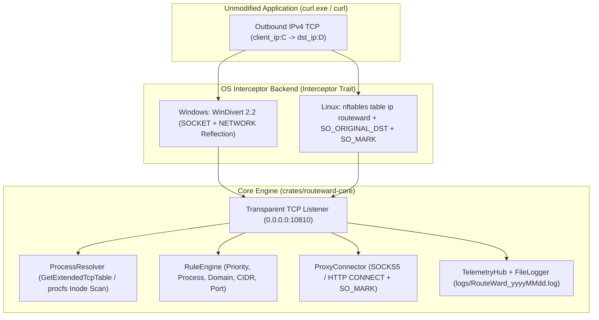

# RouteWard Architecture

## Overview and Current Status

RouteWard is structured as a Rust workspace with three crates (`routeward-core`, `routeward-cli`, and `routeward-desktop` under `apps/desktop`) and a React + TypeScript frontend (`ui/`).

### Milestone 1 Status (Windows IPv4 TCP Interception)
- **Pluggable `Interceptor` Trait (`routeward-core::interceptor::backend`)**: Abstracts OS packet capture behind the `Interceptor` trait so OS backends (`WinDivertInterceptor` on Windows, `NftablesInterceptor` on Linux) share the same rule engine and proxy connector.
- **WinDivert 2.2 Backend (`routeward-core::interceptor::windivert`)**: Dynamically loads `WinDivert.dll` at runtime via `LoadLibraryExW` and `GetProcAddress` (LGPLv3 dynamic linking compliance; no WinDivert binaries are committed to the repository).
- **SOCKET / NETWORK Race Resolution (`routeward-core::interceptor::nat`)**: Opens both `WINDIVERT_LAYER_SOCKET` (sniff/read-only) and `WINDIVERT_LAYER_NETWORK`. If a `SYN` arrives before its `SOCKET` event is cached, RouteWard enqueues the `SYN` in a non-blocking `PendingSynQueue` and resolves the owning PID via `GetExtendedTcpTable` (`tcp_table_fallback`), logging which path resolved the PID (`resolvedVia=socket_layer` or `resolvedVia=tcp_table_fallback`).
- **Loopback Redirection via `streamdump` Reflection**: Redirected IPv4 TCP packets use the reflection technique from the official WinDivert `streamdump` example (`reflect_outbound_to_local_relay` and `reflect_relay_reply_to_client` in `nat.rs`).

### Milestone 2 Status (Linux IPv4 TCP Interception)
- **`nftables` Backend (`routeward-core::interceptor::nftables`)**: Runs as `root` (`geteuid() == 0`) and installs a dedicated table (`table ip routeward`, `chain output`, `type nat hook output priority -100`) that redirects outbound IPv4 TCP connections to the local transparent TCP relay (`0.0.0.0:10810`).
- **Original Destination Recovery**: The transparent listener recovers the pre-DNAT destination IPv4 address and port on accepted sockets via `getsockopt(SOL_IP, SO_ORIGINAL_DST)`. Direct unredirected connections to `127.0.0.1:10810` are rejected and logged.
- **Anti-Loop via `SO_MARK` (`fwmark`)**: All outbound connections opened by RouteWard (both upstream proxy connections and `Direct` rule connections) set `setsockopt(SOL_SOCKET, SO_MARK, linuxFwmark)` (`0x5257` / `21079`) prior to `connect()`. The `nftables` chain starts with `meta mark 21079 return` and `ip daddr 127.0.0.0/8 return`, preventing redirection loops.
- **Process Attribution and Edge Cases (`routeward-core::process`)**: Matches the client source port in `/proc/net/tcp` to obtain the socket inode, then scans `/proc/<pid>/fd` for `socket:[<inode>]`:
  - `Single`: Exactly one process owns the socket (`resolvedVia=procfs_single`).
  - `Shared`: Multiple PIDs share the socket after `fork()` (`resolvedVia=procfs_shared_fork`); RouteWard logs the candidate PIDs and attributes the connection to the primary (lowest) PID.
  - `Unknown`: If the client closes the socket before user-space inspection completes, RouteWard logs the unattributed connection (`resolvedVia=procfs_unknown`) and applies the configurable `securityPolicy.unknownProcessAction` (`Direct`, `Block`, or `Proxy`).
- **`Block` Semantics on Linux vs Windows**: Under Windows (`WinDivert`), a `Block` rule drops the initial `SYN` packet so the client sees a connection timeout/refusal before handshake completion. Under Linux (`nftables redirect`), the kernel completes the local TCP handshake before user-space accepts the socket; RouteWard immediately sets `SO_LINGER(1, 0)` and closes the socket, sending a `TCP RST` to the client.
- **Fail-Open Watchdog and `routeward cleanup`**: `NftablesInterceptor` spawns a pipe-linked watchdog process (`sh -c "cat >/dev/null; nft delete table ip routeward"`) in its own process group. If `routeward` is killed with `SIGKILL` (`kill -9`), the kernel closes the pipe write-end immediately and the watchdog deletes `table ip routeward`. If the entire process group is killed simultaneously, `routeward cleanup` removes any orphaned `nftables` table (or Windows firewall rule).
- **Known Technical Debt (Milestone 2)**: Scanning `/proc/*/fd` on each accepted connection has complexity `O(processes * fds)`. Replacing or augmenting this lookup with `NETLINK_SOCK_DIAG` or eBPF socket-cookie caching is tracked as post-Milestone-2 optimization debt.

### Milestone 3 - Batch 3.1 Status (Real-Time Telemetry, Cancellation, and Atomic Profile Persistence)
- **Zero Simulated Engine Startup Data**: `RouteWardController::new` starts with an empty Fake-IP table and an empty connection registry; no synthetic DNS entries or connections are pre-seeded at startup.
- **Streaming Byte Counters (`TelemetryCountingStream`)**: Relayed connections (`handle_local_socks5_client` and `handle_transparent_tcp_client`) wrap the upstream socket in `TelemetryCountingStream` so `rx_bytes`, `tx_bytes`, and rolling bandwidth counters are updated continuously on every read/write chunk while the connection is active.
- **Active Connection Termination (`terminate_connection`)**: Each active relayed connection registers a `tokio::sync::watch` cancellation channel in `TelemetryHub`; calling `RouteWardController::terminate_connection(id)` immediately aborts the in-flight `copy_bidirectional` select loop, shuts down both client and upstream sockets, and marks the connection `Closed`.
- **Real-Time Event Broadcast (`tokio::sync::broadcast`)**: `TelemetryHub::subscribe()` exposes a typed broadcast stream of `TelemetryEvent` (`Telemetry`, `ConnectionUpdated`, `ConnectionsCleared`, `Log`, `LogsCleared`) with configurable capacity (`telemetry.eventBroadcastCapacity`).
- **Atomic Profile Persistence (`ProfileConfig::save_to_path`)**: Writes serialized JSON to a temporary sibling file, flushes via `sync_all()`, and atomically renames over the target path.

### Milestone 3 - Batch 3.2 Status (Privileged Daemon, Restricted OS IPC Channel, and Hardened Desktop Bridge)
- **Privilege Separation (`routeward daemon`)**: The privileged packet interception engine runs as a single-instance daemon (`routeward daemon`, launched manually as Administrator on Windows or `root` on Linux), decoupled from the unprivileged desktop UI (`apps/desktop`) and CLI controller (`routeward ctl`).
- **Restricted Local Control Channel (`routeward-core::ipc::transport`)**:
  - **Linux**: Unix domain socket (`/run/routeward/routeward.sock` by default from `configs/system_constants.json`), owned by `root:<unixSocketGroup>` (`routeward`), parent directory mode `0750`, socket mode `0660`. Verifies connecting clients via `SO_PEERCRED` and logs `pid`, `uid`, and `gid`. Fails fast at startup with a clear error if the configured group does not exist or if another daemon instance is already listening.
  - **Windows**: Named Pipe (`\\.\pipe\routeward-daemon`), created with `first_pipe_instance(true)` on the initial instance to prevent pipe squatting, `reject_remote_clients(true)`, and an explicit SDDL security descriptor (`D:P(A;;GA;;;SY)(A;;GA;;;BA)(A;;GRGW;;;{user_sid})`) granting access exclusively to `SYSTEM`, `Administrators`, and the user SID that launched the daemon.
- **Bounded Line-Delimited JSON Protocol (`routeward-core::ipc::protocol`)**:
  - Uses strict deserialization (`#[serde(deny_unknown_fields)]`) on all requests and command payloads; malformed JSON, unknown fields, or unknown commands return a structured `IpcResponse` error and never panic.
  - Enforces a configurable line length cap (`ipc.maxLineBytes`, default `65536`) and idle timeout (`ipc.idleTimeoutMs`, default `30000` ms) prior to allocation.
  - Converts `broadcast::error::RecvError::Lagged(skipped)` on subscribed event streams into an `IpcStreamEvent::Resync` notification and logs a `WARN` event so clients reload full state.
- **Fixed System Profile Path & Ownership/ACL Verification (`routeward-core::config::security`)**:
  - On Windows, the `ProgramData` path is resolved via `SHGetKnownFolderPath(FOLDERID_ProgramData)` (never from environment variables). When `%ProgramData%\RouteWard` and `active_profile.json` are created, they receive protected DACLs without inheritance (`D:P(A;OICI;FA;;;SY)(A;OICI;FA;;;BA)` on the directory and `D:P(A;;FA;;;SY)(A;;FA;;;BA)` on the file, with no `BU` / `Users` access) and owner `Administrators` so proxy credentials stored in the profile cannot be read by standard users. At startup, the daemon verifies that both the directory and `active_profile.json` are owned by `SYSTEM` or `Administrators` and that no DACL entry grants read or write access to any other principal; otherwise it refuses to start without loading the profile.
  - On Linux, `/etc/routeward` (`0700`) and `/etc/routeward/active_profile.json` (`0600`) must be owned by `root` (`uid 0`) and must not grant any read, write, or execute permission to group or others (`(mode & 0o077) == 0`); otherwise the daemon refuses to start.
  - **Proxy Password Redaction (`ProxyCredentials`)**: Cleartext proxy passwords (`ProxyCredentials.password`) are never returned in IPC responses (`GetState`, `GetProfile`, `ReplaceProfile`); the daemon strips `password` (`None`) and sets `"hasPassword": true/false`. On IPC writes (`UpsertProxy`, `ReplaceProfile`), an omitted `password` field (`None`) preserves the existing password stored in the daemon, whereas a provided `password` replaces it. `Debug` formatting on `ProxyCredentials` and invalid proxy URI errors redact credentials as `[REDACTED]`.
  - Note on Windows Named Pipe elevation: the daemon must be started by elevating the desktop user's own account; elevating with a different administrator account binds the pipe DACL to that other account's SID and prevents the desktop UI from connecting.
- **Hardened Desktop Loopback Bridge (`apps/desktop`)**: Connects to the daemon via `IpcClient` (reporting `daemonConnected: false, running: false` and auto-reconnecting in the background if the daemon stops), injects an ephemeral startup token into the WebView (`window.__ROUTEWARD_TOKEN__`), and enforces constant-time token verification (`constant_time_eq`) plus strict `Host` (`127.0.0.1:<port>`) and `Origin` (`http://127.0.0.1:<port>`) header validation on `/api/*`.

### Milestone 3 - Batch 3.3 Status (End-to-End Frontend Wiring, Authenticated SSE Stream, and Startup Cleanup)
- **Zero Frontend Simulation (`ui/src/services/ipc.ts` & `ui/src/App.tsx`)**: All simulated traffic generators, synthetic presets (`SIMULATION_PRESETS`), and `Math.random` telemetry mocks have been removed from `ui/`. Every UI action and view (`DashboardView`, `ConnectionsView`, `RulesView`, `ProxiesView`, `ChainsView`, `DnsManagerView`, `LogsView`, `QuickSetupWizardModal`) communicates with the privileged daemon through the hardened loopback bridge, sending `window.__ROUTEWARD_TOKEN__` in the `X-RouteWard-Token` header on every request.
- **Header-Authenticated Real-Time Stream (`GET /api/events`)**: Rather than using `EventSource` (which cannot set custom headers) or placing the token in a URL query string, `ui/src/services/ipc.ts` consumes the Server-Sent Events stream via `fetch` + `ReadableStream` (`response.body.getReader()`) with the `X-RouteWard-Token` header. Upon initial connection, reconnection, or receipt of an `IpcStreamEvent::Resync` frame, the frontend reloads full state (`GET /api/state`) before resuming incremental updates.
- **Daemon Disconnection & Privilege Banners (`ui/src/App.tsx`)**: When the daemon is unreachable (`!diagnostics.daemonConnected`), the UI displays a persistent localized banner with the platform command to start `routeward daemon`, sets engine status to stopped, zeroes live throughput rates, marks active connections as `closed`, and automatically resynchronizes when the daemon comes online. If a connected daemon reports `!diagnostics.elevatedPrivileges`, a dedicated warning banner is displayed.
- **Write-Only Proxy Password Handling (`ui/src/components/ProxiesView.tsx`)**: Proxy cards display a localized `"Password Set"` badge when `auth.hasPassword` is true. Editing a proxy leaves the password field write-only: omitting a new password preserves the existing secret in the daemon, while an explicit `"Replace Password"` action allows rotating the secret without ever exposing or logging cleartext passwords in the browser.
- **Automatic Orphaned-Rule Cleanup at Daemon Startup (`crates/routeward-cli/src/main.rs`)**: Right after `DaemonIpcService::bind` succeeds (ensuring no other daemon instance is active), `routeward daemon` invokes `controller.cleanup_orphaned_rules()` to remove any orphaned Windows firewall rule (`RouteWard_TransparentRelay_*`) or Linux `nftables` table (`table ip routeward`) left by a previous crash, logging the result at `INFO` level.
- **Dedicated Daemon & User Log Paths (`routeward-core::config`)**: Privileged daemon processes (`routeward daemon`, `routeward run`, `routeward cleanup`) write logs to `%ProgramData%\RouteWard\logs` on Windows (via `SHGetKnownFolderPath(FOLDERID_ProgramData)`) and `/var/log/routeward` on Linux. Unprivileged desktop and CLI processes (`routeward-desktop`, `routeward ctl`) write logs to `%LOCALAPPDATA%\RouteWard\logs` on Windows (via `SHGetKnownFolderPath(FOLDERID_LocalAppData)`) and `$XDG_STATE_HOME/routeward/logs` (or `~/.local/state/routeward/logs`) on Linux, never depending on the process working directory (`CWD`).
- **Not Implemented Yet**: IPv6 and UDP interception, and transparent DNS capture.

## Component Diagram

## Workspace Modules

| Path | Crate / Package | Responsibility |
| :--- | :--- | :--- |
| `crates/routeward-core` | `routeward-core` | `Interceptor` trait, `WinDivertInterceptor` (Windows), `NftablesInterceptor` (Linux), `TransparentNatTable`, `ProcessResolver`, `RuleEngine`, `ProxyConnector`, and daily `FileLogger`. |
| `crates/routeward-cli` | `routeward-cli` (`routeward`) | Command-line interface (`run --duration-secs`, `cleanup`, `check`, `eval`, `fake-ip`). |
| `apps/desktop` | `routeward-desktop` | Native desktop shell built with `tao` and `wry` serving the compiled `ui/dist` bundle. |
| `ui` | `routeward-ui` | React 18 + TypeScript + Tailwind CSS interface with ThemeForge palettes. |
| `tools/fetch-windivert.ps1` | PowerShell Script | Downloads official WinDivert 2.2.2-A, verifies SHA-256, and extracts `WinDivert.dll` and `WinDivert64.sys` into `third_party/windivert/bin/`. |
| `tests/linux/` | Container Test Suite | Automated Debian 12 + `nftables` Docker integration scenarios (`run-scenarios.sh`). |
