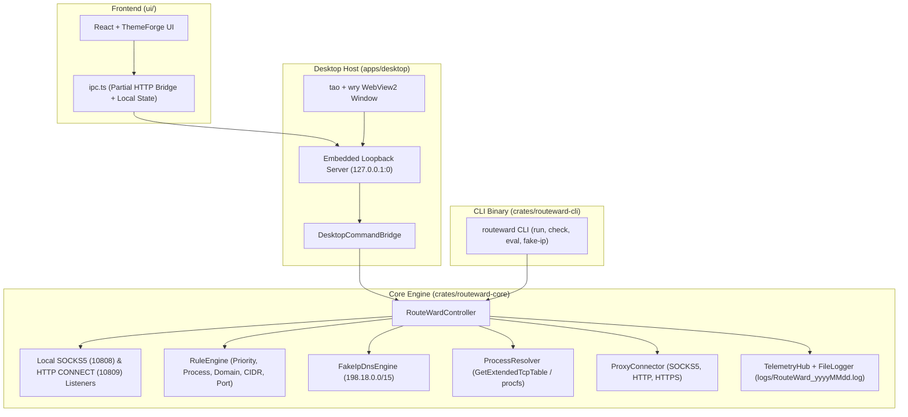

# RouteWard Architecture

## Overview and Current Status

RouteWard is structured as a Rust workspace with three crates (`routeward-core`, `routeward-cli`, and `routeward-desktop` under `apps/desktop`) and a React + TypeScript frontend (`ui/`).

**Important current limitation**:
- **Transparent OS-level packet interception is not implemented yet.** Currently, `routeward-core` exposes local loopback listeners (SOCKS5 on `127.0.0.1:10808`, HTTP CONNECT on `127.0.0.1:10809`, and Fake-IP DNS on `127.0.0.1:10853`) and attributes incoming loopback sockets to local processes via OS socket tables. Applications must currently either be launched with proxy environment variables (`ALL_PROXY`, `HTTP_PROXY`, `HTTPS_PROXY`), use the Windows System Proxy setting, or connect to the local relay explicitly.
- **Frontend IPC status**: The React frontend (`ui/src/services/ipc.ts`) still uses a local state client for most rule/profile editing and only calls the desktop backend over HTTP for `/api/scan-os`, `/api/system-proxy`, `/api/launch-process`, and window controls. Full backend IPC wiring is scheduled for Milestone 3.

## Component Diagram

## Workspace Modules

| Path | Crate / Package | Responsibility |
| :--- | :--- | :--- |
| `crates/routeward-core` | `routeward-core` | Configuration loader, priority rule engine, Fake-IP DNS cache, SOCKS5/HTTP proxy connector, OS TCP socket attribution, telemetry, and daily `FileLogger`. |
| `crates/routeward-cli` | `routeward-cli` (`routeward`) | Command-line interface for running the local relay, probing proxies, evaluating rules, and inspecting Fake-IP allocations. |
| `apps/desktop` | `routeward-desktop` | Native desktop shell built with `tao` and `wry` serving the compiled `ui/dist` bundle. |
| `ui` | `routeward-ui` | React 18 + TypeScript + Tailwind CSS interface with ThemeForge palettes and `react-i18next` localization. |
| `configs` | JSON Configurations | `system_constants.json`, `default_profile.json`, and `themeforge_palettes.json`. |
| `locales` | i18n Dictionaries | `en.json` and `fr.json` translation catalogs. |
