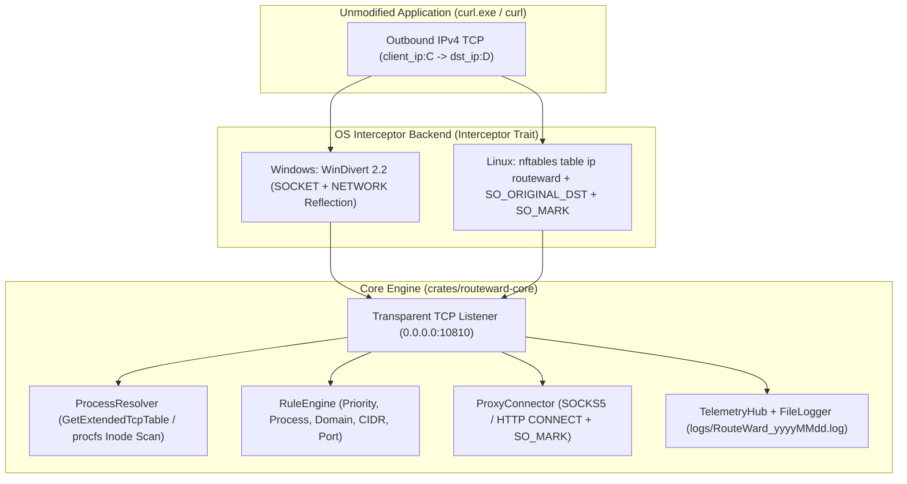

# RouteWard Architecture

## Overview and Current Status

RouteWard is structured as a Rust workspace with three crates (`routeward-core`, `routeward-cli`, and `routeward-desktop` under `apps/desktop`) and a React + TypeScript frontend (`ui/`).

### Milestone 1 Status (Windows IPv4 TCP Interception)
- **Pluggable `Interceptor` Trait (`routeward-core::interceptor::backend`)**: Abstracts OS packet capture behind the `Interceptor` trait so OS backends (`WinDivertInterceptor` on Windows, `NftablesInterceptor` on Linux) share the same rule engine and proxy connector.
- **WinDivert 2.2 Backend (`routeward-core::interceptor::windivert`)**: Dynamically loads `WinDivert.dll` at runtime via `LoadLibraryExW` and `GetProcAddress` (LGPLv3 dynamic linking compliance; no WinDivert binaries are committed to the repository).
- **SOCKET / NETWORK Race Resolution (`routeward-core::interceptor::nat`)**: Opens both `WINDIVERT_LAYER_SOCKET` (sniff/read-only) and `WINDIVERT_LAYER_NETWORK`. If a `SYN` arrives before its `SOCKET` event is cached, RouteWard enqueues the `SYN` in a non-blocking `PendingSynQueue` and resolves the owning PID via `GetExtendedTcpTable` (`tcp_table_fallback`), logging which path resolved the PID (`resolvedVia=socket_layer` or `resolvedVia=tcp_table_fallback`).
- **Loopback Redirection via `streamdump` Reflection**: Redirected IPv4 TCP packets use the reflection technique from the official WinDivert `streamdump` example (`reflect_outbound_to_local_relay` and `reflect_relay_reply_to_client` in `nat.rs`).

### Milestone 2 Status (Linux IPv4 TCP Interception)
- **`nftables` Backend (`routeward-core::interceptor::nftables`)**: Runs as `root` (`geteuid() == 0`) and installs a dedicated table (`table ip routeward`, `chain output`, `type nat hook output priority -100`) that redirects outbound IPv4 TCP connections to the local transparent TCP relay (`0.0.0.0:10810`).
- **Original Destination Recovery**: The transparent listener recovers the pre-DNAT destination IPv4 address and port on accepted sockets via `getsockopt(SOL_IP, SO_ORIGINAL_DST)`. Direct unredirected connections to `127.0.0.1:10810` are rejected and logged.
- **Anti-Loop via `SO_MARK` (`fwmark`)**: All outbound connections opened by RouteWard (both upstream proxy connections and `Direct` rule connections) set `setsockopt(SOL_SOCKET, SO_MARK, linuxFwmark)` (`0x5257` / `21079`) prior to `connect()`. The `nftables` chain starts with `meta mark 21079 return` and `ip daddr 127.0.0.0/8 return`, preventing redirection loops.
- **Process Attribution and Edge Cases (`routeward-core::process`)**: Matches the client source port in `/proc/net/tcp` to obtain the socket inode, then scans `/proc/<pid>/fd` for `socket:[<inode>]`:
  - `Single`: Exactly one process owns the socket (`resolvedVia=procfs_single`).
  - `Shared`: Multiple PIDs share the socket after `fork()` (`resolvedVia=procfs_shared_fork`); RouteWard logs the candidate PIDs and attributes the connection to the primary (lowest) PID.
  - `Unknown`: If the client closes the socket before user-space inspection completes, RouteWard logs the unattributed connection (`resolvedVia=procfs_unknown`) and applies the configurable `securityPolicy.unknownProcessAction` (`Direct`, `Block`, or `Proxy`).
- **`Block` Semantics on Linux vs Windows**: Under Windows (`WinDivert`), a `Block` rule drops the initial `SYN` packet so the client sees a connection timeout/refusal before handshake completion. Under Linux (`nftables redirect`), the kernel completes the local TCP handshake before user-space accepts the socket; RouteWard immediately sets `SO_LINGER(1, 0)` and closes the socket, sending a `TCP RST` to the client.
- **Fail-Open Watchdog and `routeward cleanup`**: `NftablesInterceptor` spawns a pipe-linked watchdog process (`sh -c "cat >/dev/null; nft delete table ip routeward"`) in its own process group. If `routeward` is killed with `SIGKILL` (`kill -9`), the kernel closes the pipe write-end immediately and the watchdog deletes `table ip routeward`. If the entire process group is killed simultaneously, `routeward cleanup` removes any orphaned `nftables` table (or Windows firewall rule).
- **Known Technical Debt (Milestone 2)**: Scanning `/proc/*/fd` on each accepted connection has complexity `O(processes * fds)`. Replacing or augmenting this lookup with `NETLINK_SOCK_DIAG` or eBPF socket-cookie caching is tracked as post-Milestone-2 optimization debt.

### Milestone 3 - Batch 3.1 Status (Real-Time Telemetry, Cancellation, and Atomic Profile Persistence)
- **Zero Simulated Engine Startup Data**: `RouteWardController::new` starts with an empty Fake-IP table and an empty connection registry; no synthetic DNS entries or connections are pre-seeded at startup.
- **Streaming Byte Counters (`TelemetryCountingStream`)**: Relayed connections (`handle_local_socks5_client` and `handle_transparent_tcp_client`) wrap the upstream socket in `TelemetryCountingStream` so `rx_bytes`, `tx_bytes`, and rolling bandwidth counters are updated continuously on every read/write chunk while the connection is active.
- **Active Connection Termination (`terminate_connection`)**: Each active relayed connection registers a `tokio::sync::watch` cancellation channel in `TelemetryHub`; calling `RouteWardController::terminate_connection(id)` immediately aborts the in-flight `copy_bidirectional` select loop, shuts down both client and upstream sockets, and marks the connection `Closed`.
- **Real-Time Event Broadcast (`tokio::sync::broadcast`)**: `TelemetryHub::subscribe()` exposes a typed broadcast stream of `TelemetryEvent` (`Telemetry`, `ConnectionUpdated`, `ConnectionsCleared`, `Log`, `LogsCleared`) with configurable capacity (`telemetry.eventBroadcastCapacity`).
- **Atomic Profile Persistence (`ProfileConfig::save_to_path`)**: Writes serialized JSON to a temporary sibling file, flushes via `sync_all()`, and atomically renames over the target path.
- **Not Implemented Yet**: Privileged IPC daemon and desktop bridge (Batch 3.2), frontend `ui/` IPC wiring (Batch 3.3), IPv6 and UDP interception, and transparent DNS capture.

## Component Diagram

## Workspace Modules

| Path | Crate / Package | Responsibility |
| :--- | :--- | :--- |
| `crates/routeward-core` | `routeward-core` | `Interceptor` trait, `WinDivertInterceptor` (Windows), `NftablesInterceptor` (Linux), `TransparentNatTable`, `ProcessResolver`, `RuleEngine`, `ProxyConnector`, and daily `FileLogger`. |
| `crates/routeward-cli` | `routeward-cli` (`routeward`) | Command-line interface (`run --duration-secs`, `cleanup`, `check`, `eval`, `fake-ip`). |
| `apps/desktop` | `routeward-desktop` | Native desktop shell built with `tao` and `wry` serving the compiled `ui/dist` bundle. |
| `ui` | `routeward-ui` | React 18 + TypeScript + Tailwind CSS interface with ThemeForge palettes. |
| `tools/fetch-windivert.ps1` | PowerShell Script | Downloads official WinDivert 2.2.2-A, verifies SHA-256, and extracts `WinDivert.dll` and `WinDivert64.sys` into `third_party/windivert/bin/`. |
| `tests/linux/` | Container Test Suite | Automated Debian 12 + `nftables` Docker integration scenarios (`run-scenarios.sh`). |
