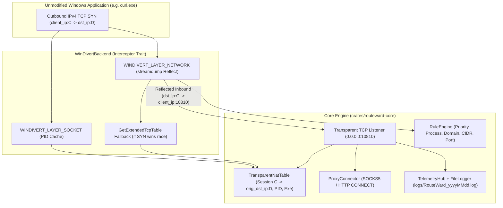

# RouteWard Architecture

## Overview and Current Status

RouteWard is structured as a Rust workspace with three crates (`routeward-core`, `routeward-cli`, and `routeward-desktop` under `apps/desktop`) and a React + TypeScript frontend (`ui/`).

### Milestone 1 Status (Windows IPv4 TCP Interception)
- **Pluggable `Interceptor` Trait (`routeward-core::interceptor::backend`)**: Abstracts OS packet capture behind the `Interceptor` trait so alternative kernel/OS backends (such as a Windows Filtering Platform callout driver or Linux `nftables`/TUN in Milestone 2) can be plugged in without modifying the rule engine.
- **WinDivert 2.2 Backend (`routeward-core::interceptor::windivert`)**: Dynamically loads `WinDivert.dll` at runtime via `LoadLibraryExW` and `GetProcAddress` (LGPLv3 dynamic linking compliance; no WinDivert binaries are committed to the repository).
- **SOCKET / NETWORK Race Resolution (`routeward-core::interceptor::nat`)**: Opens both `WINDIVERT_LAYER_SOCKET` (sniff/read-only) and `WINDIVERT_LAYER_NETWORK`. Because `SOCKET` events and the first outbound TCP `SYN` arrive on separate handles, if a `SYN` arrives before its `SOCKET` event is cached, RouteWard holds the `SYN` briefly and resolves the owning PID via `GetExtendedTcpTable` (`tcp_table_fallback`), logging which path resolved the PID (`resolvedVia=socket_layer` or `resolvedVia=tcp_table_fallback`).
- **Loopback Redirection via `streamdump` Reflection**: Redirected IPv4 TCP packets use the reflection technique from the official WinDivert `streamdump` example (`reflect_outbound_to_local_relay` and `reflect_relay_reply_to_client` in `nat.rs`). Outbound client packets (`client_ip:client_port -> orig_dst_ip:orig_dst_port`) have their IPv4 addresses swapped (`orig_dst_ip:client_port -> client_ip:10810`), their destination port rewritten to the local transparent TCP relay (`0.0.0.0:10810`), their direction flipped to inbound (`Outbound = 0`), and their RFC 1071 checksums recomputed before reinjection. Reply packets from `10810` are reflected back (`orig_dst_ip:orig_dst_port -> client_ip:client_port`, `Outbound = 0`) so the unmodified client application sees a seamless connection to the original destination.
- **Loop Exclusion**: Connections owned by RouteWard's own PID, loopback traffic, and connections destined to configured upstream proxy servers bypass interception automatically.
- **Not Implemented Yet**: IPv6 and UDP interception, transparent DNS capture, Linux transparent interception (Milestone 2), and full frontend IPC wiring (Milestone 3).

## Component Diagram

## Workspace Modules

| Path | Crate / Package | Responsibility |
| :--- | :--- | :--- |
| `crates/routeward-core` | `routeward-core` | `Interceptor` trait, `WinDivertInterceptor`, `TransparentNatTable` (`streamdump` reflection + PID fallback), priority `RuleEngine`, `ProxyConnector`, and daily `FileLogger`. |
| `crates/routeward-cli` | `routeward-cli` (`routeward`) | Command-line interface (`run --duration-secs`, `check`, `eval`, `fake-ip`). |
| `apps/desktop` | `routeward-desktop` | Native desktop shell built with `tao` and `wry` serving the compiled `ui/dist` bundle. |
| `ui` | `routeward-ui` | React 18 + TypeScript + Tailwind CSS interface with ThemeForge palettes. |
| `tools/fetch-windivert.ps1` | PowerShell Script | Downloads official WinDivert 2.2.2-A, verifies SHA-256, and extracts `WinDivert.dll` and `WinDivert64.sys` into `third_party/windivert/bin/`. |
