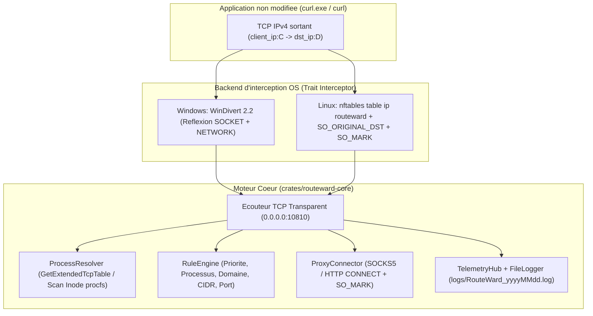

# Architecture de RouteWard

## Vue d'ensemble et Etat Actuel

RouteWard est organise en workspace Rust comprenant trois crates (`routeward-core`, `routeward-cli` et `routeward-desktop` dans `apps/desktop`) ainsi qu'une interface React + TypeScript (`ui/`).

### Etat du Milestone 1 (Interception TCP IPv4 sous Windows)
- **Trait `Interceptor` enfichable (`routeward-core::interceptor::backend`)** : Abstrait l'interception de paquets derriere le trait `Interceptor` afin que les moteurs OS (`WinDivertInterceptor` sous Windows, `NftablesInterceptor` sous Linux) partagent le meme moteur de regles et le meme connecteur proxy.
- **Backend WinDivert 2.2 (`routeward-core::interceptor::windivert`)** : Charge dynamiquement `WinDivert.dll` au runtime via `LoadLibraryExW` et `GetProcAddress` (conformite LGPLv3 par liaison dynamique; aucun binaire WinDivert n'est versionne dans le depot).
- **Resolution de la course SOCKET / NETWORK (`routeward-core::interceptor::nat`)** : Ouvre simultanement `WINDIVERT_LAYER_SOCKET` (sniff lecture seule) et `WINDIVERT_LAYER_NETWORK`. Si un `SYN` arrive avant l'evenement `SOCKET`, RouteWard place le `SYN` dans une file non bloquante `PendingSynQueue` et resout le PID via `GetExtendedTcpTable` (`tcp_table_fallback`), en journalisant la source (`resolvedVia=socket_layer` ou `resolvedVia=tcp_table_fallback`).
- **Redirection locale par reflexion `streamdump`** : Les paquets TCP IPv4 rediriges utilisent la technique `reflect` de l'exemple officiel `streamdump` de WinDivert (`reflect_outbound_to_local_relay` et `reflect_relay_reply_to_client` dans `nat.rs`).

### Etat du Milestone 2 (Interception TCP IPv4 sous Linux)
- **Backend `nftables` (`routeward-core::interceptor::nftables`)** : S'execute en tant que `root` (`geteuid() == 0`) et installe une table dediee (`table ip routeward`, `chain output`, `type nat hook output priority -100`) qui redirige les connexions TCP IPv4 sortantes vers le relais TCP transparent local (`0.0.0.0:10810`).
- **Recuperation de la destination d'origine** : Le relais transparent recupere l'adresse IPv4 et le port d'origine avant DNAT sur le socket accepte via `getsockopt(SOL_IP, SO_ORIGINAL_DST)`. Les connexions directes non redirigees vers `127.0.0.1:10810` sont rejetees et journalisees.
- **Anti-boucle par `SO_MARK` (`fwmark`)** : Toutes les connexions sortantes ouvertes par RouteWard (vers un proxy amont ou en mode `Direct`) appliquent `setsockopt(SOL_SOCKET, SO_MARK, linuxFwmark)` (`0x5257` / `21079`) avant l'appel a `connect()`. La chaine `nftables` commence par `meta mark 21079 return` et `ip daddr 127.0.0.0/8 return`, evitant toute boucle de redirection.
- **Attribution de processus et cas limites (`routeward-core::process`)** : Associe le port source du client dans `/proc/net/tcp` a l'inode du socket, puis parcourt `/proc/<pid>/fd` pour trouver `socket:[<inode>]` :
  - `Single` : Un seul processus detient le socket (`resolvedVia=procfs_single`).
  - `Shared` : Plusieurs PID partagent le socket apres un `fork()` (`resolvedVia=procfs_shared_fork`); RouteWard journalise la liste des PID candidats et attribue la connexion au PID principal (le plus bas).
  - `Unknown` : Si le client ferme le socket avant la fin de l'inspection, RouteWard journalise le cas (`resolvedVia=procfs_unknown`) et applique l'action configurable `securityPolicy.unknownProcessAction` (`Direct`, `Block` ou `Proxy`).
- **Comportement de `Block` sous Linux vs Windows** : Sous Windows (`WinDivert`), une regle `Block` jette le paquet `SYN` initial avant l'etablissement de la connexion. Sous Linux (`nftables redirect`), le noyau termine le handshake TCP sur l'ecouteur local avant que l'espace utilisateur n'accepte le socket; RouteWard applique immediatement `SO_LINGER(1, 0)` et ferme le socket, ce qui envoie un `TCP RST` au client.
- **Watchdog fail-open et commande `routeward cleanup`** : `NftablesInterceptor` lance un processus watchdog lie par pipe (`sh -c "cat >/dev/null; nft delete table ip routeward"`) dans son propre groupe de processus. Si `routeward` est tue par `SIGKILL` (`kill -9`), le noyau ferme immediatement le descripteur du pipe et le watchdog supprime `table ip routeward`. Si le watchdog est egalement tue, la commande `routeward cleanup` supprime toute table `nftables` orpheline (ou la regle de pare-feu Windows).
- **Dette technique connue (Milestone 2)** : Le parcours de `/proc/*/fd` a chaque connexion acceptee a un cout `O(processus * descripteurs)`. Son remplacement ou enrichissement par `NETLINK_SOCK_DIAG` ou un cache eBPF est note comme dette technique post-Milestone 2.

### Etat du Milestone 3 - Lot 3.1 (Telemetrie Temps Reel, Annulation et Persistance Atomique)
- **Suppression des donnees simulees au demarrage moteur** : `RouteWardController::new` demarre avec une table Fake-IP et une table de connexions vides; aucune entree DNS ou connexion fictive n'est pre-injectee.
- **Compteurs d'octets en continu (`TelemetryCountingStream`)** : Les connexions relayees (`handle_local_socks5_client` et `handle_transparent_tcp_client`) encapsulent le flux amont dans `TelemetryCountingStream` afin que `rx_bytes`, `tx_bytes` et les compteurs de bande passante soient mis a jour en temps reel a chaque bloc lu ou ecrit pendant le transfert.
- **Annulation reelle d'une connexion active (`terminate_connection`)** : Chaque tunnel actif enregistre un canal d'annulation `tokio::sync::watch` dans `TelemetryHub`; l'appel a `RouteWardController::terminate_connection(id)` interrompt immediatement la boucle `copy_bidirectional`, ferme les sockets client et amont, et marque la connexion `Closed`.
- **Canal d'evenements temps reel (`tokio::sync::broadcast`)** : `TelemetryHub::subscribe()` expose un flux diffuse `TelemetryEvent` (`Telemetry`, `ConnectionUpdated`, `ConnectionsCleared`, `Log`, `LogsCleared`) dont la capacite est configuree par `telemetry.eventBroadcastCapacity`.
- **Sauvegarde atomique du profil (`ProfileConfig::save_to_path`)** : Ecrit le JSON dans un fichier temporaire adjacent, force la synchronisation disque via `sync_all()` puis remplace atomiquement la cible via `fs::rename`.

### Etat du Milestone 3 - Lot 3.2 (Daemon Privilegie, Canal IPC OS Restreint et Pont Bureau Durci)
- **Separation des privileges (`routeward daemon`)** : Le moteur d'interception privilegie tourne dans un daemon a instance unique (`routeward daemon`, lance manuellement en Administrateur sous Windows ou `root` sous Linux), separe de l'interface bureau non privilegiee (`apps/desktop`) et du client CLI (`routeward ctl`).
- **Canal de controle local restreint (`routeward-core::ipc::transport`)** :
  - **Linux** : Socket Unix (`/run/routeward/routeward.sock` par defaut depuis `configs/system_constants.json`), proprietaire `root:<unixSocketGroup>` (`routeward`), dossier parent en `0750`, socket en `0660`. Verifie chaque client via `SO_PEERCRED` et journalise `pid`, `uid` et `gid`. Echoue immediatement au demarrage avec un message explicite si le groupe n'existe pas ou si une autre instance tourne deja.
  - **Windows** : Named Pipe (`\\.\pipe\routeward-daemon`), cree avec `first_pipe_instance(true)` sur la premiere instance contre le squatting de nom, `reject_remote_clients(true)` et un descripteur SDDL explicite (`D:P(A;;GA;;;SY)(A;;GA;;;BA)(A;;GRGW;;;{user_sid})`) limitant l'acces a `SYSTEM`, `Administrators` et au SID de l'utilisateur ayant lance le daemon.
- **Protocole JSON delimite par ligne borne (`routeward-core::ipc::protocol`)** :
  - Deserialisation stricte (`#[serde(deny_unknown_fields)]`) sur toutes les requetes et charges utiles; un JSON invalide, un champ inconnu ou une commande inconnue renvoie une erreur structuree sans paniquer.
  - Applique une taille maximale de ligne (`ipc.maxLineBytes`, `65536` octets) et un delai d'inactivite (`ipc.idleTimeoutMs`, `30000` ms) avant coupure.
  - En cas de `RecvError::Lagged(skipped)` sur le flux d'evenements, journalise un `WARN` et envoie un evenement `IpcStreamEvent::Resync` au client pour recharger l'etat complet.
- **Chemin de profil fixe et verification du proprietaire / des ACL (`routeward-core::config::security`)** :
  - Sous Windows, le dossier `ProgramData` est resolu via l'API `SHGetKnownFolderPath(FOLDERID_ProgramData)` (jamais via une variable d'environnement). A la creation de `%ProgramData%\RouteWard` et de `active_profile.json`, une DACL protegee sans heritage (`D:P(A;OICI;FA;;;SY)(A;OICI;FA;;;BA)` sur le dossier et `D:P(A;;FA;;;SY)(A;;FA;;;BA)` sur le fichier, sans acces `BU` / `Utilisateurs`) et le proprietaire `Administrators` sont appliques afin de proteger les identifiants de proxy. Au demarrage du daemon, si le dossier ou `active_profile.json` existe deja, le daemon verifie que le proprietaire est `SYSTEM` ou `Administrators` et qu'aucune entree DACL n'accorde de lecture ou d'ecriture a un autre principal; sinon il refuse de demarrer sans charger le profil.
  - Sous Linux, `/etc/routeward` (`0700`) et `/etc/routeward/active_profile.json` (`0600`) doivent appartenir a `root` (`uid 0`) sans aucun droit de lecture, d'ecriture ou d'execution pour le groupe ni les autres (`(mode & 0o077) == 0`), sous peine de refus de demarrer.
  - **Masquage des mots de passe de proxy (`ProxyCredentials`)** : Les mots de passe de proxy en clair ne sont jamais renvoyes dans les reponses IPC (`GetState`, `GetProfile`, `ReplaceProfile`); le daemon omet `password` (`None`) et renvoie l'indicateur `"hasPassword": true/false`. Lors d'une ecriture IPC (`UpsertProxy`, `ReplaceProfile`), un champ `password` absent (`None`) conserve le mot de passe existant en memoire/disque, tandis qu'un mot de passe fourni le remplace. L'implementation `Debug` de `ProxyCredentials` et les erreurs d'URI de proxy masquent systematiquement le secret avec `[REDACTED]`.
  - Note sur l'elevation Windows : le daemon doit etre lance par l'utilisateur de l'interface (elevation de son propre compte); si l'elevation est faite avec un autre compte administrateur, l'interface de l'utilisateur ne pourra pas se connecter au pipe.
- **Pont Loopback Bureau durci (`apps/desktop`)** : Se connecte au daemon via `IpcClient` (remonte `daemonConnected: false, running: false` avec reconnexion automatique en tache de fond si le daemon est absent), injecte un jeton ephemere dans la WebView (`window.__ROUTEWARD_TOKEN__`) et verifie le jeton en temps constant (`constant_time_eq`) ainsi que les en-tetes `Host` (`127.0.0.1:<port>`) et `Origin` (`http://127.0.0.1:<port>`) sur `/api/*`.

### Etat du Milestone 3 - Lot 3.3 (Branchement Frontend Reel, Flux SSE Authentifie et Nettoyage au Demarrage)
- **Suppression totale de la simulation Frontend (`ui/src/services/ipc.ts` & `ui/src/App.tsx`)** : Tous les generateurs de trafic fictif, presets de simulation (`SIMULATION_PRESETS`) et appels `Math.random` ont ete retires de `ui/`. Toutes les vues (`DashboardView`, `ConnectionsView`, `RulesView`, `ProxiesView`, `ChainsView`, `DnsManagerView`, `LogsView`, `QuickSetupWizardModal`) communiquent avec le daemon reel via le pont loopback en transmettant `window.__ROUTEWARD_TOKEN__` dans l'en-tete `X-RouteWard-Token` sur chaque requete.
- **Flux temps reel SSE authentifie par en-tete (`GET /api/events`)** : Au lieu d'utiliser `EventSource` (qui ne supporte pas les en-tetes personnalises) ou de passer le jeton dans une URL, `ui/src/services/ipc.ts` lit le flux SSE via `fetch` + `ReadableStream` (`response.body.getReader()`) avec l'en-tete `X-RouteWard-Token`. Lors de la connexion initiale, d'une reconnexion ou de la reception d'un evenement `IpcStreamEvent::Resync`, l'interface recharge l'etat complet (`GET /api/state`) avant de reprendre le flux.
- **Bannieres d'etat du daemon et des privileges (`ui/src/App.tsx`)** : Lorsque le daemon est absent ou deconnecte (`!diagnostics.daemonConnected`), l'interface affiche une banniere persistante traduite indiquant la commande de lancement de `routeward daemon`, passe l'etat du moteur a arrete, remet les debits temps reel a `0`, marque les connexions actives comme `closed`, et se resynchronise automatiquement des que le daemon redemarre. Si le daemon tourne sans elevation (`!diagnostics.elevatedPrivileges`), une banniere d'avertissement dediee s'affiche.
- **Mots de passe de proxy en ecriture seule (`ui/src/components/ProxiesView.tsx`)** : Les cartes de proxy affichent un badge traduit « Mot de passe defini » lorsque `auth.hasPassword` vaut `true`. A l'edition d'un proxy, un champ mot de passe vide n'envoie pas la cle `password` (conservant le secret existant cote daemon), tandis qu'une action explicite « Remplacer le mot de passe » permet de definir un nouveau secret sans jamais exposer ni journaliser de mot de passe en clair dans le navigateur.
- **Nettoyage automatique au demarrage du daemon (`crates/routeward-cli/src/main.rs`)** : Immediatement apres la reussite de `DaemonIpcService::bind` (garantissant qu'aucune autre instance du daemon ne tourne), `routeward daemon` appelle `controller.cleanup_orphaned_rules()` afin de supprimer toute regle de pare-feu Windows (`RouteWard_TransparentRelay_*`) ou table `nftables` Linux (`table ip routeward`) orpheline laissee par un crash precedent, et journalise l'operation au niveau `INFO`.
- **Dossiers de journaux dedies Daemon et Utilisateur (`routeward-core::config`)** : Les processus privilegies (`routeward daemon`, `routeward run`, `routeward cleanup`) ecrivent leurs journaux dans `%ProgramData%\RouteWard\logs` sous Windows (via `SHGetKnownFolderPath(FOLDERID_ProgramData)`) et `/var/log/routeward` sous Linux. Les processus non privilegies (`routeward-desktop`, `routeward ctl`) ecrivent dans `%LOCALAPPDATA%\RouteWard\logs` sous Windows (via `SHGetKnownFolderPath(FOLDERID_LocalAppData)`) et `$XDG_STATE_HOME/routeward/logs` (ou `~/.local/state/routeward/logs`) sous Linux, sans dependre du repertoire courant (`CWD`).
- **Non implemente a ce stade** : Interception IPv6 et UDP, et capture DNS transparente.

## Diagramme des Composants

## Modules du Workspace

| Chemin | Crate / Paquet | Responsabilite |
| :--- | :--- | :--- |
| `crates/routeward-core` | `routeward-core` | Trait `Interceptor`, `WinDivertInterceptor` (Windows), `NftablesInterceptor` (Linux), `TransparentNatTable`, `ProcessResolver`, `RuleEngine`, `ProxyConnector` et `FileLogger` quotidien. |
| `crates/routeward-cli` | `routeward-cli` (`routeward`) | Interface en ligne de commande (`run --duration-secs`, `cleanup`, `check`, `eval`, `fake-ip`). |
| `apps/desktop` | `routeward-desktop` | Application bureau native basee sur `tao` et `wry` embarquant le bundle `ui/dist`. |
| `ui` | `routeward-ui` | Interface React 18 + TypeScript + Tailwind CSS avec palettes ThemeForge. |
| `tools/fetch-windivert.ps1` | Script PowerShell | Telecharge WinDivert 2.2.2-A officiel, verifie le SHA-256 et extrait `WinDivert.dll` et `WinDivert64.sys` dans `third_party/windivert/bin/`. |
| `tests/linux/` | Suite de Tests Conteneur | Scenarios d'integration automatises sous Docker Debian 12 + `nftables` (`run-scenarios.sh`). |
| `tests/windows/` | Suite de Tests Windows | Scenarios de non-regression Windows PowerShell 5.1 (`Invoke-RouteWardTests.ps1`, `Run-RouteWardTests.bat`). |
