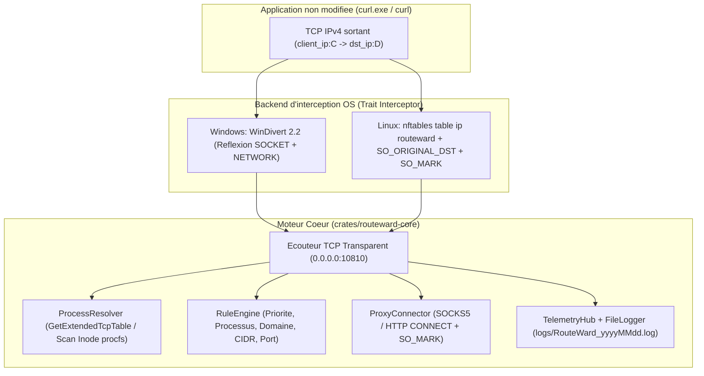

# Architecture de RouteWard

## Vue d'ensemble et Etat Actuel

RouteWard est organise en workspace Rust comprenant trois crates (`routeward-core`, `routeward-cli` et `routeward-desktop` dans `apps/desktop`) ainsi qu'une interface React + TypeScript (`ui/`).

### Etat du Milestone 1 (Interception TCP IPv4 sous Windows)
- **Trait `Interceptor` enfichable (`routeward-core::interceptor::backend`)** : Abstrait l'interception de paquets derriere le trait `Interceptor` afin que les moteurs OS (`WinDivertInterceptor` sous Windows, `NftablesInterceptor` sous Linux) partagent le meme moteur de regles et le meme connecteur proxy.
- **Backend WinDivert 2.2 (`routeward-core::interceptor::windivert`)** : Charge dynamiquement `WinDivert.dll` au runtime via `LoadLibraryExW` et `GetProcAddress` (conformite LGPLv3 par liaison dynamique; aucun binaire WinDivert n'est versionne dans le depot).
- **Resolution de la course SOCKET / NETWORK (`routeward-core::interceptor::nat`)** : Ouvre simultanement `WINDIVERT_LAYER_SOCKET` (sniff lecture seule) et `WINDIVERT_LAYER_NETWORK`. Si un `SYN` arrive avant l'evenement `SOCKET`, RouteWard place le `SYN` dans une file non bloquante `PendingSynQueue` et resout le PID via `GetExtendedTcpTable` (`tcp_table_fallback`), en journalisant la source (`resolvedVia=socket_layer` ou `resolvedVia=tcp_table_fallback`).
- **Redirection locale par reflexion `streamdump`** : Les paquets TCP IPv4 rediriges utilisent la technique `reflect` de l'exemple officiel `streamdump` de WinDivert (`reflect_outbound_to_local_relay` et `reflect_relay_reply_to_client` dans `nat.rs`).

### Etat du Milestone 2 (Interception TCP IPv4 sous Linux)
- **Backend `nftables` (`routeward-core::interceptor::nftables`)** : S'execute en tant que `root` (`geteuid() == 0`) et installe une table dediee (`table ip routeward`, `chain output`, `type nat hook output priority -100`) qui redirige les connexions TCP IPv4 sortantes vers le relais TCP transparent local (`0.0.0.0:10810`).
- **Recuperation de la destination d'origine** : Le relais transparent recupere l'adresse IPv4 et le port d'origine avant DNAT sur le socket accepte via `getsockopt(SOL_IP, SO_ORIGINAL_DST)`. Les connexions directes non redirigees vers `127.0.0.1:10810` sont rejetees et journalisees.
- **Anti-boucle par `SO_MARK` (`fwmark`)** : Toutes les connexions sortantes ouvertes par RouteWard (vers un proxy amont ou en mode `Direct`) appliquent `setsockopt(SOL_SOCKET, SO_MARK, linuxFwmark)` (`0x5257` / `21079`) avant l'appel a `connect()`. La chaine `nftables` commence par `meta mark 21079 return` et `ip daddr 127.0.0.0/8 return`, evitant toute boucle de redirection.
- **Attribution de processus et cas limites (`routeward-core::process`)** : Associe le port source du client dans `/proc/net/tcp` a l'inode du socket, puis parcourt `/proc/<pid>/fd` pour trouver `socket:[<inode>]` :
  - `Single` : Un seul processus detient le socket (`resolvedVia=procfs_single`).
  - `Shared` : Plusieurs PID partagent le socket apres un `fork()` (`resolvedVia=procfs_shared_fork`); RouteWard journalise la liste des PID candidats et attribue la connexion au PID principal (le plus bas).
  - `Unknown` : Si le client ferme le socket avant la fin de l'inspection, RouteWard journalise le cas (`resolvedVia=procfs_unknown`) et applique l'action configurable `securityPolicy.unknownProcessAction` (`Block` par defaut; forcee a `Block` lorsque `securityPolicy.killSwitchEnabled` vaut `true` et que l'action configuree est `Direct`).
- **Comportement de `Block` sous Linux vs Windows** : Sous Windows (`WinDivert`), une regle `Block` jette le paquet `SYN` initial avant l'etablissement de la connexion. Sous Linux (`nftables redirect`), le noyau termine le handshake TCP sur l'ecouteur local avant que l'espace utilisateur n'accepte le socket; RouteWard applique immediatement `SO_LINGER(1, 0)` et ferme le socket, ce qui envoie un `TCP RST` au client.
- **Watchdog fail-open et commande `routeward cleanup`** : `NftablesInterceptor` lance un processus watchdog lie par pipe (`sh -c "cat >/dev/null; nft delete table ip routeward"`) dans son propre groupe de processus. Si `routeward` est tue par `SIGKILL` (`kill -9`), le noyau ferme immediatement le descripteur du pipe et le watchdog supprime `table ip routeward`. Si le watchdog est egalement tue, la commande `routeward cleanup` supprime toute table `nftables` orpheline (ou la regle de pare-feu Windows).
- **Dette technique connue (Milestone 2)** : Le parcours de `/proc/*/fd` a chaque connexion acceptee a un cout `O(processus * descripteurs)`. Son remplacement ou enrichissement par `NETLINK_SOCK_DIAG` ou un cache eBPF est note comme dette technique post-Milestone 2.

### Etat du Milestone 3 - Lot 3.1 (Telemetrie Temps Reel, Annulation et Persistance Atomique)
- **Suppression des donnees simulees au demarrage moteur** : `RouteWardController::new` demarre avec une table Fake-IP et une table de connexions vides; aucune entree DNS ou connexion fictive n'est pre-injectee.
- **Compteurs d'octets en continu (`TelemetryCountingStream`)** : Les connexions relayees (`handle_local_socks5_client` et `handle_transparent_tcp_client`) encapsulent le flux amont dans `TelemetryCountingStream` afin que `rx_bytes`, `tx_bytes` et les compteurs de bande passante soient mis a jour en temps reel a chaque bloc lu ou ecrit pendant le transfert.
- **Annulation reelle d'une connexion active (`terminate_connection`)** : Chaque tunnel actif enregistre un canal d'annulation `tokio::sync::watch` dans `TelemetryHub`; l'appel a `RouteWardController::terminate_connection(id)` interrompt immediatement la boucle `copy_bidirectional`, ferme les sockets client et amont, et marque la connexion `Closed`.
- **Canal d'evenements temps reel (`tokio::sync::broadcast`)** : `TelemetryHub::subscribe()` expose un flux diffuse `TelemetryEvent` (`Telemetry`, `ConnectionUpdated`, `ConnectionsCleared`, `Log`, `LogsCleared`) dont la capacite est configuree par `telemetry.eventBroadcastCapacity`.
- **Sauvegarde atomique du profil (`ProfileConfig::save_to_path`)** : Ecrit le JSON dans un fichier temporaire adjacent, force la synchronisation disque via `sync_all()` puis remplace atomiquement la cible via `fs::rename`.

### Etat du Milestone 3 - Lot 3.2 (Daemon Privilegie, Canal IPC OS Restreint et Pont Bureau Durci)
- **Separation des privileges (`routeward daemon`)** : Le moteur d'interception privilegie tourne dans un daemon a instance unique (`routeward daemon`, lance manuellement en Administrateur sous Windows ou `root` sous Linux), separe de l'interface bureau non privilegiee (`apps/desktop`) et du client CLI (`routeward ctl`).
- **Canal de controle local restreint (`routeward-core::ipc::transport`)** :
  - **Linux** : Socket Unix (`/run/routeward/routeward.sock` par defaut depuis `configs/system_constants.json`), proprietaire `root:<unixSocketGroup>` (`routeward`), dossier parent en `0750`, socket en `0660`. Verifie chaque client via `SO_PEERCRED` et journalise `pid`, `uid` et `gid`. Echoue immediatement au demarrage avec un message explicite si le groupe n'existe pas ou si une autre instance tourne deja.
  - **Windows** : Named Pipe (`\\.\pipe\routeward-daemon`), cree avec `first_pipe_instance(true)` sur la premiere instance contre le squatting de nom, `reject_remote_clients(true)` et un descripteur SDDL explicite (`D:P(A;;GA;;;SY)(A;;GA;;;BA)(A;;GRGW;;;{user_sid})`) limitant l'acces a `SYSTEM`, `Administrators` et au SID de l'utilisateur ayant lance le daemon.
- **Protocole JSON delimite par ligne borne (`routeward-core::ipc::protocol`)** :
  - Deserialisation stricte (`#[serde(deny_unknown_fields)]`) sur toutes les requetes et charges utiles; un JSON invalide, un champ inconnu ou une commande inconnue renvoie une erreur structuree sans paniquer.
  - Applique une taille maximale de ligne (`ipc.maxLineBytes`, `65536` octets) et un delai d'inactivite (`ipc.idleTimeoutMs`, `30000` ms) avant coupure.
  - En cas de `RecvError::Lagged(skipped)` sur le flux d'evenements, journalise un `WARN` et envoie un evenement `IpcStreamEvent::Resync` au client pour recharger l'etat complet.
- **Chemin de profil fixe et verification du proprietaire / des ACL (`routeward-core::config::security`)** :
  - Sous Windows, le dossier `ProgramData` est resolu via l'API `SHGetKnownFolderPath(FOLDERID_ProgramData)` (jamais via une variable d'environnement). A la creation de `%ProgramData%\RouteWard` et de `active_profile.json`, une DACL protegee sans heritage (`D:P(A;OICI;FA;;;SY)(A;OICI;FA;;;BA)` sur le dossier et `D:P(A;;FA;;;SY)(A;;FA;;;BA)` sur le fichier, sans acces `BU` / `Utilisateurs`) et le proprietaire `Administrators` sont appliques afin de proteger les identifiants de proxy. Au demarrage du daemon, si le dossier ou `active_profile.json` existe deja, le daemon verifie que le proprietaire est `SYSTEM` ou `Administrators` et qu'aucune entree DACL n'accorde de lecture ou d'ecriture a un autre principal; sinon il refuse de demarrer sans charger le profil.
  - Sous Linux, `/etc/routeward` (`0700`) et `/etc/routeward/active_profile.json` (`0600`) doivent appartenir a `root` (`uid 0`) sans aucun droit de lecture, d'ecriture ou d'execution pour le groupe ni les autres (`(mode & 0o077) == 0`), sous peine de refus de demarrer.
  - **Masquage des mots de passe de proxy (`ProxyCredentials`)** : Les mots de passe de proxy en clair ne sont jamais renvoyes dans les reponses IPC (`GetState`, `GetProfile`, `ReplaceProfile`); le daemon omet `password` (`None`) et renvoie l'indicateur `"hasPassword": true/false`. Lors d'une ecriture IPC (`UpsertProxy`, `ReplaceProfile`), un champ `password` absent (`None`) conserve le mot de passe existant en memoire/disque, tandis qu'un mot de passe fourni le remplace. L'implementation `Debug` de `ProxyCredentials` et les erreurs d'URI de proxy masquent systematiquement le secret avec `[REDACTED]`.
  - Note sur l'elevation Windows : le daemon doit etre lance par l'utilisateur de l'interface (elevation de son propre compte); si l'elevation est faite avec un autre compte administrateur, l'interface de l'utilisateur ne pourra pas se connecter au pipe.
- **Pont Loopback Bureau durci (`apps/desktop`)** : Se connecte au daemon via `IpcClient` (remonte `daemonConnected: false, running: false` avec reconnexion automatique en tache de fond si le daemon est absent), injecte un jeton ephemere dans la WebView (`window.__ROUTEWARD_TOKEN__`) et verifie le jeton en temps constant (`constant_time_eq`) ainsi que les en-tetes `Host` (`127.0.0.1:<port>`) et `Origin` (`http://127.0.0.1:<port>`) sur `/api/*`.

### Etat du Milestone 3 - Lot 3.3 (Branchement Frontend Reel, Flux SSE Authentifie et Nettoyage au Demarrage)
- **Suppression totale de la simulation Frontend (`ui/src/services/ipc.ts` & `ui/src/App.tsx`)** : Tous les generateurs de trafic fictif, presets de simulation (`SIMULATION_PRESETS`) et appels `Math.random` ont ete retires de `ui/`. Toutes les vues (`DashboardView`, `ConnectionsView`, `RulesView`, `ProxiesView`, `ChainsView`, `DnsManagerView`, `LogsView`, `QuickSetupWizardModal`) communiquent avec le daemon reel via le pont loopback en transmettant `window.__ROUTEWARD_TOKEN__` dans l'en-tete `X-RouteWard-Token` sur chaque requete.
- **Flux temps reel SSE authentifie par en-tete (`GET /api/events`)** : Au lieu d'utiliser `EventSource` (qui ne supporte pas les en-tetes personnalises) ou de passer le jeton dans une URL, `ui/src/services/ipc.ts` lit le flux SSE via `fetch` + `ReadableStream` (`response.body.getReader()`) avec l'en-tete `X-RouteWard-Token`. Lors de la connexion initiale, d'une reconnexion ou de la reception d'un evenement `IpcStreamEvent::Resync`, l'interface recharge l'etat complet (`GET /api/state`) avant de reprendre le flux.
- **Bannieres d'etat du daemon et des privileges (`ui/src/App.tsx`)** : Lorsque le daemon est absent ou deconnecte (`!diagnostics.daemonConnected`), l'interface affiche une banniere persistante traduite indiquant la commande de lancement de `routeward daemon`, passe l'etat du moteur a arrete, remet les debits temps reel a `0`, marque les connexions actives comme `closed`, et se resynchronise automatiquement des que le daemon redemarre. Si le daemon tourne sans elevation (`!diagnostics.elevatedPrivileges`), une banniere d'avertissement dediee s'affiche.
- **Mots de passe de proxy en ecriture seule (`ui/src/components/ProxiesView.tsx`)** : Les cartes de proxy affichent un badge traduit « Mot de passe defini » lorsque `auth.hasPassword` vaut `true`. A l'edition d'un proxy, un champ mot de passe vide n'envoie pas la cle `password` (conservant le secret existant cote daemon), tandis qu'une action explicite « Remplacer le mot de passe » permet de definir un nouveau secret sans jamais exposer ni journaliser de mot de passe en clair dans le navigateur.
- **Nettoyage automatique au demarrage du daemon (`crates/routeward-cli/src/main.rs`)** : Immediatement apres la reussite de `DaemonIpcService::bind` (garantissant qu'aucune autre instance du daemon ne tourne), `routeward daemon` appelle `controller.cleanup_orphaned_rules()` afin de supprimer toute regle de pare-feu Windows (`RouteWard_TransparentRelay_*`) ou table `nftables` Linux (`table ip routeward`) orpheline laissee par un crash precedent, et journalise l'operation au niveau `INFO`.
- **Dossiers de journaux dedies Daemon et Utilisateur (`routeward-core::config`)** : Les processus privilegies (`routeward daemon`, `routeward run`, `routeward cleanup`) ecrivent leurs journaux dans `%ProgramData%\RouteWard\logs` sous Windows (via `SHGetKnownFolderPath(FOLDERID_ProgramData)`) et `/var/log/routeward` sous Linux. Les processus non privilegies (`routeward-desktop`, `routeward ctl`) ecrivent dans `%LOCALAPPDATA%\RouteWard\logs` sous Windows (via `SHGetKnownFolderPath(FOLDERID_LocalAppData)`) et `$XDG_STATE_HOME/routeward/logs` (ou `~/.local/state/routeward/logs`) sous Linux, sans dependre du repertoire courant (`CWD`).

### Etat du Milestone 4 - Lot 4.0 (Application du Kill-Switch)
- **Kill-Switch strict (`securityPolicy.killSwitchEnabled = true`, valeur par defaut)** : Tant que le moteur d'interception tourne et que `killSwitchEnabled` vaut `true`, tout flux route vers un `Proxy` ou une `Chain` dont la connexion amont echoue (refus de connexion, delai depasse, erreur d'authentification, chaine multi-sauts `Sequence` cassee, ou groupe dont tous les noeuds actifs tombent) est bloque et **ne sort jamais en `Direct`** :
  - Enregistre une `TrackedConnection` dans `TelemetryHub` avec `status = Blocked` (`"blocked"`) et `routeLabel = "BLOCKED"` (incrementant `blocked_count`).
  - Journalise un message `WARN` detaille avec le nom de la regle et la raison de l'echec (`Kill-Switch blocked connection ...` sur le relais TCP transparent; `Kill-Switch blocked local SOCKS5 connection ...` sur le relais SOCKS5 local).
  - Ferme proprement la connexion cote client : reponse d'echec general SOCKS5 (`0x05, 0x01, ...`) suivie d'un `shutdown` sur le relais SOCKS5 local (`127.0.0.1:10808`), fermeture propre et nettoyage de la session NAT sur le relais transparent Windows, et envoi d'un `TCP RST` (`SO_LINGER(1, 0)`) sur le relais transparent Linux (`nftables`).
- **Repli explicite en `Direct` lorsque desactive (`securityPolicy.killSwitchEnabled = false`)** : Lorsque `killSwitchEnabled` est explicitement mis a `false` et qu'un `Proxy` ou une `Chain` amont echoue, RouteWard journalise un `WARN` (`Upstream proxy failed ...; falling back to DIRECT because killSwitchEnabled=false`), ouvre une connexion `Direct` et enregistre la connexion avec `routeLabel = "DIRECT"`.
- **Groupes intelligents (`Failover`, `LowestLatency`, `LoadBalance`)** : Les groupes basculent uniquement vers un autre noeud proxy actif du meme groupe (`ProxyConnector::connect_group`). Si tous les noeuds du groupe echouent et que `killSwitchEnabled` vaut `true`, le flux est bloque et ne sort jamais en `Direct`.
- **Fail-open a l'arret ou au crash du daemon conserve** : L'arret de l'interception (`ctl stop`) ou le crash du daemon (`SIGKILL` / `Stop-Process -Force`) retire les regles d'interception OS et laisse passer le trafic en direct (fail-open), sans changement par rapport aux jalons 1 a 3.
- **Contournement DNS en environnement Active Directory / Split-Horizon (`dnsConfig.bypassDomains`)** : Dans les environnements Active Directory et d'entreprise, la liste `dnsConfig.bypassDomains` permet de configurer les suffixes de domaine internes, zones privees et zones inverses (par exemple `*.ad.entreprise.tld`, `*.internal`, `*.local`, `10.in-addr.arpa`, `168.192.in-addr.arpa`, `*.ip6.arpa`) qui sont resolus en direct sans attribution Fake-IP ni passage par le proxy distant.
- **Non implemente a ce stade** : Capture DNS transparente (Lot 4.1), relais UDP (Lot 4.2) et interception IPv6 (Lot 4.3).

### Etat du Milestone 4 - Lot 4.0.1 (Fermeture des Fuites Indirectes)
- **Politique d'expiration de `PendingSynQueue` sous Windows (`routeward-core::interceptor::nat` & `windivert`)** :
  - Lorsque `securityPolicy.killSwitchEnabled = true` (defaut) et que la resolution du PID depasse `pendingSynTimeoutMs` (`50` ms), RouteWard **jette** le paquet `SYN` sans le reinjecter (`WinDivertSend` n'est pas appele) et sans reponse. La pile TCP du client retransmet naturellement le `SYN` (~1 s plus tard), moment auquel l'attribution du PID a abouti. Chaque `SYN` jete incremente `dropped_unattributed_syn_count` et est journalise en `INFO` (`Dropped unattributed Pending SYN #<count> after <ms>ms ...`).
  - Lorsque `securityPolicy.killSwitchEnabled = false`, le comportement de reinjection fail-open est conserve, incremente `reinjected_unattributed_syn_count` et journalise un `WARN` (`Released unattributed Pending SYN #<count> after <ms>ms ...`).
- **Politique des processus non attribues (`securityPolicy.unknownProcessAction`)** :
  - La valeur par defaut de `securityPolicy.unknownProcessAction` dans `configs/default_profile.json` et `SecurityPolicyConfig::default()` est desormais `Block` (`{ "type": "block" }`).
  - Lorsque `securityPolicy.killSwitchEnabled = true`, tout socket non attribue (`ProcessAttribution::Unknown`, binaire illisible `pid:<n>` ou client SOCKS5 local non attribue) dont l'action `unknownProcessAction` est `Direct` (ou absente) se voit appliquer `Block` avec un log `WARN` (`SecurityPolicy:unknownProcessAction(KillSwitchOverride)`).
  - Les identites de repli `pid:<n>` (processus deja termine ou image illisible) ne sont plus mises en cache dans `ProcessResolver`.
- **Garde Fake-IP non allouee ou expiree (`routeward-core::dns` & `interceptor`)** : Toute connexion ciblant une IPv4 de la plage `fakeIpCidr` (`198.18.0.0/15`) sans correspondance active non expiree est bloquee (`FakeIP:UnmappedOrExpired`) et journalisee en `WARN` au lieu de sortir en `Direct`.
- **Garde des paquets de fin de session du relais sous Windows (`windivert.rs`)** : Tout paquet de reponse provenant du port du relais transparent local (`10810`) apres la suppression de l'entree `NatSessionEntry` correspondante est jete au lieu d'etre reinjecte sur le reseau.

### Etat du Milestone 4 - Lot 4.1 (Interception DNS Transparente, Fake-IP, DNS-over-TCP Reel et Contournements Entreprise)
- **Interception du port 53 sortant (UDP et TCP)** :
  - **Linux (`nftables.rs`)** : `table ip routeward` redirige le port `53` UDP (`udp dport 53 redirect to :10853`) et TCP (`tcp dport 53 redirect to :10853`) vers le resolveur DNS local de RouteWard (`0.0.0.0:10853`). Le service DNS systeme (`systemd-resolved`) n'est jamais exclu de la redirection DNS ; le filtrage par processus s'effectue au moment de la connexion via Fake-IP.
  - **Windows (`windivert.rs`)** : Intercepte les paquets UDP `53` IPv4 sortants (resolution memoire rapide via `resolve_dns_query_fast` ou asynchrone via `resolve_dns_query_async`, forgeage du paquet UDP de reponse via `build_forged_ipv4_udp_reply` et reinjection entrante via `WinDivertSend`) et reflechit les flux TCP `53` IPv4 sortants vers le relais TCP transparent (`:10810`), qui delegue le port `53` a `handle_dns_tcp_stream`. Les services DNS systeme (`svchost.exe`/`Dnscache` et `dns.exe` sur un serveur DNS Windows) ne sont jamais exclus.
- **Codec DNS RFC 1035 100 % Safe Rust (`routeward-core::dns::codec`)** : Decodeur et constructeur `#![forbid(unsafe_code)]` gerant `A`, `AAAA`, `CNAME`, `PTR`, `TXT` et `OPT` (EDNS0), la compression de labels (`0xC0`) avec verification stricte des bornes et protection anti-boucle (16 sauts maximum), la troncature UDP (`TC = 1` au-dela de 512 octets ou de la taille EDNS0 annoncee), et le cadrage DNS-over-TCP sur 2 octets big-endian.
- **Mode Fake-IP (`dnsConfig.enableFakeIp = true`, par defaut)** :
  - Requete `A` : renvoie une IPv4 de la plage `fakeIpCidr` (`198.18.0.0/15`) avec un **TTL de 5 secondes renvoye a l'OS** (`dns.osResponseTtlSeconds = 5`) afin que le cache DNS du systeme expire rapidement apres l'arret du daemon, tandis que la table interne `FakeIpEngine` conserve l'association pendant `300` secondes (`dns.defaultTtlSeconds = 300`).
  - Requete `AAAA` : renvoie **`NODATA`** (`RCODE = 0 NOERROR`, `ANCOUNT = 0`) pour que les applications dual-stack se connectent immediatement en IPv4 sur la Fake-IP allouee.
  - Requete `PTR` sur une IP du pool `198.18.0.0/15` : renvoie le nom de domaine associe.
  - Lors de la connexion ulterieure vers une Fake-IP, RouteWard retrouve le nom de domaine, evalue les regles sur le processus et le domaine, et transmet le nom de domaine au proxy amont (`ATYP = 0x03` en SOCKS5, nom d'hote dans `CONNECT` HTTP). Si la regle est `Direct`, RouteWard resout lui-meme la vraie IPv4 en direct (`resolve_host_direct_ipv4`, protege contre les boucles) avant d'etablir la connexion.
- **Resolution DNS reelle via le proxy (`dnsConfig.enableFakeIp = false` ou types hors A/AAAA)** :
  - Execute une requete **DNS-over-TCP** a travers le proxy ou la chaine determinee par les regles.
  - Lorsque `securityPolicy.strictDnsNoLocalFallback = true` (defaut) ou `killSwitchEnabled = true` et que le proxy echoue, RouteWard renvoie **`SERVFAIL` (`RCODE = 2`)**, journalise un `WARN` et ne effectue **jamais** de repli DNS en clair.
- **Contournements DNS directs en entreprise / Active Directory** :
  - En environnement d'entreprise Active Directory, les controleurs de domaine internes (`_ldap._tcp.dc._msdcs.<domaine>`), royaumes Kerberos et zones split-horizon doivent impérativement etre resolus en direct aupres du resolveur DNS interne vise par le systeme, sans Fake-IP ni passage par un proxy externe.
  - RouteWard resout directement vers le resolveur vise par l'OS (avec `SO_MARK` sous Linux et `SelfPortGuard` sous Windows contre toute boucle) :
    1. La liste configurable `dnsConfig.bypassDomains`
    2. Le suffixe DNS principal et la liste de recherche de la machine detectes automatiquement (domaine Active Directory via `USERDNSDOMAIN` et `HKLM\SYSTEM\CurrentControlSet\Services\Tcpip\Parameters` `Domain` / `NV Domain` / `SearchList` sous Windows ; directives `domain` et `search` de `/etc/resolv.conf` sous Linux)
    3. Les noms courts sans point (single-label)
    4. `.local` et `.localhost`
    5. Les zones inverses privees (`10.in-addr.arpa`, `168.192.in-addr.arpa`, `16.172.in-addr.arpa`..`31.172.in-addr.arpa`, `127.in-addr.arpa`, `254.169.in-addr.arpa`, IPv6 ULA `c.f.ip6.arpa`/`d.f.ip6.arpa` et link-local `8..b.e.f.ip6.arpa`).
- **Resolution d'amorçage des proxys amont configures par nom** : Lorsqu'un proxy amont est configure par nom de domaine, RouteWard le resout en direct (`bootstrap_resolve_proxy_hosts` / `prepare_proxy_node_with_bootstrap`) sans Fake-IP ni boucle et injecte les couples `(ip, port)` obtenus dans `nat_table.upstream_endpoints()` pour l'exclusion anti-boucle.
- **Protection contre le contournement DNS chiffre (`securityPolicy.blockEncryptedDnsBypass = true`, defaut) et blocage DNS IPv6** :
  - Renvoie **`NXDOMAIN` (`RCODE = 3`)** (journalise en `WARN`) pour le domaine canari DoH `use-application-dns.net` afin de desactiver le DoH opportuniste des navigateurs.
  - Bloque le port **853 sortant (DoT / DoQ)** en TCP et en UDP et journalise un `WARN`.
  - En attendant l'interception IPv6 complete au lot 4.3, avec le kill switch actif (`killSwitchEnabled = true`), bloque les ports **53 et 853 sortants en IPv6** (UDP et TCP) sous Windows (`WinDivert`) et sous Linux (`table ip6 routeward` `reject` / `reject with tcp reset`, couverte par le meme watchdog fail-open et par `routeward cleanup`), forçant le systeme a utiliser ses resolveurs IPv4.
- **Journalisation DNS respectueuse de la vie privee** : Les requetes DNS ordinaires et allocations Fake-IP ne sont jamais journalisees en `INFO` (uniquement en `DEBUG`), tandis que les entrees Fake-IP actives restent consultables via `routeward ctl fake-ips` (`ctl flush-fake-ips`) et dans l'onglet DNS de l'interface. Les erreurs (`SERVFAIL`, proxy injoignable, blocage 853 / canari) sont journalisees en `WARN`.

### Etat du Milestone 4 - Lot 4.1.1 (Fermeture des Fuites DNS, Inspection TLS SNI, Vidage du Cache OS et Rechargement a Chaud)
- **Resolution strictement interne des domaines en contournement (`DnsResolverMode::BypassOnlySystem`)** :
  - Les domaines couverts par `dnsConfig.bypassDomains`, les suffixes Active Directory / DNS de la machine, les noms courts sans point, `.local`/`.localhost` et les zones inverses privees **n'interrogent jamais** `upstreamDns`, `default_upstream` ni `fallback_dns_server`.
  - Seuls `orig_resolver`, `last_seen_orig_resolver` et les resolveurs actifs du systeme (`GetAdaptersAddresses` sous Windows ; `/etc/resolv.conf` sous Linux, avec bascule automatique sur `/run/systemd/resolve/resolv.conf` lorsque `/etc/resolv.conf` ne contient que le stub `127.0.0.53`) sont interroges. Si aucun ne repond, RouteWard renvoie **`SERVFAIL` (`RCODE = 2`)** sans jamais contacter un resolveur public.
- **Blocage inconditionnel des ports 53 et 853 en IPv6** :
  - Jusqu'a l'interception IPv6 complete au lot 4.3, les ports `53` et `853` sortants en IPv6 (UDP et TCP) sont bloques des que le moteur tourne, independamment de `securityPolicy.killSwitchEnabled`, sous Linux (`table ip6 routeward`) comme sous Windows (`WinDivert`).
- **Priorite aux resolveurs systeme pour les flux `Direct` (`DnsResolverMode::DirectPreferSystem`)** :
  - Lors de la resolution d'un domaine non contourne pour un flux `Direct` (`resolve_host_direct_ipv4_all` ou regle DNS `Direct`), RouteWard interroge d'abord `orig_resolver`, `last_seen_orig_resolver` et les resolveurs actifs du systeme (`GetAdaptersAddresses` sous Windows ; `/etc/resolv.conf` / `/run/systemd/resolve/resolv.conf` sous Linux). `upstreamDns` n'est utilise que si aucun resolveur systeme ni `orig_resolver` n'existe, et jamais pour un domaine en contournement.
- **Vidage automatique du cache DNS de l'OS au demarrage et a l'arret du moteur (`dns::flush_os_dns_cache`)** :
  - Au demarrage (`start_engine`) et a l'arret (`stop_engine`) du moteur, RouteWard vide le cache DNS client de l'OS (`dnsapi.dll!DnsFlushResolverCache` avec repli sur `ipconfig /flushdns` sous Windows sans toucher au role serveur DNS Windows ; `resolvectl flush-caches` sous Linux si `systemd-resolved` est present, sinon ignore avec un log `DEBUG`).
- **Inspection TLS `ClientHello` SNI sur le relais TCP transparent (`peek_tls_client_hello_sni`)** :
  - Lorsqu'une connexion TCP transparente cible une IPv4 litterale (hors Fake-IP) sur le port `443` (`network.tlsSniDefaultPort`), RouteWard lit en mode `peek` non destructif le `ClientHello` TLS (borne par `network.tlsSniPeekTimeoutMs = 200` ms et `network.tlsSniMaxBytes = 4096` octets) et extrait le SNI via `TlsSniExtractor`.
  - Si un SNI est present, les regles de domaine sont reevaluees avec ce nom ; si la regle retenue est `Proxy` ou `Chain`, le domaine SNI est transmis au proxy (`ATYP = 0x03`) et le `ClientHello` complet est relaye sans perte. Sous Windows, `WinDivertInterceptor` reflechit egalement les `SYN` vers le port `443` lorsque des regles de domaine sont actives afin de permettre l'inspection SNI.
- **Rechargement atomique a chaud de `securityPolicy`, `dnsConfig` et `proxies` (`Interceptor::reload`)** :
  - Toute modification de `securityPolicy`, `dnsConfig` ou `proxies` via `replace_profile` (`routeward ctl replace-profile` ou l'interface) pendant que le moteur tourne reapplique immediatement les regles d'interception (`nft -f -` en une transaction atomique sur `table ip` et `table ip6` sous Linux ; ouverture du nouveau handle `WinDivert` avant fermeture de l'ancien sous Windows) et relance l'amorçage des proxys sans fenetre permissive. Journalise en `INFO`.
- **Eviction de la plus ancienne entree Fake-IP et garde `SERVFAIL` (`FakeIpEngine::evict_oldest`)** :
  - Lorsque le pool Fake-IP atteint `dns.maxCacheEntries`, RouteWard evince d'abord les entrees expirees (`evict_expired`) puis la plus ancienne entree (`evict_oldest`). Si l'allocation echoue malgre tout, RouteWard renvoie **`SERVFAIL` (`RCODE = 2`)** sans jamais basculer sur une resolution DNS reelle en clair.

### Etat du Milestone 4 - Lot 4.2 (Relais UDP, Rejet QUIC, Gardes de Noms Locaux et Interception UDP IPv4 Transparente)
- **Sous-lot 4.2.a — SOCKS5 `UDP ASSOCIATE`, Relais UDP SOCKS5 Local, Rejet QUIC (`UDP 443`) et Gardes LLMNR/mDNS/NetBIOS** :
  - **`UdpAssociationManager` (`routeward-core::proxy::udp`)** : Implemente `UDP ASSOCIATE` RFC 1928 (`CMD = 0x03`) et l'encapsulation UDP RFC 1928 §7 (`RSV=0x0000`, `FRAG`, `ATYP` `0x01`/`0x03`/`0x04`). Les associations sont indexees par `(socket_client, proxy_id)` avec expiration d'inactivite (`udp.associationIdleTimeoutSeconds = 60` s) et plafond (`udp.maxConcurrentAssociations = 256`).
  - **Evaluation des regles par datagramme et bascule multi-noeuds** : Chaque datagramme UDP sortant evalue `RuleEngine::evaluate` selon sa propre destination (`ATYP = 0x03` ou recherche inverse Fake-IP + port). Deux datagrammes issus d'un meme socket client vers deux destinations distinctes peuvent suivre des regles differentes (`Proxy`, `Direct`, `Block`). Si un proxy renvoie `REP = 0x07` (`Command not supported`) ou echoue lors de `UDP ASSOCIATE`, un groupe (`Failover`, `LowestLatency`, `LoadBalance`) bascule vers un autre noeud actif du groupe ; si aucun noeud ne repond et que `killSwitchEnabled = true`, le datagramme est bloque (`status = Blocked`, `routeLabel = "BLOCKED"`).
  - **Politique de fragmentation UDP** : Les trames UDP SOCKS5 fragmentees (`FRAG != 0`) et les paquets IPv4 UDP fragmentes (`MF != 0 || frag_offset != 0`) ne sont pas reassembles en v1 ; lorsqu'ils correspondent a une regle `Proxy`/`Chain` avec `killSwitchEnabled = true`, ils sont bloques avec compteur et log `WARN` limite en debit (`Direct` passe).
  - **Rejet QUIC (`UDP 443`, `securityPolicy.blockQuicUdp443 = true` par defaut)** :
    - **Linux** : `nftables` `udp dport 443 reject` (envoi immediat d'`ICMP Port Unreachable`) double d'une journalisation `WARN` limitee en debit et d'une entree `blocked` dans la telemetrie.
    - **Windows** : `WinDivert` jette le paquet `UDP 443` sortant et injecte en entree un paquet `ICMPv4 Destination Unreachable / Port Unreachable` (`Type 3, Code 3`) via `build_forged_ipv4_icmp_port_unreachable` (avec recalcul complet des sommes de controle IPv4+UDP internes citees et IPv4+ICMPv4 externes). Note : sous Windows, `tcpip.sys` / WFP (`FWPM_LAYER_INBOUND_ICMP_ERROR_V4`) peut ignorer les erreurs ICMP entrantes synthetiques lorsque le paquet UDP sortant a ete jete sur `WINDIVERT_LAYER_NETWORK` avant la creation complete de l'etat de flux sortant WFP.
  - **Gardes LLMNR (`UDP 5355`), mDNS (`UDP 5353`) et NetBIOS-NS (`UDP 137`)** :
    - Les requetes LLMNR et mDNS portant sur un nom local (nom court sans point, `.local`, suffixes Active Directory / DNS de la machine, `dnsConfig.bypassDomains`, zones inverses privees) sortent en direct ; les FQDN publics sont bloques (`LocalNameGuard:LLMNR` / `LocalNameGuard:mDNS`) avec un log `WARN` limite en debit.
    - NetBIOS-NS (`UDP 137`) vers une IPv4 privee, link-local ou broadcast sort en direct ; vers une IPv4 publique unicast, il est bloque (`LocalNameGuard:NetBIOS-NS`) avec un log `WARN` limite en debit.
- **Sous-lot 4.2.b — Interception UDP IPv4 Transparente Generale (`TPROXY` sous Linux & `WinDivert` sous Windows)** :
  - **Linux (`TPROXY` dans `routeward-core::interceptor::nftables` & `mod.rs`)** :
    - Les datagrammes UDP IPv4 sortants (hors `SO_MARK = linuxFwmark`, loopback `127.0.0.0/8`, proxys amont et multicast/broadcast hors LLMNR/mDNS) sont marques dans `chain route_output` (`type route hook output priority -150`, `meta mark set <linuxTproxyFwmark>`) et routes localement sur `lo` via `ip rule add fwmark <linuxTproxyFwmark> lookup <linuxTproxyRouteTable> priority <linuxTproxyRulePriority>` et `ip route add local 0.0.0.0/0 dev lo table <linuxTproxyRouteTable>`.
    - `chain prerouting` (`type filter hook prerouting priority -150`) intercepte les paquets marques via `meta l4proto udp meta mark <linuxTproxyFwmark> tproxy to 127.0.0.1:10854 accept`.
    - Au demarrage, `NftablesInterceptor` verifie que `linuxTproxyFwmark`, `linuxTproxyRouteTable` et `linuxTproxyRulePriority` (configures dans `configs/system_constants.json`) sont libres ; s'ils sont deja occupes, il journalise une erreur claire et refuse de demarrer l'interception sans ecraser l'existant.
    - Le socket UDP TPROXY (`127.0.0.1:10854`) active `IP_TRANSPARENT` et `IP_RECVORIGDSTADDR`, recupere la destination d'origine par datagramme via `recvmsg` (`SOL_IP` / `IP_ORIGDSTADDR`), attribue le processus via `/proc/net/udp` (`resolve_by_local_udp_port`) et injecte les reponses vers le client via `SOCK_RAW` + `IP_HDRINCL` + `SO_MARK` avec l'IP et le port source du serveur distant (ou la Fake-IP visee par le client).
    - Les requetes LLMNR (`5355`) et mDNS (`5353`) autorisees passent par `TPROXY` et sont reemises via `send_raw_ipv4_udp_packet` (`SOCK_RAW` + `IP_HDRINCL` + `SO_MARK`) sans reecriture du port source (`5353` conserve pour la conformite RFC 6762).
    - Le watchdog fail-open, l'arret (`stop`), le rechargement a chaud (`reload`) et `routeward cleanup` suppriment exactement l'`ip rule` et la route locale posees, en plus de `table ip routeward` et `table ip6 routeward`.
  - **Windows (`WinDivert` dans `routeward-core::interceptor::windivert` & `nat.rs`)** :
    - Etend `WINDIVERT_LAYER_SOCKET` a `"outbound and !loopback and (tcp or udp)"` et `WINDIVERT_LAYER_NETWORK` a tout l'UDP IPv4 sortant (hors loopback, ports internes et proxys amont).
    - Attribue le processus via le cache de la couche `SOCKET` avec repli sur `GetExtendedUdpTable` (`resolve_by_local_udp_port`). Si un premier datagramme UDP arrive avant son attribution `SOCKET`, il est place dans la file bornee `PendingUdpQueue` (`pendingUdpTimeoutMs = 40` ms, `maxPendingUdpPackets = 256`) ; a expiration, il est bloque (`INFO` + compteur) si `killSwitchEnabled = true`, ou reinjecte (`WARN` + compteur) sinon.
    - Evalue chaque datagramme : `Block` jette le paquet ; `Direct` reinjecte en sortie (ou traduit une Fake-IP vers sa vraie IPv4 via `send_and_optional_recv_udp_direct_protected` et reinjecte la reponse avec la Fake-IP comme source) ; `Proxy`/`Chain` relaie via `UdpAssociationManager::send_datagram` et reinjecte les reponses en entree via `build_forged_ipv4_udp_reply` + `WinDivertSend` avec l'IP/port du serveur distant (ou la Fake-IP).

## Diagramme des Composants

## Modules du Workspace

| Chemin | Crate / Paquet | Responsabilite |
| :--- | :--- | :--- |
| `crates/routeward-core` | `routeward-core` | Trait `Interceptor`, `WinDivertInterceptor` (Windows), `NftablesInterceptor` (Linux), `TransparentNatTable`, `ProcessResolver`, `RuleEngine`, `ProxyConnector` (TCP + SOCKS5 `UDP ASSOCIATE` via `UdpAssociationManager`), rejet QUIC (`UDP 443`) par ICMP Port Unreachable, filtrage LLMNR (`5355`) / mDNS (`5353`) / NetBIOS-NS (`137`) et `FileLogger` quotidien. |
| `crates/routeward-cli` | `routeward-cli` (`routeward`) | Interface en ligne de commande (`run --duration-secs`, `cleanup`, `check`, `eval`, `fake-ip`). |
| `apps/desktop` | `routeward-desktop` | Application bureau native basee sur `tao` et `wry` embarquant le bundle `ui/dist`. |
| `ui` | `routeward-ui` | Interface React 18 + TypeScript + Tailwind CSS avec palettes ThemeForge. |
| `tools/fetch-windivert.ps1` | Script PowerShell | Telecharge WinDivert 2.2.2-A officiel, verifie le SHA-256 et extrait `WinDivert.dll` et `WinDivert64.sys` dans `third_party/windivert/bin/`. |
| `tests/linux/` | Suite de Tests Conteneur | Scenarios d'integration automatises sous Docker Debian 12 + `nftables` (`run-scenarios.sh`). |
| `tests/windows/` | Suite de Tests Windows | Scenarios de non-regression Windows PowerShell 5.1 (`Invoke-RouteWardTests.ps1`, `Run-RouteWardTests.bat`). |
