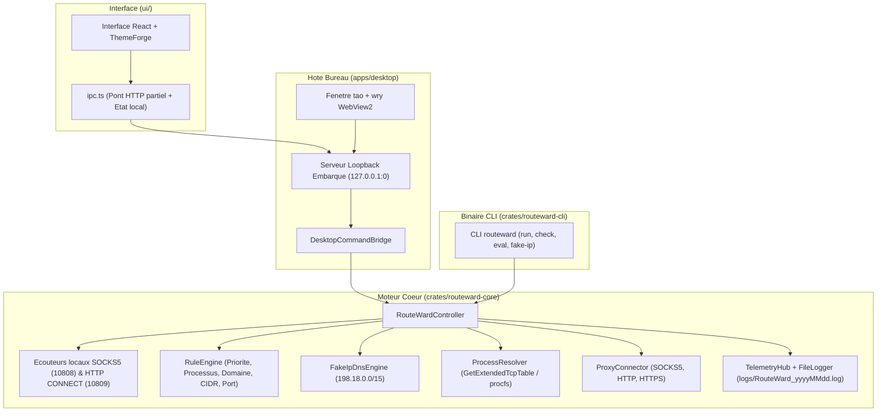

# Architecture de RouteWard

## Vue d'ensemble et Etat Actuel

RouteWard est organise en workspace Rust comprenant trois crates (`routeward-core`, `routeward-cli` et `routeward-desktop` dans `apps/desktop`) ainsi qu'une interface React + TypeScript (`ui/`).

**Limitation importante de l'etat actuel** :
- **L'interception transparente de paquets au niveau du systeme d'exploitation n'est pas encore implementee.** Actuellement, `routeward-core` expose des ecouteurs locaux (SOCKS5 sur `127.0.0.1:10808`, HTTP CONNECT sur `127.0.0.1:10809` et DNS Fake-IP sur `127.0.0.1:10853`) et attribue les connexions locales aux processus via la table TCP du systeme. Les applications doivent donc etre lancees avec les variables d'environnement de proxy (`ALL_PROXY`, `HTTP_PROXY`, `HTTPS_PROXY`), utiliser le Proxy Systeme Windows, ou pointer explicitement vers le relais local.
- **Etat de l'IPC Frontend** : L'interface React (`ui/src/services/ipc.ts`) utilise encore un client d'etat local pour l'edition des profils et n'appelle le backend Rust que pour `/api/scan-os`, `/api/system-proxy`, `/api/launch-process` et les controles de fenetre. Le branchement IPC complet est prevu au Milestone 3.

## Diagramme des Composants

## Modules du Workspace

| Chemin | Crate / Paquet | Responsabilite |
| :--- | :--- | :--- |
| `crates/routeward-core` | `routeward-core` | Chargement de configuration, moteur de regles par priorite, cache DNS Fake-IP, connecteur proxy SOCKS5/HTTP, attribution de sockets TCP OS, telemetrie et `FileLogger` quotidien. |
| `crates/routeward-cli` | `routeward-cli` (`routeward`) | Interface en ligne de commande pour demarrer le relais local, tester les proxies, evaluer les regles et inspecter le DNS Fake-IP. |
| `apps/desktop` | `routeward-desktop` | Application bureau native basee sur `tao` et `wry` embarquant le bundle `ui/dist`. |
| `ui` | `routeward-ui` | Interface React 18 + TypeScript + Tailwind CSS avec palettes ThemeForge et internationalisation `react-i18next`. |
| `configs` | Configurations JSON | `system_constants.json`, `default_profile.json` et `themeforge_palettes.json`. |
| `locales` | Dictionnaires i18n | Fichiers de traduction `fr.json` et `en.json`. |
