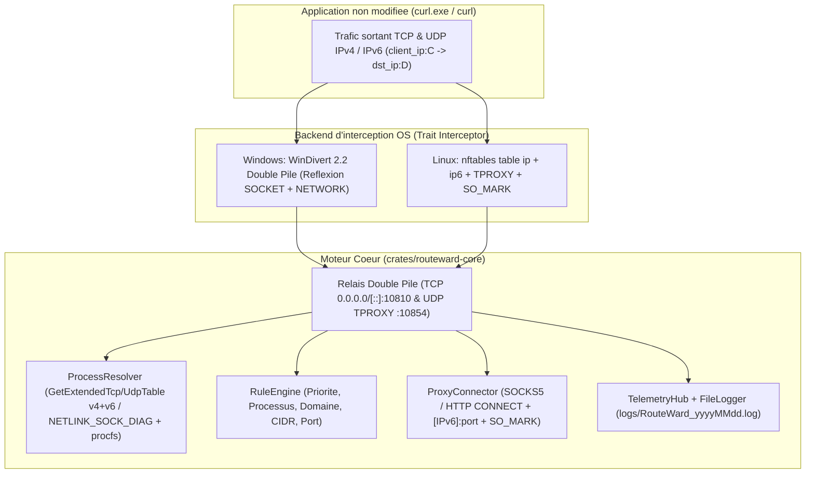

[English](../architecture.md) | Français

# Architecture de RouteWard

## Vue d'Ensemble et État Actuel

RouteWard est organisé en workspace Rust comprenant trois crates (`routeward-core`, `routeward-cli` et `routeward-desktop` dans `apps/desktop`) ainsi qu'une interface React + TypeScript (`ui/`).

### État du Milestone 1 (Interception TCP IPv4 sous Windows)
- **Trait `Interceptor` enfichable (`routeward-core::interceptor::backend`)** : Abstrait l'interception de paquets derrière le trait `Interceptor` afin que les moteurs OS (`WinDivertInterceptor` sous Windows, `NftablesInterceptor` sous Linux) partagent le même moteur de règles et le même connecteur proxy.
- **Backend WinDivert 2.2 (`routeward-core::interceptor::windivert`)** : Charge dynamiquement `WinDivert.dll` au runtime via `LoadLibraryExW` et `GetProcAddress` (conformité LGPLv3 par liaison dynamique ; aucun binaire WinDivert n'est versionné dans le dépôt). La DLL n'est chargée que depuis le dossier de l'exécutable (les entrées relatives de `windivertDllPaths` y sont résolues) ; la variable `ROUTEWARD_WINDIVERT_DLL_PATH` n'est prise en compte que par les builds de débogage.
- **Résolution de la course SOCKET / NETWORK (`routeward-core::interceptor::nat`)** : Ouvre simultanément `WINDIVERT_LAYER_SOCKET` (sniff lecture seule) et `WINDIVERT_LAYER_NETWORK`. Si un `SYN` arrive avant l'événement `SOCKET`, RouteWard place le `SYN` dans une file non bloquante `PendingSynQueue` et résout le PID via `GetExtendedTcpTable` (`tcp_table_fallback`), en journalisant la source (`resolvedVia=socket_layer` ou `resolvedVia=tcp_table_fallback`).
- **Redirection locale par réflexion `streamdump`** : Les paquets TCP IPv4 redirigés utilisent la technique `reflect` de l'exemple officiel `streamdump` de WinDivert (`reflect_outbound_to_local_relay` et `reflect_relay_reply_to_client` dans `nat.rs`).

### État du Milestone 2 (Interception TCP IPv4 sous Linux)
- **Backend `nftables` (`routeward-core::interceptor::nftables`)** : S'exécute en tant que `root` (`geteuid() == 0`) et installe une table dédiée (`table ip routeward`, `chain output`, `type nat hook output priority -100`) qui redirige les connexions TCP IPv4 sortantes vers le relais TCP transparent local (`0.0.0.0:10810`).
- **Récupération de la destination d'origine** : Le relais transparent récupère l'adresse IPv4 et le port d'origine avant DNAT sur le socket accepté via `getsockopt(SOL_IP, SO_ORIGINAL_DST)`. Les connexions directes non redirigées vers `127.0.0.1:10810` sont rejetées et journalisées.
- **Anti-boucle par `SO_MARK` (`fwmark`)** : Toutes les connexions sortantes ouvertes par RouteWard (vers un proxy amont ou en mode `Direct`) appliquent `setsockopt(SOL_SOCKET, SO_MARK, linuxFwmark)` (`0x5257` / `21079`) avant l'appel à `connect()`. La chaîne `nftables` commence par `meta mark 21079 return` et `ip daddr 127.0.0.0/8 return`, évitant toute boucle de redirection.
- **Attribution de processus et cas limites (`routeward-core::process`)** : Associe le port source du client dans `/proc/net/tcp` à l'inode du socket, puis parcourt `/proc/<pid>/fd` pour trouver `socket:[<inode>]` :
  - `Single` : Un seul processus détient le socket (`resolvedVia=procfs_single`).
  - `Shared` : Plusieurs PID partagent le socket après un `fork()` (`resolvedVia=procfs_shared_fork`) ; RouteWard journalise la liste des PID candidats et attribue la connexion au PID principal (le plus bas).
  - `Unknown` : Si le client ferme le socket avant la fin de l'inspection, RouteWard journalise le cas (`resolvedVia=procfs_unknown`) et applique l'action configurable `securityPolicy.unknownProcessAction` (`Block` par défaut ; forcée à `Block` lorsque `securityPolicy.killSwitchEnabled` vaut `true` et que l'action configurée est `Direct`).
- **Comportement de `Block` sous Linux vs Windows** : Sous Windows (`WinDivert`), une règle `Block` jette le paquet `SYN` initial avant l'établissement de la connexion. Sous Linux (`nftables redirect`), le noyau termine le handshake TCP sur l'écouteur local avant que l'espace utilisateur n'accepte le socket ; RouteWard applique immédiatement `SO_LINGER(1, 0)` et ferme le socket, ce qui envoie un `TCP RST` au client.
- **Watchdog fail-open et commande `routeward cleanup`** : `NftablesInterceptor` lance un processus watchdog lié par pipe (`sh -c "cat >/dev/null; nft delete table ip routeward"`) dans son propre groupe de processus. Si `routeward` est tué par `SIGKILL` (`kill -9`), le noyau ferme immédiatement le descripteur du pipe et le watchdog supprime `table ip routeward`. Si le watchdog est également tué, la commande `routeward cleanup` supprime toute table `nftables` orpheline (ou la règle de pare-feu Windows).
- **Dette technique connue (Milestone 2)** : Le parcours de `/proc/*/fd` à chaque connexion acceptée a un coût `O(processus * descripteurs)`. Son remplacement ou enrichissement par `NETLINK_SOCK_DIAG` ou un cache eBPF est noté comme dette technique post-Milestone 2.

### État du Milestone 3 - Lot 3.1 (Télémétrie Temps Réel, Annulation et Persistance Atomique)
- **Suppression des données simulées au démarrage moteur** : `RouteWardController::new` démarre avec une table Fake-IP et une table de connexions vides ; aucune entrée DNS ou connexion fictive n'est pré-injectée.
- **Compteurs d'octets en continu (`TelemetryCountingStream`)** : Les connexions relayées (`handle_local_socks5_client` et `handle_transparent_tcp_client`) encapsulent le flux amont dans `TelemetryCountingStream` afin que `rx_bytes`, `tx_bytes` et les compteurs de bande passante soient mis à jour en temps réel à chaque bloc lu ou écrit pendant le transfert.
- **Annulation réelle d'une connexion active (`terminate_connection`)** : Chaque tunnel actif enregistre un canal d'annulation `tokio::sync::watch` dans `TelemetryHub` ; l'appel à `RouteWardController::terminate_connection(id)` interrompt immédiatement la boucle `copy_bidirectional`, ferme les sockets client et amont, et marque la connexion `Closed`.
- **Canal d'événements temps réel (`tokio::sync::broadcast`)** : `TelemetryHub::subscribe()` expose un flux diffusé `TelemetryEvent` (`Telemetry`, `ConnectionUpdated`, `ConnectionsCleared`, `Log`, `LogsCleared`) dont la capacité est configurée par `telemetry.eventBroadcastCapacity`.
- **Sauvegarde atomique du profil (`ProfileConfig::save_to_path`)** : Écrit le JSON dans un fichier temporaire adjacent, force la synchronisation disque via `sync_all()` puis remplace atomiquement la cible via `fs::rename`.

### État du Milestone 3 - Lot 3.2 (Daemon Privilégié, Canal IPC OS Restreint et Pont Bureau Durci)
- **Séparation des privilèges (`routeward daemon`)** : Le moteur d'interception privilégié tourne dans un daemon à instance unique (`routeward daemon`, lancé manuellement en Administrateur sous Windows ou `root` sous Linux), séparé de l'interface bureau non privilégiée (`apps/desktop`) et du client CLI (`routeward ctl`).
- **Canal de contrôle local restreint (`routeward-core::ipc::transport`)** :
  - **Linux** : Socket Unix (`/run/routeward/routeward.sock` par défaut depuis `configs/system_constants.json`), propriétaire `root:<unixSocketGroup>` (`routeward`), dossier parent en `0750`, socket en `0660`. Vérifie chaque client via `SO_PEERCRED` et journalise `pid`, `uid` et `gid`. Échoue immédiatement au démarrage avec un message explicite si le groupe n'existe pas ou si une autre instance tourne déjà.
  - **Windows** : Named Pipe (`\\.\pipe\routeward-daemon`), créé avec `first_pipe_instance(true)` sur la première instance contre le squatting de nom, `reject_remote_clients(true)` et un descripteur SDDL explicite (`D:P(A;;GA;;;SY)(A;;GA;;;BA)(A;;GRGW;;;{user_sid})`) limitant l'accès à `SYSTEM`, `Administrators` et au SID de l'utilisateur ayant lancé le daemon. Durcissement : les ACE accordées au SID utilisateur portent le masque d'accès `0x12019b`, qui n'inclut pas `FILE_CREATE_PIPE_INSTANCE`, si bien qu'un non-administrateur ne peut pas créer une autre instance du pipe ; le pipe de production appartient à `BUILTIN\Administrators` ; avant d'envoyer quoi que ce soit, les clients vérifient que le propriétaire du pipe est `Administrators`, `SYSTEM` ou l'utilisateur courant, et échouent sinon avec `errors.daemon.untrusted_pipe_owner` ; le daemon refuse lui-même de démarrer avec `errors.daemon.pipe_squatted` lorsqu'un autre processus tient déjà le nom du pipe.
- **Protocole JSON délimité par ligne borné (`routeward-core::ipc::protocol`)** :
  - Désérialisation stricte (`#[serde(deny_unknown_fields)]`) sur toutes les requêtes et charges utiles ; un JSON invalide, un champ inconnu ou une commande inconnue renvoie une erreur structurée sans paniquer.
  - Applique une taille maximale de ligne (`ipc.maxLineBytes`, `8388608` octets, soit 8 MiB) et un délai d'inactivité (`ipc.idleTimeoutMs`, `30000` ms) avant coupure.
  - En cas de `RecvError::Lagged(skipped)` sur le flux d'événements, journalise un `WARN` et envoie un événement `IpcStreamEvent::Resync` au client pour recharger l'état complet.
- **Chemin de profil fixe et vérification du propriétaire / des ACL (`routeward-core::config::security`)** :
  - Sous Windows, le dossier `ProgramData` est résolu via l'API `SHGetKnownFolderPath(FOLDERID_ProgramData)` (jamais via une variable d'environnement). À la création de `%ProgramData%\RouteWard` et de `active_profile.json`, une DACL protégée sans héritage (`D:P(A;OICI;FA;;;SY)(A;OICI;FA;;;BA)` sur le dossier et `D:P(A;;FA;;;SY)(A;;FA;;;BA)` sur le fichier, sans accès `BU` / `Utilisateurs`) et le propriétaire `Administrators` sont appliqués afin de protéger les identifiants de proxy. Au démarrage du daemon, si le dossier ou `active_profile.json` existe déjà, le daemon vérifie que le propriétaire est `SYSTEM` ou `Administrators` et qu'aucune entrée DACL n'accorde de lecture ou d'écriture à un autre principal ; sinon il refuse de démarrer sans charger le profil.
  - Sous Linux, `/etc/routeward` (`0700`) et `/etc/routeward/active_profile.json` (`0600`) doivent appartenir à `root` (`uid 0`) sans aucun droit de lecture, d'écriture ou d'exécution pour le groupe ni les autres (`(mode & 0o077) == 0`), sous peine de refus de démarrer.
  - **Masquage des mots de passe de proxy (`ProxyCredentials`)** : Les mots de passe de proxy en clair ne sont jamais renvoyés dans les réponses IPC (`GetState`, `GetProfile`, `ReplaceProfile`) ; le daemon omet `password` (`None`) et renvoie l'indicateur `"hasPassword": true/false`. Lors d'une écriture IPC (`UpsertProxy`, `ReplaceProfile`), un champ `password` absent (`None`) conserve le mot de passe existant en mémoire/disque, tandis qu'un mot de passe fourni le remplace. L'implémentation `Debug` de `ProxyCredentials` et les erreurs d'URI de proxy masquent systématiquement le secret avec `[REDACTED]`.
  - Note sur l'élévation Windows : le daemon doit être lancé par l'utilisateur de l'interface (élévation de son propre compte) ; si l'élévation est faite avec un autre compte administrateur, l'interface de l'utilisateur ne pourra pas se connecter au pipe.
- **Pont Loopback Bureau durci (`apps/desktop`)** : Se connecte au daemon via `IpcClient` (remonte `daemonConnected: false, running: false` avec reconnexion automatique en tâche de fond si le daemon est absent), injecte un jeton éphémère dans la WebView (`window.__ROUTEWARD_TOKEN__`) et vérifie le jeton en temps constant (`constant_time_eq`) ainsi que les en-têtes `Host` (`127.0.0.1:<port>`) et `Origin` (`http://127.0.0.1:<port>`) sur `/api/*`. La WebView ne navigue qu'à l'intérieur de l'origine loopback de l'interface (`http://127.0.0.1:<port>`) ; toute autre navigation est annulée et les nouvelles fenêtres sont bloquées.

### État du Milestone 3 - Lot 3.3 (Branchement Frontend Réel, Flux SSE Authentifié et Nettoyage au Démarrage)
- **Suppression totale de la simulation Frontend (`ui/src/services/ipc.ts` & `ui/src/App.tsx`)** : Tous les générateurs de trafic fictif, presets de simulation (`SIMULATION_PRESETS`) et appels `Math.random` ont été retirés de `ui/`. Toutes les vues (`DashboardView`, `ConnectionsView`, `RulesView`, `ProxiesView`, `ChainsView`, `DnsManagerView`, `LogsView`, `QuickSetupWizardModal`) communiquent avec le daemon réel via le pont loopback en transmettant `window.__ROUTEWARD_TOKEN__` dans l'en-tete `X-RouteWard-Token` sur chaque requête.
- **Flux temps réel SSE authentifié par en-tête (`GET /api/events`)** : Au lieu d'utiliser `EventSource` (qui ne supporte pas les en-têtes personnalisés) ou de passer le jeton dans une URL, `ui/src/services/ipc.ts` lit le flux SSE via `fetch` + `ReadableStream` (`response.body.getReader()`) avec l'en-tête `X-RouteWard-Token`. Lors de la connexion initiale, d'une reconnexion ou de la réception d'un événement `IpcStreamEvent::Resync`, l'interface recharge l'état complet (`GET /api/state`) avant de reprendre le flux.
- **Bannières d'état du daemon et des privilèges (`ui/src/App.tsx`)** : Lorsque le daemon est absent ou déconnecté (`!diagnostics.daemonConnected`), l'interface affiche une bannière persistante traduite indiquant la commande de lancement de `routeward daemon`, passe l'état du moteur à arrêté, remet les débits temps réel à `0`, marque les connexions actives comme `closed`, et se resynchronise automatiquement dès que le daemon redémarre. Si le daemon tourne sans élévation (`!diagnostics.elevatedPrivileges`), une bannière d'avertissement dédiée s'affiche.
- **Mots de passe de proxy en écriture seule (`ui/src/components/ProxiesView.tsx`)** : Les cartes de proxy affichent un badge traduit `"Password Set"` / `"Mot de passe défini"` lorsque `auth.hasPassword` vaut `true`. À l'édition d'un proxy, un champ mot de passe vide n'envoie pas la clé `password` (conservant le secret existant côté daemon), tandis qu'une action explicite `"Replace Password"` / `"Remplacer"` permet de définir un nouveau secret sans jamais exposer ni journaliser de mot de passe en clair dans le navigateur.
- **Nettoyage automatique au démarrage du daemon (`crates/routeward-cli/src/main.rs`)** : Immédiatement après la réussite de `DaemonIpcService::bind` (garantissant qu'aucune autre instance du daemon ne tourne), `routeward daemon` appelle `controller.cleanup_orphaned_rules()` afin de supprimer toute règle de pare-feu Windows (`RouteWard_TransparentRelay_*`) ou table `nftables` Linux (`table ip routeward`) orpheline laissée par un crash précédent, et journalise l'opération au niveau `INFO`.
- **Dossiers de journaux dédiés Daemon et Utilisateur (`routeward-core::config`)** : Les processus privilégiés (`routeward daemon`, `routeward run`, `routeward cleanup`) écrivent leurs journaux dans `%ProgramData%\RouteWard\logs` sous Windows (via `SHGetKnownFolderPath(FOLDERID_ProgramData)`) et `/var/log/routeward` sous Linux. Les processus non privilégiés (`routeward-desktop`, `routeward ctl`) écrivent dans `%LOCALAPPDATA%\RouteWard\logs` sous Windows (via `SHGetKnownFolderPath(FOLDERID_LocalAppData)`) et `$XDG_STATE_HOME/routeward/logs` (ou `~/.local/state/routeward/logs`) sous Linux, sans dépendre du répertoire courant (`CWD`).

### État du Milestone 4 - Lot 4.0 (Application du Kill-Switch)
- **Kill-Switch strict (`securityPolicy.killSwitchEnabled = true`, valeur par défaut)** : Tant que le moteur d'interception tourne et que `killSwitchEnabled` vaut `true`, tout flux routé vers un `Proxy` ou une `Chain` dont la connexion amont échoue (refus de connexion, délai dépassé, erreur d'authentification, chaîne multi-sauts `Sequence` cassée, ou groupe dont tous les noeuds actifs tombent) est bloqué et **ne sort jamais en `Direct`** :
  - Enregistre une `TrackedConnection` dans `TelemetryHub` avec `status = Blocked` (`"blocked"`) et `routeLabel = "BLOCKED"` (incrémentant `blocked_count`).
  - Journalise un message `WARN` détaillé avec le nom de la règle et la raison de l'échec (`Kill-Switch blocked connection ...` sur le relais TCP transparent ; `Kill-Switch blocked local SOCKS5 connection ...` sur le relais SOCKS5 local).
  - Ferme proprement la connexion côté client : réponse d'échec général SOCKS5 (`0x05, 0x01, ...`) suivie d'un `shutdown` sur le relais SOCKS5 local (`127.0.0.1:10808`), fermeture propre et nettoyage de la session NAT sur le relais transparent Windows, et envoi d'un `TCP RST` (`SO_LINGER(1, 0)`) sur le relais transparent Linux (`nftables`).
- **Repli explicite en `Direct` lorsque désactivé (`securityPolicy.killSwitchEnabled = false`)** : Lorsque `killSwitchEnabled` est explicitement mis à `false` et qu'un `Proxy` ou une `Chain` amont échoue, RouteWard journalise un `WARN` (`Upstream proxy failed ...; falling back to DIRECT because killSwitchEnabled=false`), ouvre une connexion `Direct` et enregistre la connexion avec `routeLabel = "DIRECT"`.
- **Groupes intelligents (`Failover`, `LowestLatency`, `LoadBalance`)** : Les groupes basculent uniquement vers un autre noeud proxy actif du même groupe (`ProxyConnector::connect_group`). Si tous les noeuds du groupe échouent et que `killSwitchEnabled` vaut `true`, le flux est bloqué et ne sort jamais en `Direct`.
- **Comportement à l'arrêt ou au crash du daemon** : Un arrêt propre (`ctl stop`, `routeward cleanup`, arrêt du service) retire les règles d'interception OS et ne laisse jamais le réseau bloqué. Un crash ou une interruption brutale (`SIGKILL` / `Stop-Process -Force`) dépend de la plateforme et du kill switch :
  - **Linux, `securityPolicy.killSwitchEnabled = true`** : l'hôte échoue en mode fermé (fail-closed). RouteWard retire ses règles d'interception et installe la table nftables `inet routeward_ks`, qui bloque tout le trafic sortant sauf le loopback, les connexions déjà établies, DHCP (IPv4/IPv6), la découverte de voisins IPv6 et MLD. Le trafic reste bloqué jusqu'à l'exécution de `sudo routeward cleanup --force` ou jusqu'au redémarrage du daemon avec l'interception active. Sous systemd, `ExecStopPost` exécute `routeward cleanup --force --fail-closed-on-crash`, qui applique la même règle lorsque le résultat du service n'est pas `success`. Inspection : `sudo nft list table inet routeward_ks`.
  - **Linux, kill switch désactivé** : un crash laisse passer le trafic (fail-open), comme aux jalons 1 à 3.
  - **Windows** : un crash laisse toujours passer le trafic (fail-open). Il n'existe pas encore de filtre persistant : le kill switch ne protège donc le réseau que tant que le daemon est vivant.
- **Contournement DNS en environnement Active Directory / Split-Horizon (`dnsConfig.bypassDomains`)** : Dans les environnements Active Directory et d'entreprise, la liste `dnsConfig.bypassDomains` permet de configurer les suffixes de domaine internes, zones privées et zones inverses (par exemple `*.ad.entreprise.tld`, `*.internal`, `*.local`, `10.in-addr.arpa`, `168.192.in-addr.arpa`, `*.ip6.arpa`) qui sont résolus en direct sans attribution Fake-IP ni passage par le proxy distant.
- **Différé au Lot 4.0 (Implémenté ci-dessous)** : Capture DNS transparente (Lot 4.1), relais UDP (Lot 4.2) et interception double pile IPv6 (Lot 4.3).

### État du Milestone 4 - Lot 4.0.1 (Fermeture des Fuites Indirectes)
- **Politique d'expiration de `PendingSynQueue` sous Windows (`routeward-core::interceptor::nat` & `windivert`)** :
  - Lorsque `securityPolicy.killSwitchEnabled = true` (défaut) et que la résolution du PID dépasse `pendingSynTimeoutMs` (`40` ms), RouteWard **jette** le paquet `SYN` sans le réinjecter (`WinDivertSend` n'est pas appelé) et sans réponse. La pile TCP du client retransmet naturellement le `SYN` (~1 s plus tard), moment auquel l'attribution du PID a abouti. Chaque `SYN` jeté incrémente `dropped_unattributed_syn_count` et est journalisé en `INFO` (`Dropped unattributed Pending SYN #<count> after <ms>ms ...`).
  - Lorsque `securityPolicy.killSwitchEnabled = false`, le comportement de réinjection fail-open est conservé, incrémente `reinjected_unattributed_syn_count` et journalise un `WARN` (`Released unattributed Pending SYN #<count> after <ms>ms ...`).
- **Politique des processus non attribués (`securityPolicy.unknownProcessAction`)** :
  - La valeur par défaut de `securityPolicy.unknownProcessAction` dans `configs/default_profile.json` et `SecurityPolicyConfig::default()` est désormais `Block` (`{ "type": "block" }`).
  - Lorsque `securityPolicy.killSwitchEnabled = true`, tout socket non attribué (`ProcessAttribution::Unknown`, binaire illisible `pid:<n>` ou client SOCKS5 local non attribué) dont l'action `unknownProcessAction` est `Direct` (ou absente) se voit appliquer `Block` avec un log `WARN` (`SecurityPolicy:unknownProcessAction(KillSwitchOverride)`).
  - Les identités de repli `pid:<n>` (processus déjà terminé ou image illisible) ne sont plus mises en cache dans `ProcessResolver`.
- **Garde Fake-IP non allouée ou expirée (`routeward-core::dns` & `interceptor`)** : Toute connexion ciblant une IPv4 de la plage `fakeIpCidr` (`198.18.0.0/15`) sans correspondance active non expirée est bloquée (`FakeIP:UnmappedOrExpired`) et journalisée en `WARN` au lieu de sortir en `Direct`.
- **Garde des paquets de fin de session du relais sous Windows (`windivert.rs`)** : Tout paquet de réponse provenant du port du relais transparent local (`10810`) après la suppression de l'entrée `NatSessionEntry` correspondante est jeté au lieu d'être réinjecté sur le réseau.

### État du Milestone 4 - Lot 4.1 (Interception DNS Transparente, Fake-IP, DNS-over-TCP Réel et Contournements Entreprise)
- **Interception du port 53 sortant (UDP et TCP)** :
  - **Linux (`nftables.rs`)** : `table ip routeward` redirige le port `53` UDP (`udp dport 53 redirect to :10853`) et TCP (`tcp dport 53 redirect to :10853`) vers le résolveur DNS local de RouteWard (`0.0.0.0:10853`). Le service DNS système (`systemd-resolved`) n'est jamais exclu de la redirection DNS ; le filtrage par processus s'effectue au moment de la connexion via Fake-IP.
  - **Windows (`windivert.rs`)** : Intercepte les paquets UDP `53` IPv4 sortants (résolution mémoire rapide via `resolve_dns_query_fast` ou asynchrone via `resolve_dns_query_async`, forgeage du paquet UDP de réponse via `build_forged_ipv4_udp_reply` et réinjection entrante via `WinDivertSend`) et réfléchit les flux TCP `53` IPv4 sortants vers le relais TCP transparent (`:10810`), qui délègue le port `53` à `handle_dns_tcp_stream`. Les services DNS système (`svchost.exe`/`Dnscache` et `dns.exe` sur un serveur DNS Windows) ne sont jamais exclus.
- **Codec DNS RFC 1035 100 % Safe Rust (`routeward-core::dns::codec`)** : Décodeur et constructeur `#![forbid(unsafe_code)]` gérant `A`, `AAAA`, `CNAME`, `PTR`, `TXT` et `OPT` (EDNS0), la compression de labels (`0xC0`) avec vérification stricte des bornes et protection anti-boucle (16 sauts maximum), la troncature UDP (`TC = 1` au-delà de 512 octets ou de la taille EDNS0 annoncée), et le cadrage DNS-over-TCP sur 2 octets big-endian.
- **Mode Fake-IP (`dnsConfig.enableFakeIp = true`, par défaut)** :
  - Requête `A` : renvoie une IPv4 de la plage `fakeIpCidr` (`198.18.0.0/15`) avec un **TTL de 5 secondes renvoyé à l'OS** (`dns.osResponseTtlSeconds = 5`) afin que le cache DNS du système expire rapidement après l'arrêt du daemon, tandis que la table interne `FakeIpEngine` conserve l'association pendant `300` secondes (`dns.defaultTtlSeconds = 300`).
  - Requête `AAAA` : renvoie **`NODATA`** (`RCODE = 0 NOERROR`, `ANCOUNT = 0`) pour que les applications dual-stack se connectent immédiatement en IPv4 sur la Fake-IP allouée.
  - Requête `PTR` sur une IP du pool `198.18.0.0/15` : renvoie le nom de domaine associé.
  - Lors de la connexion ultérieure vers une Fake-IP, RouteWard retrouve le nom de domaine, évalue les règles sur le processus et le domaine, et transmet le nom de domaine au proxy amont (`ATYP = 0x03` en SOCKS5, nom d'hôte dans `CONNECT` HTTP). Si la règle est `Direct`, RouteWard résout lui-même la vraie IPv4 en direct (`resolve_host_direct_ipv4`, protégé contre les boucles) avant d'établir la connexion.
- **Résolution DNS réelle via le proxy (`dnsConfig.enableFakeIp = false` ou types hors A/AAAA)** :
  - Exécute une requête **DNS-over-TCP** à travers le proxy ou la chaîne déterminée par les règles.
  - Lorsque `securityPolicy.strictDnsNoLocalFallback = true` (défaut) ou `killSwitchEnabled = true` et que le proxy échoue, RouteWard renvoie **`SERVFAIL` (`RCODE = 2`)**, journalise un `WARN` et n'effectue **jamais** de repli DNS en clair.
- **Contournements DNS directs en entreprise / Active Directory** :
  - En environnement d'entreprise Active Directory, les contrôleurs de domaine internes (`_ldap._tcp.dc._msdcs.<domaine>`), royaumes Kerberos et zones split-horizon doivent impérativement être résolus en direct auprès du résolveur DNS interne visé par le système, sans Fake-IP ni passage par un proxy externe.
  - RouteWard résout directement vers le résolveur visé par l'OS (avec `SO_MARK` sous Linux et `SelfPortGuard` sous Windows contre toute boucle) :
    1. La liste configurable `dnsConfig.bypassDomains`
    2. Le suffixe DNS principal et la liste de recherche de la machine détectés automatiquement (domaine Active Directory via `USERDNSDOMAIN` et `HKLM\SYSTEM\CurrentControlSet\Services\Tcpip\Parameters` `Domain` / `NV Domain` / `SearchList` sous Windows ; directives `domain` et `search` de `/etc/resolv.conf` sous Linux)
    3. Les noms courts sans point (single-label)
    4. `.local` et `.localhost`
    5. Les zones inverses privées (`10.in-addr.arpa`, `168.192.in-addr.arpa`, `16.172.in-addr.arpa`..`31.172.in-addr.arpa`, `127.in-addr.arpa`, `254.169.in-addr.arpa`, IPv6 ULA `c.f.ip6.arpa`/`d.f.ip6.arpa` et link-local `8..b.e.f.ip6.arpa`).
- **Résolution d'amorçage des proxys amont configurés par nom** : Lorsqu'un proxy amont est configuré par nom de domaine, RouteWard le résout en direct (`bootstrap_resolve_proxy_hosts` / `prepare_proxy_node_with_bootstrap`) sans Fake-IP ni boucle et injecte les couples `(ip, port)` obtenus dans `nat_table.upstream_endpoints()` pour l'exclusion anti-boucle.
- **Protection contre le contournement DNS chiffré (`securityPolicy.blockEncryptedDnsBypass = true`, défaut) et blocage DNS IPv6** :
  - Renvoie **`NXDOMAIN` (`RCODE = 3`)** (journalisé en `WARN`) pour le domaine canari DoH `use-application-dns.net` afin de désactiver le DoH opportuniste des navigateurs.
  - Bloque le port **853 sortant (DoT / DoQ)** en TCP et en UDP et journalise un `WARN`.
  - En attendant l'interception IPv6 complète au lot 4.3, avec le kill switch actif (`killSwitchEnabled = true`), bloque les ports **53 et 853 sortants en IPv6** (UDP et TCP) sous Windows (`WinDivert`) et sous Linux (`table ip6 routeward` `reject` / `reject with tcp reset`, couverte par le même watchdog fail-open et par `routeward cleanup`), forçant le système à utiliser ses résolveurs IPv4.
- **Journalisation DNS respectueuse de la vie privée** : Les requêtes DNS ordinaires et allocations Fake-IP ne sont jamais journalisées en `INFO` (uniquement en `DEBUG`), tandis que les entrées Fake-IP actives restent consultables via `routeward ctl fake-ips` (`ctl flush-fake-ips`) et dans l'onglet DNS de l'interface. Les erreurs (`SERVFAIL`, proxy injoignable, blocage 853 / canari) sont journalisées en `WARN`.

### État du Milestone 4 - Lot 4.1.1 (Fermeture des Fuites DNS, Inspection TLS SNI, Vidage du Cache OS et Rechargement à Chaud)
- **Résolution strictement interne des domaines en contournement (`DnsResolverMode::BypassOnlySystem`)** :
  - Les domaines couverts par `dnsConfig.bypassDomains`, les suffixes Active Directory / DNS de la machine, les noms courts sans point, `.local`/`.localhost` et les zones inverses privées **n'interrogent jamais** `upstreamDns`, `default_upstream` ni `fallback_dns_server`.
  - Seuls `orig_resolver`, `last_seen_orig_resolver` et les résolveurs actifs du système (`GetAdaptersAddresses` sous Windows ; `/etc/resolv.conf` sous Linux, avec bascule automatique sur `/run/systemd/resolve/resolv.conf` lorsque `/etc/resolv.conf` ne contient que le stub `127.0.0.53`) sont interrogés. Si aucun ne répond, RouteWard renvoie **`SERVFAIL` (`RCODE = 2`)** sans jamais contacter un résolveur public.
- **Blocage inconditionnel des ports 53 et 853 en IPv6** :
  - Jusqu'à l'interception IPv6 complète au lot 4.3, les ports `53` et `853` sortants en IPv6 (UDP et TCP) sont bloqués dès que le moteur tourne, indépendamment de `securityPolicy.killSwitchEnabled`, sous Linux (`table ip6 routeward`) comme sous Windows (`WinDivert`).
- **Priorité aux résolveurs système pour les flux `Direct` (`DnsResolverMode::DirectPreferSystem`)** :
  - Lors de la résolution d'un domaine non contourné pour un flux `Direct` (`resolve_host_direct_ipv4_all` ou règle DNS `Direct`), RouteWard interroge d'abord `orig_resolver`, `last_seen_orig_resolver` et les résolveurs actifs du système (`GetAdaptersAddresses` sous Windows ; `/etc/resolv.conf` / `/run/systemd/resolve/resolv.conf` sous Linux). `upstreamDns` n'est utilisé que si aucun résolveur système ni `orig_resolver` n'existe, et jamais pour un domaine en contournement.
- **Vidage automatique du cache DNS de l'OS au démarrage et à l'arrêt du moteur (`dns::flush_os_dns_cache`)** :
  - Au démarrage (`start_engine`) et à l'arrêt (`stop_engine`) du moteur, RouteWard vide le cache DNS client de l'OS (`dnsapi.dll!DnsFlushResolverCache` avec repli sur `ipconfig /flushdns` sous Windows sans toucher au rôle serveur DNS Windows ; `resolvectl flush-caches` sous Linux si `systemd-resolved` est présent, sinon ignoré avec un log `DEBUG`).
- **Inspection TLS `ClientHello` SNI sur le relais TCP transparent (`peek_tls_client_hello_sni`)** :
  - Lorsqu'une connexion TCP transparente cible une IPv4 littérale (hors Fake-IP) sur le port `443` (`network.tlsSniDefaultPort`), RouteWard lit en mode `peek` non destructif le `ClientHello` TLS (borné par `network.tlsSniPeekTimeoutMs = 200` ms et `network.tlsSniMaxBytes = 4096` octets) et extrait le SNI via `TlsSniExtractor`.
  - Si un SNI est présent, les règles de domaine sont réévaluées avec ce nom ; si la règle retenue est `Proxy` ou `Chain`, le domaine SNI est transmis au proxy (`ATYP = 0x03`) et le `ClientHello` complet est relayé sans perte. Sous Windows, `WinDivertInterceptor` réfléchit également les `SYN` vers le port `443` lorsque des règles de domaine sont actives afin de permettre l'inspection SNI.
- **Rechargement atomique à chaud de `securityPolicy`, `dnsConfig` et `proxies` (`Interceptor::reload`)** :
  - Toute modification de `securityPolicy`, `dnsConfig` ou `proxies` via `replace_profile` (`routeward ctl replace-profile` ou l'interface) pendant que le moteur tourne réapplique immédiatement les règles d'interception (`nft -f -` en une transaction atomique sur `table ip` et `table ip6` sous Linux ; ouverture du nouveau handle `WinDivert` avant fermeture de l'ancien sous Windows) et relance l'amorçage des proxys sans fenêtre permissive. Journalisé en `INFO`.
- **Éviction de la plus ancienne entrée Fake-IP et garde `SERVFAIL` (`FakeIpEngine::evict_oldest`)** :
  - Lorsque le pool Fake-IP atteint `dns.maxCacheEntries`, RouteWard évince d'abord les entrées expirées (`evict_expired`) puis la plus ancienne entrée (`evict_oldest`). Si l'allocation échoue malgré tout, RouteWard renvoie **`SERVFAIL` (`RCODE = 2`)** sans jamais basculer sur une résolution DNS réelle en clair.

### État du Milestone 4 - Lot 4.2 (Relais UDP, Rejet QUIC, Gardes de Noms Locaux et Interception UDP IPv4 Transparente)
- **Sous-lot 4.2.a - SOCKS5 `UDP ASSOCIATE`, Relais UDP SOCKS5 Local, Rejet QUIC (`UDP 443`) et Gardes LLMNR/mDNS/NetBIOS** :
  - **`UdpAssociationManager` (`routeward-core::proxy::udp`)** : Implémente `UDP ASSOCIATE` RFC 1928 (`CMD = 0x03`) et l'encapsulation UDP RFC 1928 §7 (`RSV=0x0000`, `FRAG`, `ATYP` `0x01`/`0x03`/`0x04`). Les associations sont indexées par `(socket_client, proxy_id)` avec expiration d'inactivité (`udp.associationIdleTimeoutSeconds = 60` s) et plafond (`udp.maxConcurrentAssociations = 256`).
  - **Évaluation des règles par datagramme et bascule multi-noeuds** : Chaque datagramme UDP sortant évalue `RuleEngine::evaluate` selon sa propre destination (`ATYP = 0x03` ou recherche inverse Fake-IP + port). Deux datagrammes issus d'un même socket client vers deux destinations distinctes peuvent suivre des règles différentes (`Proxy`, `Direct`, `Block`). Si un proxy renvoie `REP = 0x07` (`Command not supported`) ou échoue lors de `UDP ASSOCIATE`, un groupe (`Failover`, `LowestLatency`, `LoadBalance`) bascule vers un autre noeud actif du groupe ; si aucun noeud ne répond et que `killSwitchEnabled = true`, le datagramme est bloqué (`status = Blocked`, `routeLabel = "BLOCKED"`).
  - **Politique de fragmentation UDP** : Les trames UDP SOCKS5 fragmentées (`FRAG != 0`) et les paquets IPv4 UDP fragmentés (`MF != 0 || frag_offset != 0`) ne sont pas réassemblés en v1 ; lorsqu'ils correspondent à une règle `Proxy`/`Chain` avec `killSwitchEnabled = true`, ils sont bloqués avec compteur et log `WARN` limité en débit (`Direct` passe). Sous Windows, le premier fragment d'un datagramme UDP fragmenté suit la décision de la règle et son verdict est mémorisé pour les fragments suivants pendant une durée bornée (`udpFragmentVerdictTtlMs`, `maxUdpFragmentVerdicts`) : les fragments d'un flux proxifié sont abandonnés lorsque le kill switch est actif, ceux d'un flux `Direct` passent.
  - **Filtre de capture Windows et fragments UDP** : le filtre `WINDIVERT_LAYER_NETWORK` capture aussi les fragments UDP IPv4 sortants (`ip.FragOff != 0 and ip.Protocol == 17`) et les paquets IPv6 dont l'en-tête suivant est un en-tête de fragment. Les fragments suivants reprennent le verdict du premier fragment ; un fragment suivant orphelin (aucun premier fragment mémorisé) est abandonné lorsque `killSwitchEnabled = true` et réinjecté sinon.
  - **Rejet QUIC (`UDP 443`, `securityPolicy.blockQuicUdp443 = true` par défaut)** :
    - **Linux** : `nftables` `udp dport 443 reject` (envoi immédiat d'`ICMP Port Unreachable`) doublé d'une journalisation `WARN` limitée en débit et d'une entrée `blocked` dans la télémétrie.
    - **Windows** : `WinDivert` jette le paquet `UDP 443` sortant et injecte en entrée un paquet `ICMPv4 Destination Unreachable / Port Unreachable` (`Type 3, Code 3`) via `build_forged_ipv4_icmp_port_unreachable` (avec recalcul complet des sommes de contrôle IPv4+UDP internes citées et IPv4+ICMPv4 externes). Note : sous Windows, `tcpip.sys` / WFP (`FWPM_LAYER_INBOUND_ICMP_ERROR_V4`) peut ignorer les erreurs ICMP entrantes synthétiques lorsque le paquet UDP sortant a été jeté sur `WINDIVERT_LAYER_NETWORK` avant la création complète de l'état de flux sortant WFP.
  - **Gardes LLMNR (`UDP 5355`), mDNS (`UDP 5353`) et NetBIOS-NS (`UDP 137`)** :
    - Les requêtes LLMNR et mDNS portant sur un nom local (nom court sans point, `.local`, suffixes Active Directory / DNS de la machine, `dnsConfig.bypassDomains`, zones inverses privées) sortent en direct ; les FQDN publics sont bloqués (`LocalNameGuard:LLMNR` / `LocalNameGuard:mDNS`) avec un log `WARN` limité en débit.
    - NetBIOS-NS (`UDP 137`) vers une IPv4 privée, link-local ou broadcast sort en direct ; vers une IPv4 publique unicast, il est bloqué (`LocalNameGuard:NetBIOS-NS`) avec un log `WARN` limité en débit.
- **Sous-lot 4.2.b - Interception UDP IPv4 Transparente Générale (`TPROXY` sous Linux & `WinDivert` sous Windows)** :
  - **Linux (`TPROXY` dans `routeward-core::interceptor::nftables` & `mod.rs`)** :
    - Les datagrammes UDP IPv4 sortants (hors `SO_MARK = linuxFwmark`, loopback `127.0.0.0/8`, proxys amont et multicast/broadcast hors LLMNR/mDNS) sont marqués dans `chain route_output` (`type route hook output priority -150`, `meta mark set <linuxTproxyFwmark>`) et routés localement sur `lo` via `ip rule add fwmark <linuxTproxyFwmark> lookup <linuxTproxyRouteTable> priority <linuxTproxyRulePriority>` et `ip route add local 0.0.0.0/0 dev lo table <linuxTproxyRouteTable>`.
    - `chain prerouting` (`type filter hook prerouting priority -150`) intercepte les paquets marqués via `meta l4proto udp meta mark <linuxTproxyFwmark> tproxy to 127.0.0.1:10854 accept`.
    - Au démarrage, `NftablesInterceptor` vérifie que `linuxTproxyFwmark`, `linuxTproxyRouteTable` et `linuxTproxyRulePriority` (configurés dans `configs/system_constants.json`) sont libres ; s'ils sont déjà occupés, il journalise une erreur claire et refuse de démarrer l'interception sans écraser l'existant.
    - Le socket UDP TPROXY (`127.0.0.1:10854`) active `IP_TRANSPARENT` et `IP_RECVORIGDSTADDR`, récupère la destination d'origine par datagramme via `recvmsg` (`SOL_IP` / `IP_ORIGDSTADDR`), attribue le processus via `/proc/net/udp` (`resolve_by_local_udp_port`) et injecte les réponses vers le client via `SOCK_RAW` + `IP_HDRINCL` + `SO_MARK` avec l'IP et le port source du serveur distant (ou la Fake-IP visée par le client).
    - Les requêtes LLMNR (`5355`) et mDNS (`5353`) autorisées passent par `TPROXY` et sont réémises via `send_raw_ipv4_udp_packet` (`SOCK_RAW` + `IP_HDRINCL` + `SO_MARK`) sans réécriture du port source (`5353` conservé pour la conformité RFC 6762).
    - Le watchdog fail-open, l'arrêt (`stop`), le rechargement à chaud (`reload`) et `routeward cleanup` suppriment exactement l'`ip rule` et la route locale posées, en plus de `table ip routeward` et `table ip6 routeward`.
  - **Windows (`WinDivert` dans `routeward-core::interceptor::windivert` & `nat.rs`)** :
    - Étend `WINDIVERT_LAYER_SOCKET` à `"outbound and !loopback and (tcp or udp)"` et `WINDIVERT_LAYER_NETWORK` à tout l'UDP IPv4 sortant (hors loopback, ports internes et proxys amont).
    - Attribue le processus via le cache de la couche `SOCKET` avec repli sur `GetExtendedUdpTable` (`resolve_by_local_udp_port`). Si un premier datagramme UDP arrive avant son attribution `SOCKET`, il est placé dans la file bornée `PendingUdpQueue` (`pendingUdpTimeoutMs = 40` ms, `maxPendingUdpPackets = 256`) ; à expiration, il est bloqué (`INFO` + compteur) si `killSwitchEnabled = true`, ou réinjecté (`WARN` + compteur) sinon.
    - Évalue chaque datagramme : `Block` jette le paquet ; `Direct` réinjecte en sortie (ou traduit une Fake-IP vers sa vraie IPv4 via `send_and_optional_recv_udp_direct_protected` et réinjecte la réponse avec la Fake-IP comme source) ; `Proxy`/`Chain` relaie via `UdpAssociationManager::send_datagram` et réinjecte les réponses en entrée via `build_forged_ipv4_udp_reply` + `WinDivertSend` avec l'IP/port du serveur distant (ou la Fake-IP).

### État du Milestone 4 - Lot 4.3 (Interception IPv6 Double Pile, Linux `NETLINK_SOCK_DIAG` et Découpage Modulaire)
- **Interception Transparente Complète Double Pile IPv4 + IPv6 (TCP, UDP et DNS)** :
  - **`TransparentNatTable` (`routeward-core::interceptor::nat`)** : Généralise les tables NAT inverses (`IpAddr`), les files d'attente SYN/UDP (`PendingSynQueue<T, M>`, `PendingUdpQueue<T, M>`), les sommes de contrôle et la forge synthétique ICMPv6 Port Unreachable / réponses UDP IPv6 aux côtés d'IPv4.
  - **Linux (`NftablesInterceptor` dans `routeward-core::interceptor::nftables`)** : Installe symétriquement `table ip routeward` et `table ip6 routeward` (y compris `ip -6 rule` / `ip -6 route` locaux vers `::1:10854`, redirection IPv6 UDP/TCP port `53` vers `[::]:10853`, et blocage DoT `853` piloté par `securityPolicy.blockEncryptedDnsBypass`), interroge `SO_ORIGINAL_DST` / `IP6T_SO_ORIGINAL_DST` (`query_original_dst_any`), `IPV6_RECVPKTINFO` ainsi que `IPV6_ORIGDSTADDR`, et nettoie atomiquement l'état IPv4 et IPv6 lors d'un `reload`, `stop`, déclenchement du watchdog ou `routeward cleanup`. Si le jeu complet de règles `table ip6 routeward` NAT/TPROXY ne peut pas être installé, RouteWard se replie sur une table de garde IPv6 : avec `killSwitchEnabled = true`, elle rejette tout le trafic sortant IPv6 (hors boucle locale et trafic marqué de RouteWard) ; sinon elle conserve uniquement la garde DNS et DoT.
  - **Windows (`WinDivertInterceptor` dans `routeward-core::interceptor::windivert`)** : Intercepte et réfléchit les paquets sortants IPv6 (TCP SYN dont port `53`, UDP, DNS UDP port `53` y compris résolveurs link-local RA via Fake-IP `A` + `AAAA NODATA`, QUIC `UDP 443`, DoT `853` conditionné) via des filtres `WinDivert` double pile et des files d'attente IPv6 dédiées.
  - **Écouteurs Double Pile du Contrôleur (`routeward-core::interceptor::controller`)** : Lie explicitement des sockets `0.0.0.0` et `[::]` (`IPV6_V6ONLY = 1`) pour le DNS UDP/TCP, le relais TCP transparent, le relais UDP TPROXY et les écouteurs SOCKS5/HTTP (sous Windows, `bind_udp_v6_only` crée un socket Winsock `SOCK_DGRAM` brut et applique `SO_REUSEADDR` et `IPV6_V6ONLY = 1` avant `bind` afin d'éviter l'erreur `WSAEINVAL` 10022), ainsi que des pools directs UDP séparés IPv4/IPv6 (`acquire_direct_udp_socket`) et le formatage `[ipv6]:port` pour l'amorçage des proxys.
- **Linux `NETLINK_SOCK_DIAG` & Attribution de Processus Double Pile (`routeward-core::process`)** :
  - Interroge directement `AF_NETLINK` (`NETLINK_SOCK_DIAG`) pour une recherche d'inode exacte sur une socket unique en `AF_INET` et `AF_INET6` (`build_inet_diag_request` / `parse_inet_diag_response_inode`), avec repli automatique sur `/proc/net/{tcp,udp,tcp6,udp6}` si `NETLINK_SOCK_DIAG` est restreint.
  - Sous Windows, IP Helper interroge également `AF_INET6` (`MIB_TCP6TABLE_OWNER_PID` / `MIB_UDP6TABLE_OWNER_PID`).
- **Service Windows (SCM), ACL de Pipe `--allow-sid` & Empaquetage** :
  - `routeward service` (`install`, `uninstall`, `start`, `stop`, `status`, `restore`, `run`) enregistre et héberge `RouteWard` en service Win32 natif (`LocalSystem`) avant d'initialiser le runtime Tokio, tout en accordant aux clients bureau un accès restreint à `\\.\pipe\routeward-daemon` via des ACE SDDL validées (`--allow-sid` / `--allow-current-user` sous `D:P`).
  - `packaging/linux/routeward.service` s'exécute sous Linux avec privilèges bornés (`CapabilityBoundingSet=CAP_NET_ADMIN CAP_NET_RAW CAP_SYS_PTRACE CAP_DAC_READ_SEARCH`), accompagné de la génération `.deb` (`packaging/linux/build-deb.sh`), de l'archive ZIP Windows (`packaging/windows/package-windows.ps1`, `install-service.ps1`) et de `.github/workflows/release.yml`.
- **Découpage Modulaire & Couverture de Tests Étendue** :
  - Découpage de `crates/routeward-core/src/interceptor` en sous-modules ciblés (`controller.rs`, `tcp_relay.rs`, `udp_relay.rs`, `dns_handler.rs`, `nat.rs`, `nftables/{mod.rs, ruleset.rs, tproxy.rs, watchdog.rs, tests.rs}`, `windivert/{mod.rs, ffi.rs, filters.rs, worker.rs, tests.rs}`, `tests.rs`).
  - Découpage de l'API loopback et du pont bureau dans `apps/desktop/src` (`security.rs`, `sse.rs`, `routes.rs`, `commands.rs`, `daemon_launcher.rs`, `tray.rs`, `lib.rs`, `tests.rs`) et ajout du drapeau `--smoke-ipc` sur `routeward-desktop`.
  - Découpage de `ui/src/services` (`uri.ts` avec support `[ipv6]:port`, `sse.ts`, `ipc.ts`) accompagné des tests de vues et navigation Vitest (`ui/src/components/Views.test.tsx`, `ui/src/App.test.tsx`).
  - Validation bout-en-bout sur les suites OS double pile (`tests/linux/run-scenarios.sh` et `25` scénarios dans `tests/windows/Invoke-RouteWardTests.ps1`, appuyés par `crates/routeward-core/examples/socks5_udp_test_server.rs` avec `--map-target` et `--udp-echo-bind`).

### Ergonomie Bureau, System Tray et Démarrage Privilégié en 1 Clic
- **5 Onglets par Cas d'Usage & Modes Simple/Avancé (`ui/src/`)** :
  - Organise l'interface autour de 5 onglets (`Alt+1`..`Alt+5`) : **Accueil** (`DashboardView.tsx`), **Mes Apps & Sites** (`RulesView.tsx`), **Mon Proxy** (`ProxiesView.tsx`), **Activité** (`ConnectionsView.tsx`) et **Réglages** (`SettingsView.tsx`, intégrant les sous-onglets techniques `DnsView` et `LogsView`).
  - Démarre par défaut en mode **Simple** (bascule `Simple` / `Avancé` persistée dans `localStorage`), conditionne l'ouverture automatique de l'assistant `QuickSetupWizardModal` à `daemonConnected` pour ne pas masquer la bannière de déconnexion, signale le proxy actif par un badge `Principal` et permet l'édition des règles existantes en mode Simple comme Avancé.
- **Zone de Notification Windows Native (`apps/desktop/src/tray.rs`)** :
  - Exécute une boucle Win32 dédiée (`Shell_NotifyIconW` / `NOTIFYICONDATAW`, reprise automatique sur `TaskbarCreated`) avec infobulle d'état UTF-16 et menu contextuel bilingue (`Ouvrir RouteWard`, `Activer la protection` / `Mettre en pause`, sous-menu de sélection rapide des profils, `Quitter`) synchronisés en temps réel via `DesktopCommandBridge::notify_tray()`.
  - Fermer la fenêtre réduit l'application dans la zone de notification (`window.set_visible(false)`) lorsque le System Tray est actif ; le menu `Quitter` arrête complètement l'interface.
- **Démarrage Privilégié du Daemon / Service en 1 Clic (`apps/desktop/src/daemon_launcher.rs` & `routes.rs`)** :
  - Toutes les routes `/api/*` qui modifient l'état exigent `POST` (les autres méthodes reçoivent `405`). Expose `POST /api/daemon/start` protégé contre les appels concurrents (`DaemonStartGuard`). Sous Windows, si le service SCM `RouteWard` est installé et arrêté, l'appel tente d'abord `start_windows_service()` puis élève `routeward.exe service start` via `ShellExecuteExW` (`"runas"`). Si le service tourne déjà avec accès refusé au Named Pipe, l'endpoint renvoie HTTP `409` (`access_denied`) sans dupliquer de daemon. Si aucun service n'est installé, il lance `routeward.exe daemon --locale <en|fr> --allow-sid <SID>` en UAC et surveille la reconnexion (`refresh_state()`).

### Fonctionnalités Proxifier / ProxyBridge / Edge FoxyProxy (`routeward-core::proxy`, `rules`, `pac`, `process`)
- **Protocoles Étendus et Windows SSPI (`routeward-core::proxy`)** :
  - Ajoute **SOCKS4 / SOCKS4a** (`ProxyProtocol::Socks4`), **HTTPS `CONNECT`** chiffré par TLS (`tokio-rustls` avec option `tlsSkipVerify` signalée dans l'interface et URIs `?insecure=1` / `?tlsSkipVerify=1`) ainsi que l'authentification Windows **SSPI (`Negotiate` / `NTLM` / Kerberos)** (`crates/routeward-core/src/proxy/ntlm.rs`) lorsqu'un proxy HTTP/HTTPS d'entreprise répond avec `Proxy-Authenticate: Negotiate` ou `NTLM` sans identifiants explicites. Les identifiants Basic d'un `CONNECT` HTTP ne sont jamais envoyés de façon préemptive sur un saut en clair : ils ne partent qu'après une réponse `407` proposant `Basic`, et restent préemptifs sur TLS (noeuds proxy `https`).
- **Inspection HTTP `Host:` et Exclusions `!motif` (`tcp_relay.rs`, `rules/mod.rs`)** :
  - En complément de l'inspection TLS `ClientHello` SNI (`peek_tls_client_hello_sni`) sur le port `443`, `peek_http_host_header` inspecte l'en-tête HTTP en clair sur les ports configurés via `httpHostInspectPorts` (`[80, 8080, 8000, 8888]` dans `configs/system_constants.json`) afin d'évaluer les règles de domaine même sur IP littérale.
  - `RuleEngine::evaluate` gère les motifs d'exclusion `!motif` dans `processPatterns`, `domainPatterns` et `ipCidrs`.
- **Routage Navigateur Natif Sans Extension (`routeward-core::pac`)** :
  - **Importateur FoxyProxy (`FoxyProxyImporter`)** : Parse les fichiers JSON FoxyProxy (v7/v8 et anciens schémas), importe les proxys et les motifs d'inclusion/exclusion par domaine en les liant à `msedge.exe` (ou tout autre navigateur), complété par le préréglage intégré `preset-edge-foxyproxy`.
  - **Serveur PAC Local Dynamique (`PacGenerator`)** : Expose un fichier PAC dynamique sur `http://127.0.0.1:10811/proxy.pac` généré depuis les règles actives du `RuleEngine` et s'intègre avec Windows `HKCU\Software\Microsoft\Windows\CurrentVersion\Internet Settings` (`AutoConfigURL`) via `/api/system/pac`.
- **Profils Nommés, Sélecteur d'Apps, Diagnostics Activité et Installateur `.msi`** :
  - **Profils Multi-Configurations (`controller.rs`, `SettingsView.tsx`, `tray.rs`)** : Enregistre, liste, bascule et supprime des profils nommés (`%ProgramData%\RouteWard\profiles\*.json` / `/etc/routeward/profiles/*.json`, avec vérification stricte des liens symboliques et des ACL en mode élevé).
  - **Sélecteur Visuel d'Applications (`process::list_system_applications`)** : Liste et déduplique les processus actifs et les applications installées dans `%ProgramFiles%`, `%ProgramFiles(x86)%` et `%LOCALAPPDATA%\Programs` sous Windows pour une sélection en 1 clic (`GET /api/system/apps`).
  - **Diagnostics & Export Activité (`ConnectionsView.tsx`)** : Enregistre le détail d'erreur `errorDetail` dans `TrackedConnection` et propose l'export CSV (protégé contre l'injection de formules) et JSON.
  - **Démarrage Automatique Session & Installateur `.msi`** : Expose `/api/system/autostart` (`HKCU\...\Run`) et génère un paquet WiX v6 `.msi` via `packaging/windows/RouteWard.wxs` et `packaging/windows/build-msi.ps1`.
  - **Contenu du MSI et comportement lors d'une mise à jour** : le `.msi` embarque WinDivert 2.2.2 (`WinDivert.dll` et `WinDivert64.sys`, non modifiés) sous licence LGPLv3 ; les mentions figurent dans `THIRD_PARTY_NOTICES.txt` et l'archive des sources de WinDivert est jointe à chaque release. Une mise à jour MSI réenregistre le service RouteWard avec ses arguments `--allow-sid` via `routeward service restore` (les services en démarrage automatique sont relancés, ceux en démarrage manuel sont enregistrés arrêtés). La désinstallation supprime le service du pilote WinDivert. Le ZIP portable ne contient pas WinDivert et exige toujours `tools/fetch-windivert.ps1`.

## Diagramme des Composants

## Modules du Workspace

| Chemin | Crate / Paquet | Responsabilité |
| :--- | :--- | :--- |
| `crates/routeward-core` | `routeward-core` | Trait `Interceptor`, `WinDivertInterceptor` (Windows), `NftablesInterceptor` (Linux), `TransparentNatTable`, `ProcessResolver` (avec `list_system_applications`), `RuleEngine` (exclusions `!motif` + HTTP `Host:` / TLS SNI), `PacGenerator` & `FoxyProxyImporter`, `ProxyConnector` (SOCKS4/SOCKS5/HTTP/HTTPS + Windows SSPI + `UdpAssociationManager`), rejet QUIC (`UDP 443`) par ICMP Port Unreachable, filtrage LLMNR/mDNS/NetBIOS et `FileLogger` quotidien. |
| `crates/routeward-cli` | `routeward-cli` (`routeward`) | Interface en ligne de commande (`daemon`, `service`, `ctl`, `run --duration-secs`, `cleanup`, `check`, `eval`, `fake-ip`). |
| `apps/desktop` | `routeward-desktop` | Application bureau native basée sur `tao` et `wry` embarquant `ui/dist`, avec System Tray Windows (`tray.rs`), routes profils nommés & PAC/démarrage auto et lancement UAC en 1 clic (`daemon_launcher.rs`). |
| `ui` | `routeward-ui` | Interface React 18 + TypeScript + Tailwind CSS à 5 onglets (`Simple`/`Avancé`) avec palettes ThemeForge, importateur FoxyProxy, sélecteur d'apps, export Activité et suites Vitest. |
| `packaging/` | Scripts d'empaquetage | Constructeurs `.deb` / `systemd` Linux (`packaging/linux/`), constructeurs ZIP Windows + `.msi` WiX (`packaging/windows/package-windows.ps1`, `build-msi.ps1`, `RouteWard.wxs`, `install-service.ps1`). |
| `tools/fetch-windivert.ps1` | Script PowerShell | Télécharge WinDivert 2.2.2-A officiel, vérifie le SHA-256 et extrait `WinDivert.dll` et `WinDivert64.sys` dans `third_party/windivert/bin/`. |
| `tests/linux/` | Suite de Tests Conteneur | Scénarios d'intégration automatisés sous Docker Debian 12 + `nftables` (`run-scenarios.sh`). |
| `tests/windows/` | Suite de Tests Windows | Scénarios de non-régression Windows PowerShell 5.1 (`Invoke-RouteWardTests.ps1`, `Run-RouteWardTests.bat`). |
