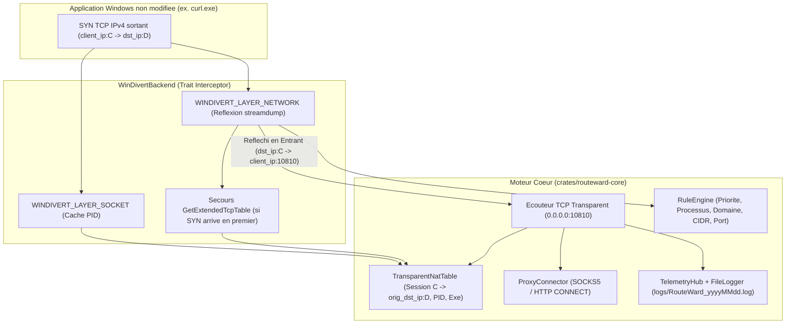

# Architecture de RouteWard

## Vue d'ensemble et Etat Actuel

RouteWard est organise en workspace Rust comprenant trois crates (`routeward-core`, `routeward-cli` et `routeward-desktop` dans `apps/desktop`) ainsi qu'une interface React + TypeScript (`ui/`).

### Etat du Milestone 1 (Interception TCP IPv4 sous Windows)
- **Trait `Interceptor` enfichable (`routeward-core::interceptor::backend`)** : Abstrait l'interception de paquets derriere le trait `Interceptor` afin de pouvoir brancher d'autres moteurs (comme un pilote WFP sous Windows ou `nftables`/TUN sous Linux au Milestone 2) sans toucher au moteur de regles.
- **Backend WinDivert 2.2 (`routeward-core::interceptor::windivert`)** : Charge dynamiquement `WinDivert.dll` au runtime via `LoadLibraryExW` et `GetProcAddress` (conformite LGPLv3 par liaison dynamique; aucun binaire WinDivert n'est versionne dans le depot).
- **Resolution de la course SOCKET / NETWORK (`routeward-core::interceptor::nat`)** : Ouvre simultanement `WINDIVERT_LAYER_SOCKET` (sniff lecture seule) et `WINDIVERT_LAYER_NETWORK`. Comme l'evenement `SOCKET` et le premier paquet `SYN` arrivent sur deux handles distincts, si le `SYN` arrive avant l'evenement `SOCKET`, RouteWard retient brievement le `SYN` et resout le PID via `GetExtendedTcpTable` (`tcp_table_fallback`), en journalisant la source de resolution (`resolvedVia=socket_layer` ou `resolvedVia=tcp_table_fallback`).
- **Redirection locale par reflexion `streamdump`** : Les paquets TCP IPv4 rediriges utilisent la technique `reflect` de l'exemple officiel `streamdump` de WinDivert (`reflect_outbound_to_local_relay` et `reflect_relay_reply_to_client` dans `nat.rs`). Les paquets sortants du client (`client_ip:client_port -> orig_dst_ip:orig_dst_port`) voient leurs adresses IPv4 permutees (`orig_dst_ip:client_port -> client_ip:10810`), leur port de destination reecrit vers le relais TCP transparent (`0.0.0.0:10810`), leur direction basculee en entrant (`Outbound = 0`) et leurs sommes de controle RFC 1071 recalculees avant reinjection. Les paquets de reponse issus du port `10810` sont reflechis en sens inverse (`orig_dst_ip:orig_dst_port -> client_ip:client_port`, `Outbound = 0`).
- **Exclusion anti-boucle** : Les connexions emises par le PID de RouteWard lui-meme, le trafic loopback et les connexions vers les serveurs proxies en amont sont automatiquement exclus.
- **Non implemente a ce stade** : Interception IPv6 et UDP, capture DNS transparente, interception sous Linux (Milestone 2) et branchement IPC complet de l'interface graphique (Milestone 3).

## Diagramme des Composants

## Modules du Workspace

| Chemin | Crate / Paquet | Responsabilite |
| :--- | :--- | :--- |
| `crates/routeward-core` | `routeward-core` | Trait `Interceptor`, `WinDivertInterceptor`, `TransparentNatTable` (reflexion `streamdump` + secours PID), `RuleEngine`, `ProxyConnector` et `FileLogger` quotidien. |
| `crates/routeward-cli` | `routeward-cli` (`routeward`) | Interface en ligne de commande (`run --duration-secs`, `check`, `eval`, `fake-ip`). |
| `apps/desktop` | `routeward-desktop` | Application bureau native basee sur `tao` et `wry` embarquant le bundle `ui/dist`. |
| `ui` | `routeward-ui` | Interface React 18 + TypeScript + Tailwind CSS avec palettes ThemeForge. |
| `tools/fetch-windivert.ps1` | Script PowerShell | Telecharge WinDivert 2.2.2-A officiel, verifie le SHA-256 et extrait `WinDivert.dll` et `WinDivert64.sys` dans `third_party/windivert/bin/`. |
